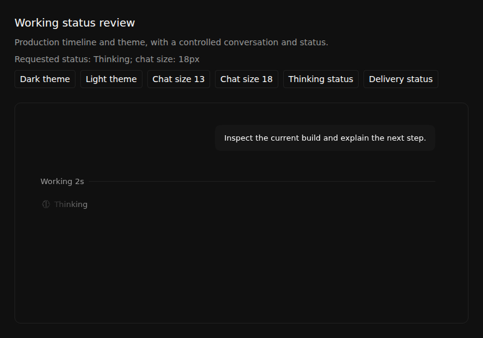
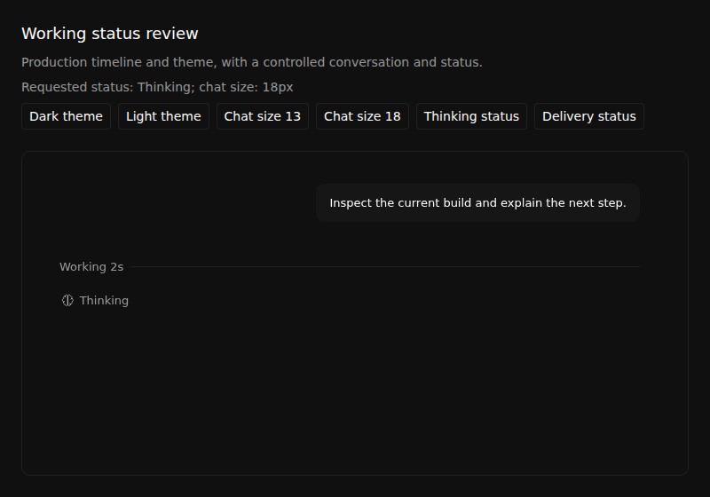
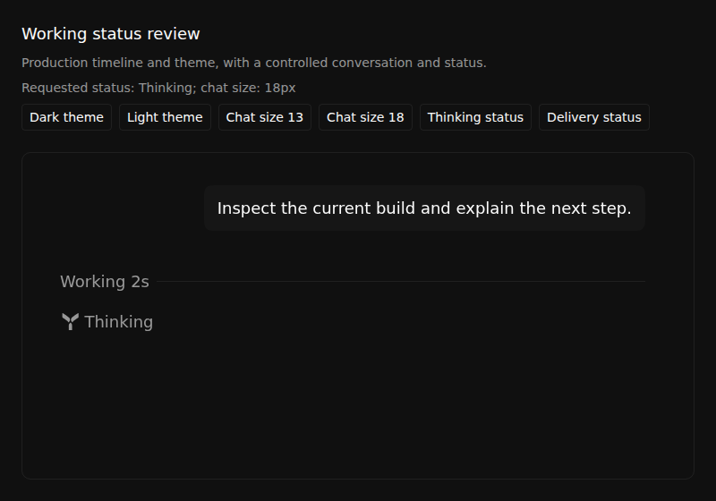

# #1824 working-status comparison

## Sources and execution

| Role | Exact application head | Tree |
| --- | --- | --- |
| Visual Before, current-main behavior | `ec8c940e07582454a475250ade40147e3c89d59f` | `26c3b060469f224dce8135d8046697eb43fe0794` |
| Regression Before, mark already integrated but retained-row defect still present | `ca7345b440a7a2fd3d9ffa4637d708cc1a1519e8` | `52cd21be0f9eb753962247437eb4f91ea2381d4e` |
| Visual and regression After | `63c33e00238b4ca13aa52ecee29bb6494ed4f642` | `5254b4f85ae05c15c4a93ef82da8cb34e3e11025` |

Reviewed driver: `3587efe17edba380210394899b7b0599798a83c0`. [Actions run 38157947260](https://github.com/Emanuele-web04/synara/actions/runs/38157947260) deliberately retains the actual failing Before jobs. This workflow is **not all green**: its After capture and two-test regression jobs pass, and its Before capture and two-test regression jobs fail at the preserved checks described below.

The production `MessagesTimeline`, actual LegendList, existing inline `SynaraLogo` primitive, stylesheet and `useTheme` hook render this interface. Fixture controls change real React props with actual pointer clicks. Conversation contents, current time and working state are controlled inputs; the displayed `Working 2s` verifies existing timer rendering for that input. The fixture does not remount the timeline to make a setting propagate. Browser motion preferences are explicitly set to normal or reduced motion. No native desktop, real provider run or elapsed-time measurement is claimed.

## Before versus After

| State | Before | After |
| --- | --- | --- |
| Thinking, 13px, normal motion |  |  |
| After the real request for 18px |  |  |
| Thinking, 13px, reduced motion |  |  |
| Request for 18px, reduced motion |  |  |

The `requested-18px-observation` screenshots occur immediately before the unchanged assertion that the actual working-row font is 18px. They are observations, not assertions that the Before state is correct. Before receives the pointer request and displays the requested 18px value, but its retained working and user rows remain 13px. The preserved assertion then fails. After reaches 18px without a remount, continues through semantic delivery status, then returns to 13px and light theme.

The completed After receipts measure the inline mark at 14.03125px for a 13px font and 19.4375px for an 18px font, matching the intended 1.08em sizing. The mark has no transform or private animation. Normal motion observes twenty distinct-time samples across the shared 2-second, 40-step shimmer; base text color remains present. Reduced motion requires no mask and no animation. The delivery state keeps its existing semantic icon instead of the Synara mark.

Additional completed After states: [normal delivery at 18px](after/no-preference-dark-delivery-18px.png), [normal light Thinking](after/no-preference-light-thinking-13px.png), [reduced-motion delivery](after/reduce-dark-delivery-18px.png), [reduced-motion light Thinking](after/reduce-light-thinking-13px.png). The Before run stops at its original font assertion, so these later states are not presented as a completed Before comparison.

Short recordings: [Before normal motion and font request](before/status-no-preference-interaction.mp4), [After normal motion and state changes](after/status-no-preference-interaction.mp4), [Before reduced motion](before/status-reduce-interaction.mp4), [After reduced motion and state changes](after/status-reduce-interaction.mp4). Original context videos remain in each source's `video-no-preference` and `video-reduce` directories.

## Independent defect controls

The [exact two-test suite](control/MessagesTimeline.workingStatus.browser.tsx) has Git blob `d2a44f3bce586f6c714f4b46f4e0292dea5cde57` and SHA256 `2f4abb76e41f438939e105c9da4b6688eab86ea1a47fca2a62e630a20d0b0718`. Both cases run without a test-name filter. On Before it is a new untracked test overlay; on After it is the unchanged tracked production test. Application files remain at their pinned trees.

| Case | Before `ca7345b` | After `63c33e0` |
| --- | --- | --- |
| Change chat font on an existing transcript | FAIL: actual 13px, requested/expected 18px | PASS: working/user rows reach 18px, mark remains proportional |
| Change the existing working label without a transcript change | FAIL: actual Thinking, requested/expected delivery | PASS: label updates and delivery icon replaces the working mark |
| Actual Vitest / tee exits | `1 / 0`, zero passed, two failed | `0 / 0`, two passed, zero failed |

Raw [Before report](control/before/vitest.json), [Before log](control/before/vitest.log), [After report](control/after/vitest.json) and [After log](control/after/vitest.log) are retained. No expected-failure wrapper changes the failing exit into success.

The two earlier diagnostic attempts also remain separate: [initial capture receipts](diagnostics/first-capture) from run `38156624761` / driver `7fef7cc6156a41f7176acf915497ff04b5560377`, and [state-observer receipts](diagnostics/state-observer) from run `38156975491` / driver `b88af16bd50d2d828b07b927ec5f5489e0e057db`. Both failed the original font assertion on both sources. The observer confirmed requested 18px versus actual retained 13px, which led to adding `normalizedChatFontSizePx` and `workingLabel` to LegendList's existing `extraData` invalidation inputs. Historical diagnostic failures are not relabelled as passing checks.
