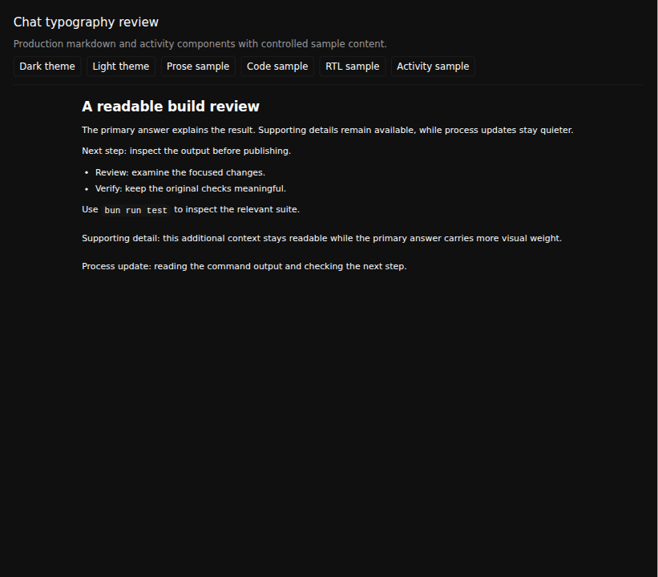
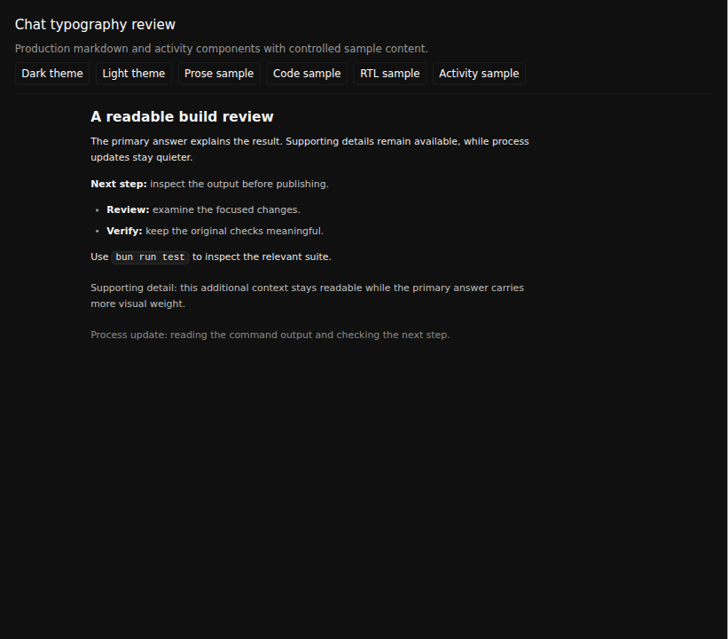
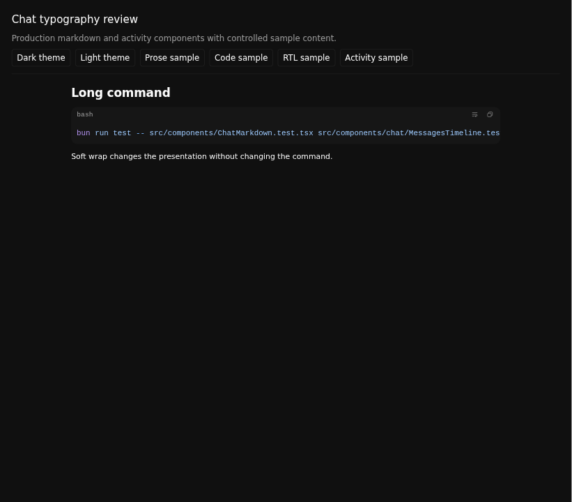
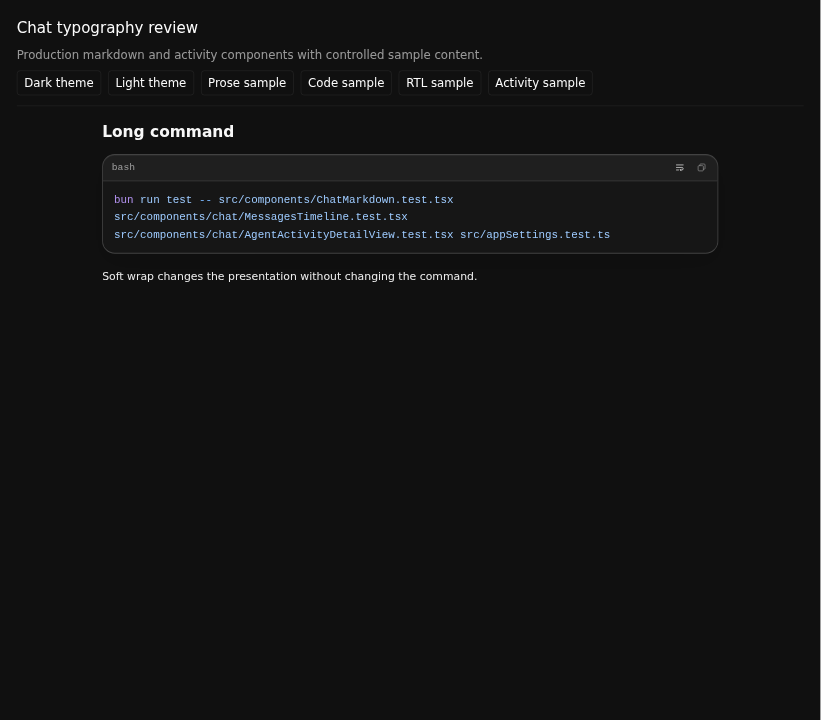
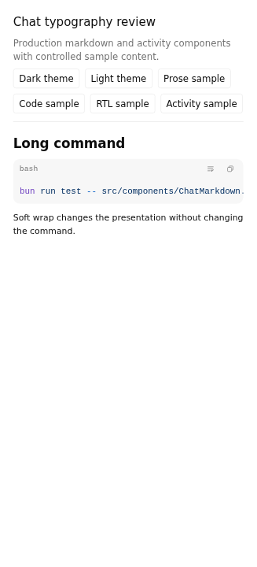
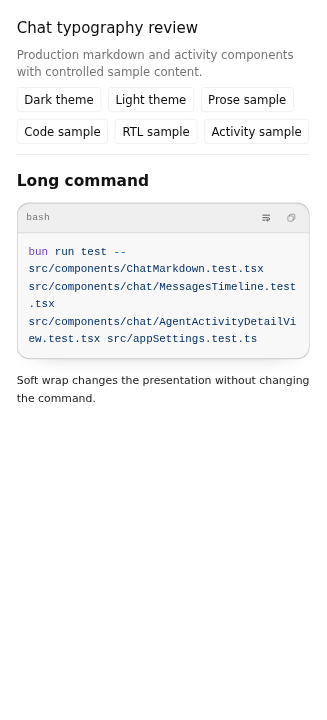
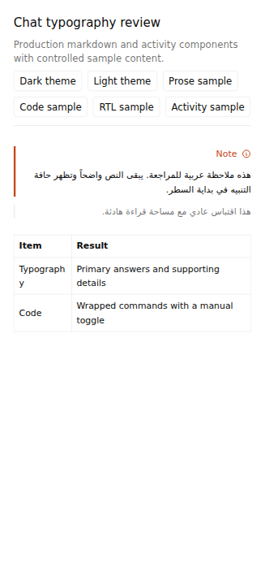
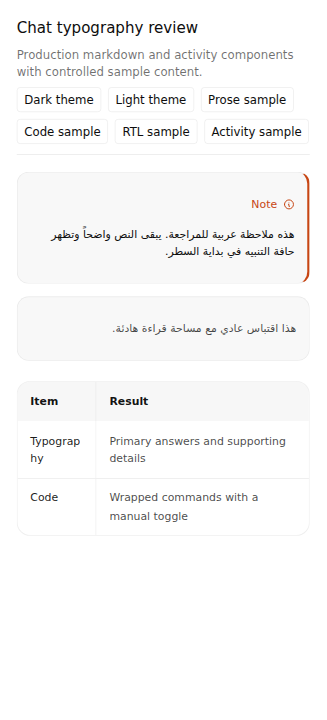
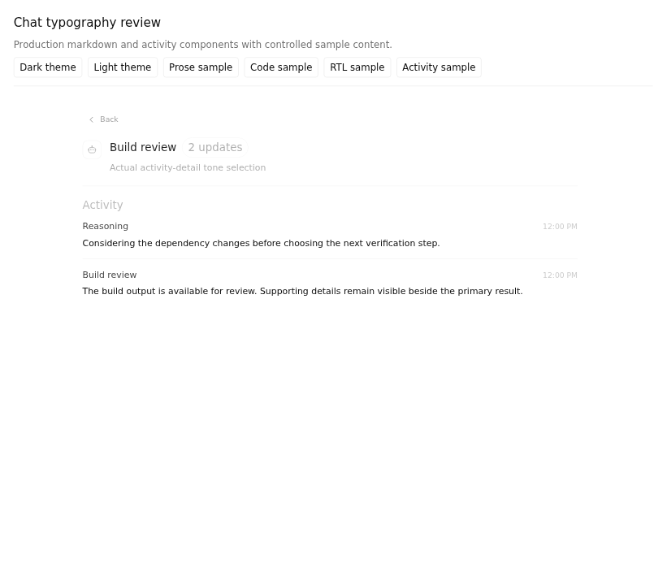
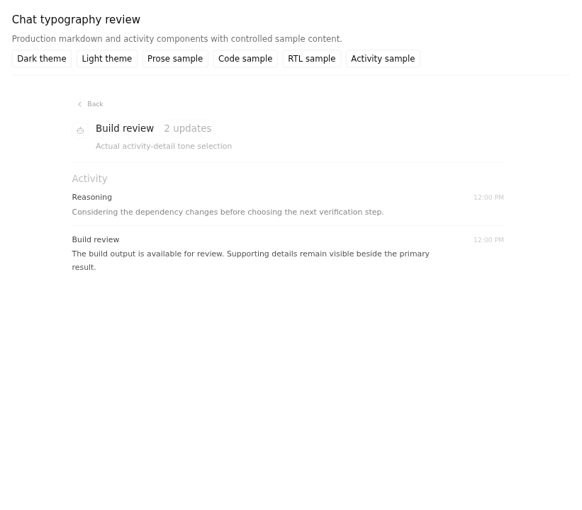

# #1826 chat-typography comparison

| Role | Exact application head | Tree |
| --- | --- | --- |
| Before | `ec8c940e07582454a475250ade40147e3c89d59f` | `26c3b060469f224dce8135d8046697eb43fe0794` |
| After | `ba8206efa8bd377e7c4e9c776600c7a4fd37d7e4` | `60d10801aad1b05081bc50b7619caf493c7dcc01` |

Reviewed driver: `a33beba91465eb4aa727e7cf055c177a347a6e3e`. [Actions run 38157656522](https://github.com/Emanuele-web04/synara/actions/runs/38157656522) completed successfully for both sources, each with actual Vitest/tee exits `0 / 0`, four complete theme/width cases, twenty PNGs and one context video. The subsequent `eddafe78eade5b4dc3981cecd59682f1122c02d1` repair only updates three browser test files; it does not change any captured production file.

These are the actual production `ChatMarkdown`, syntax highlighter, `AgentActivityDetailView`, stylesheet and theme hook under controlled sample content. The fixture's pointer controls select panels and themes; the code block's real production button changes wrapping. The RTL case uses an explicit RTL container and does not claim to test automatic language detection. No native desktop or live provider conversation is represented.

## Before versus After

| State | Before | After |
| --- | --- | --- |
| Primary, supporting and process text — dark, 980px |  |  |
| Default long code block — dark, 980px |  |  |
| Default long code block — light, 390px |  |  |
| Explicit RTL alert and table — light, 390px |  |  |
| Actual activity-detail tone selection — light, 980px |  |  |

All four combinations of 980px/390px and dark/light themes are retained in the Before and After directories, with prose, default code, toggled code, RTL/table and activity-detail PNGs for each case. Every original PNG has been visually inspected.

Both sources use a 13px base font and measured 21.125px line height. The After source differentiates default, supporting and process content while keeping the text present, reduces the sampled h2 from 20.15px to 18.46px, and applies the quote/table/inline-code styling. The actual activity-detail caller selects the process tone for Reasoning and the supporting tone for the tool summary.

The long command is byte-identical before and after the real wrap toggle. Before defaults to `data-wrap=false`; After defaults to `true`. At 390px, the After wrapped block's measured scroll width equals its 348px client width. Disabling wrapping restores horizontal overflow to 1391px without changing the command, and the fixture toggles back again. The completed receipts preserve both states rather than relaxing the horizontal-scroll contract.

For the explicit RTL alert, Before has a 3px physical left border and no right border; After has a 3px right/start accent and the ordinary 1px left border. This is a rendering check in the explicit RTL container, not an automatic-detection claim.

Short recordings: [Before panel/theme/wrap interaction](before/typography-interaction.mp4) and [After panel/theme/wrap interaction](after/typography-interaction.mp4). The clips retain the full browser recording frame and its padding. Original source videos are retained in each `video-no-preference` directory; exact trims and hashes are in the top-level `clips.json`.

Canonical CI originally exposed five old browser assertions that assumed code blocks started unwrapped: two static-transcript widths, two oversized-highlight cases, and one streaming-identity case. The focused test-only repair explicitly verifies the new wrapped default, uses the real Disable/Enable controls, and retains horizontal/vertical scroll independence, source/find/copy/highlighting checks, and same-block identity across streaming updates. Those historical failures remain in the PR's check record. Capture success is separate from the final canonical CI status of the latest feature head.
