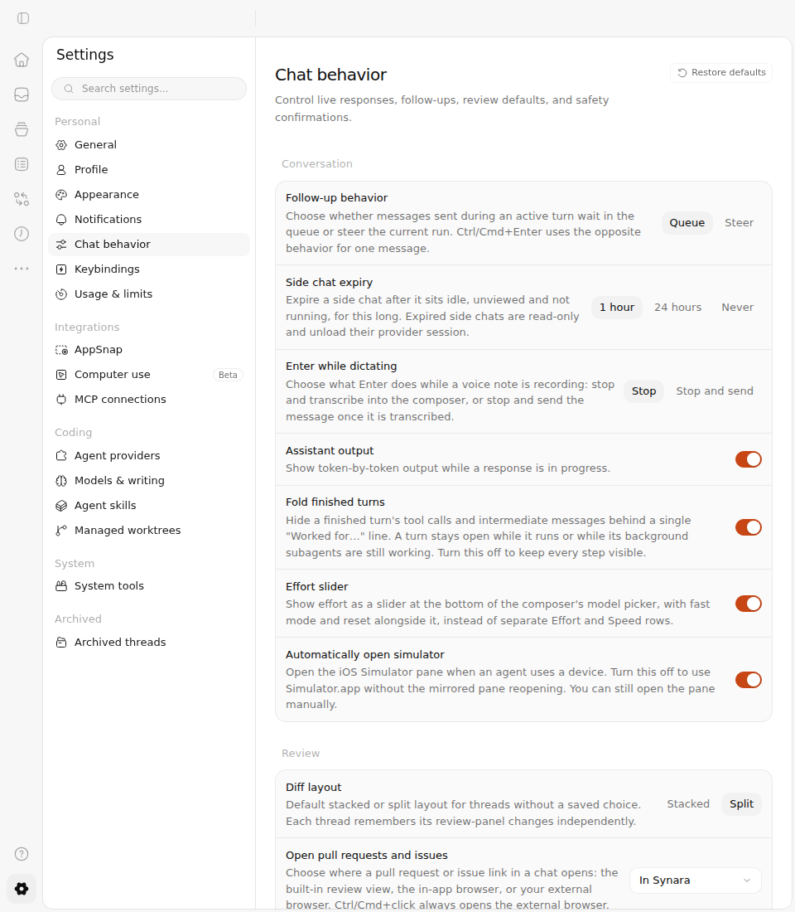
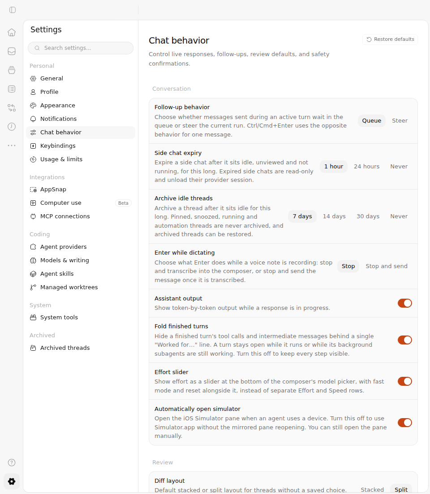
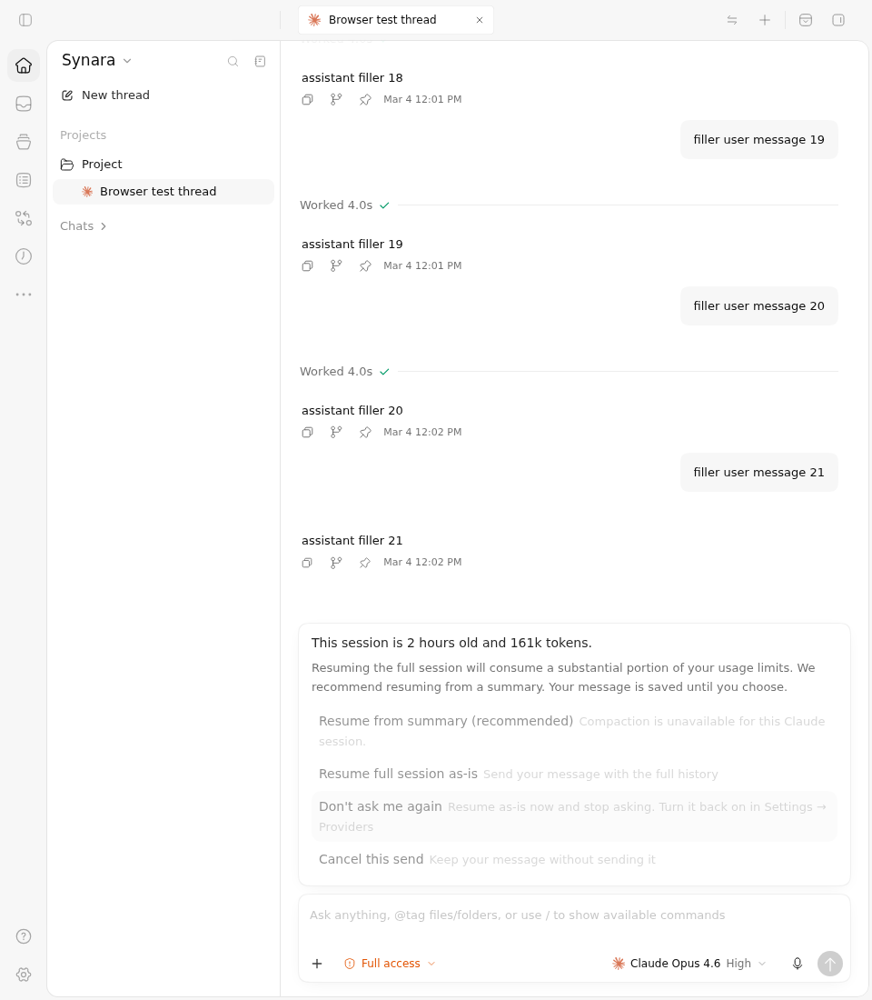
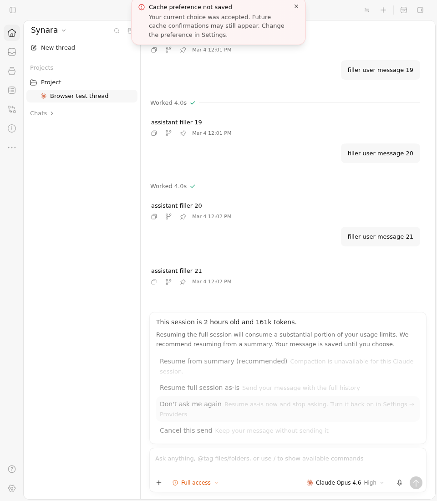
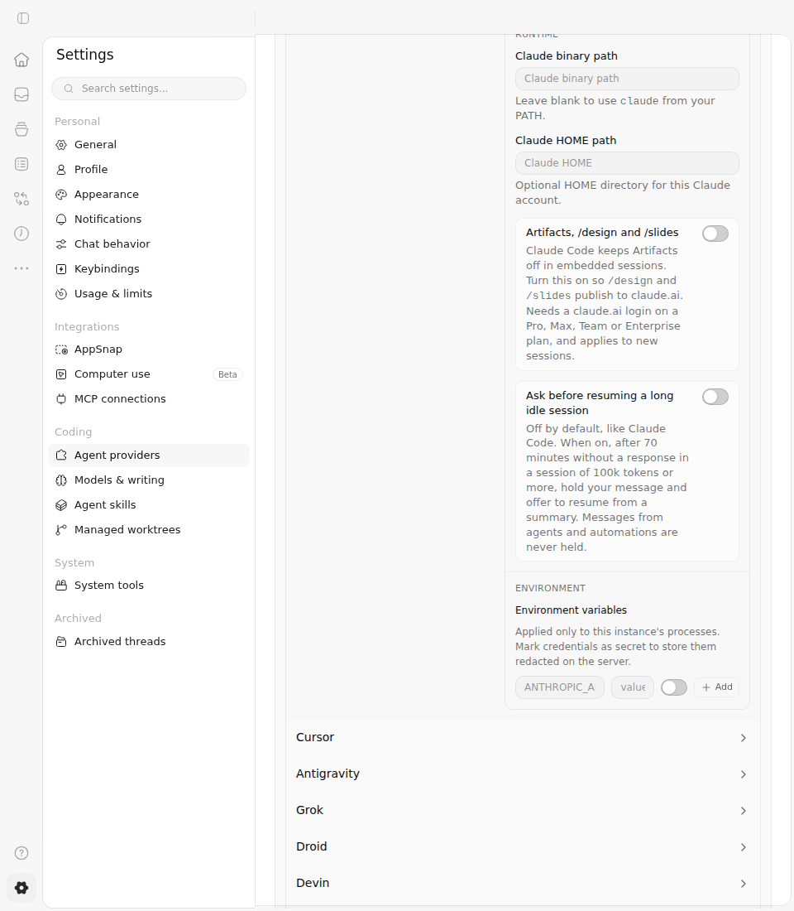

# #1713 — current retention and cache-choice Before Vs After

The current integration adds the **Archive idle threads** setting and reports a failed preference save after the user's current cache choice has already been accepted. The source-pinned Chromium comparison has actual **Before: 2 failed / 1 passed → After: 3 passed**. Each source leaves 223 original cases unselected; those cases are not counted as passes.

## Immutable sources and execution

| Item | Before | After |
| --- | --- | --- |
| Application source | `3270dcf89bb60745ac568803a940cd7e7ac676a7` | `90028f855f9e4c7ee04933322529e0a1e4d42ff1` |
| Full source tree | `3041a3cf0328b6e7e4d9b6c5027a2a1a09e33822` | `14ad2aac8785978b2b59bd5dcfc0663f11b9e038` |
| Actual job | [114559604271](https://github.com/Emanuele-web04/synara/actions/runs/38169683774/job/114559604271) | [114559604315](https://github.com/Emanuele-web04/synara/actions/runs/38169683774/job/114559604315) |
| Vitest / tee exits | `1 / 0` | `0 / 0` |
| Screenshots | 8 original PNGs | 9 original PNGs |
| Recorded observations | 8 distinct phases | 9 distinct phases |

Both jobs use independently reviewed driver `b527de9ebe18d977baba503df3e4f2918726c37c` in [run 38169683774](https://github.com/Emanuele-web04/synara/actions/runs/38169683774). The complete common ChatView fixture is blob `1fd638007a36a7a4f74adab4ee0ea96c9deef34a`, SHA-256 `5574d81fea2e0982e2c9032765f2c1e53ff819b7386219e2dcc3306dea524273`. Both sources run the same additive three-case overlay, SHA-256 `a6e23a5018375ee6f23a8e2547422f5f7e4b2ad8b522c3407e34ec58b5795310`; reversing the additions recovers every original byte. Source heads, full trees and tracked files are checked before and after execution.

## Before Vs After screenshots

These are actual production components rendered in the full ChatView/router fixture, with production CSS and theme, at 960×1100 in Chromium. The images are light mode.

| State | Before | After |
| --- | --- | --- |
| Chat behavior settings |  |  |
| Failed save after accepted cache choice |  |  |
| Existing provider default |  |  |

[After selecting Never](after/conversation-never.png) shows the new selected value after the actual click and exact `threadAutoArchive: "never"` settings patch. Before has no matching row; the same 7-day assertion fails after its screenshot. No Before condition bypasses that assertion.

The provider option **Ask before resuming a long idle session** remains scoped to Claude and defaults off on both sources. The complete off → on → off interaction and exact nested settings updates are retained. The Before `provider-opted-out.png` catches the switch during its visual transition: its thumb/background still appear on, while the recorded checked state and settings write are already off. That frame does not establish the settled off appearance. The off-default screenshots establish the initial off appearance on both sources, and the After opt-out frame shows the settled gray/left appearance. This is preservation of the canonical main policy. The earlier #1713 screenshots at `4112a2f6...` show the former global option and remain historical; they do not describe this current integration.

In the cache scenario, the real **Don't ask me again** click submits one `continue` response. While its acknowledgement is held, there is no settings write and the choices are disabled. After acknowledgement, the real queued mutation submits one `providers.claudeAgent.confirmColdCacheResume: false` update. Rejecting that controlled update produces the After toast: **Cache preference not saved** and an explanation that the current choice was accepted but future confirmations may still appear. The choices stay disabled, the controlled server preference remains true, and neither request is duplicated. Before executes the same sequence but fails the unchanged toast assertion.

## Interaction recordings

- [Before short cache-choice clip](before/interaction.mp4): full-frame real-time source interval 170.76–173.96 seconds, **3.20 seconds**. It shows the active choices becoming disabled; no notice appears. The complete failed log retains the later missing-toast timeout.
- [After short cache-choice clip](after/interaction.mp4): full-frame real-time source interval 124.84–127.44 seconds, **2.60 seconds**. It shows the active choice, pending disabled state and failure notice.
- Both complete original context WebMs are retained under `before/video/` and `after/video/`, including setup, the settings/provider interactions and the actual failed wait. The Before recording is longer because its two assertions time out.

The short clips are contiguous H.264 transcodes only: no crop, overlay, retiming or substituted frames. `clips.json` records the source/clip SHA-256 values, exact times, encoder arguments, ffprobe results and seven representative clip frames. Both clips remain 960×1100 at 25 fps.

## Boundaries and preserved failures

The real Router, ChatView, Settings route, provider settings panel, cache-review panel, app-settings mutation queue and toast run without component, hook or geometry mocks. The canonical MSW/orchestration fixture supplies the application context. Settings responses, a synthetic two-hour-old/161k-token cache assessment, acknowledgement and failed preference RPC are controlled inputs. The summary option is unavailable in this fixture and is disabled as expected.

The fixture intentionally holds its pending read model after the accepted response so the locked panel remains visible. Real durable events may unmount that panel; separate production regressions cover failure reporting after unmount. These pixels do not establish live Claude dispatch, actual settings-file persistence, a native process cleanup or a retention sweep. The independently reviewed production and backend tests establish those separate implemented contracts.

The first driver `32bca0aec717aba9e0ef12ffc23d45d7af987fcd`, [run 38168437578](https://github.com/Emanuele-web04/synara/actions/runs/38168437578), genuinely failed on both sources when Playwright rejected the serialized apostrophe in the role-selector regex. The retention Before failure and provider passes from that run remain valid partial observations. The follow-up encodes the identical apostrophe as `\x27`, preserving matching semantics and every later assertion. `historical-failures/first/` retains complete original logs, JSON reports, exits, provenance and archive metadata. Its partial media remains in the original Actions archives and local verified ZIPs; it has not been relabelled as final evidence.

The final PNGs, full videos, original/observed fixture bytes, reports and provenance are byte-identical copies of the final Actions archives. `archive-verification.json` records a fresh comparison against GitHub artifact digests and direct ZIP-member verification. `manifest.json` records every packaged file's byte count, SHA-256 and Git blob identity. `driver-boundaries.md` contains the complete execution contract.
