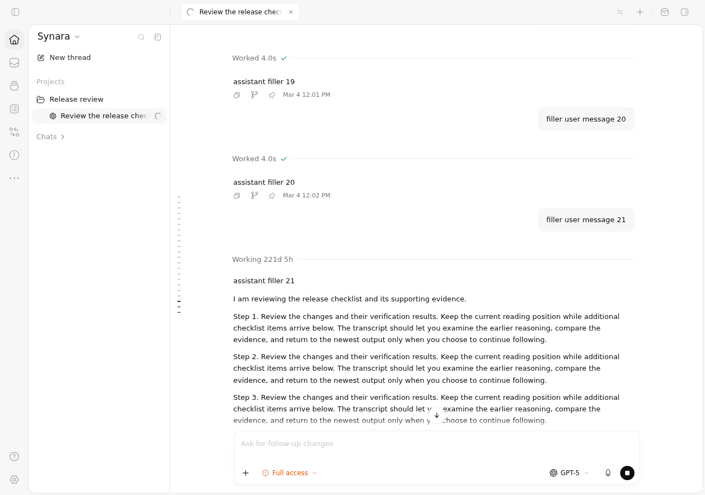
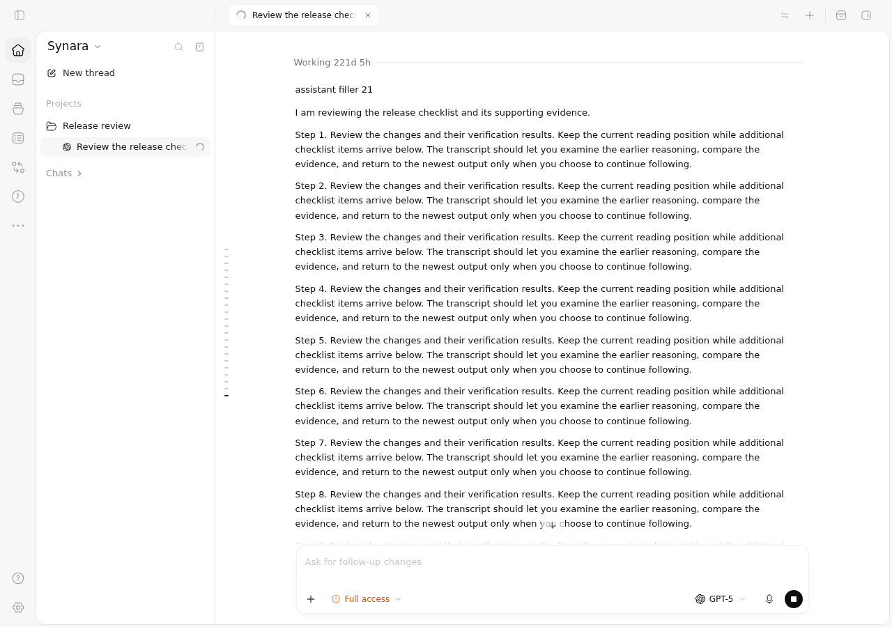
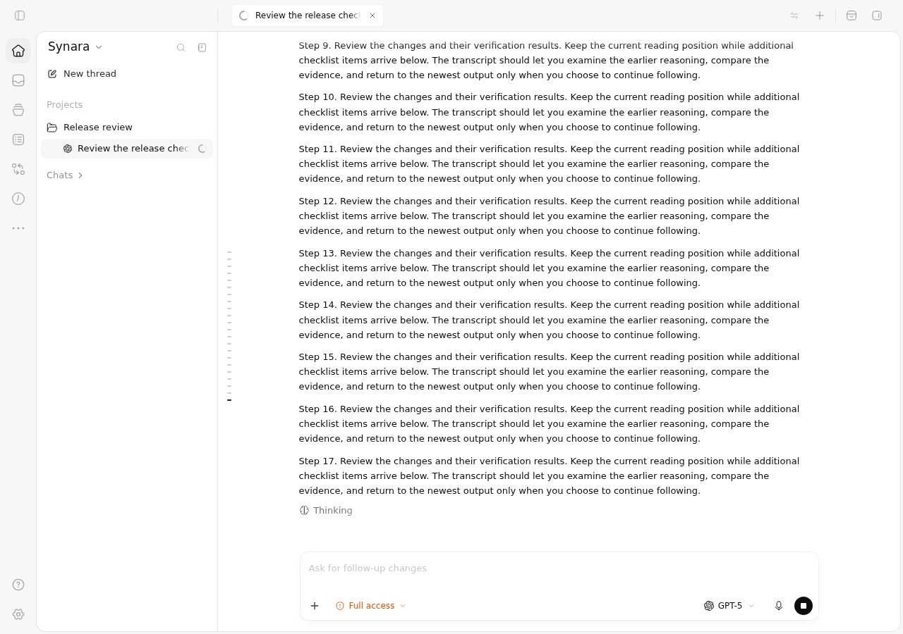
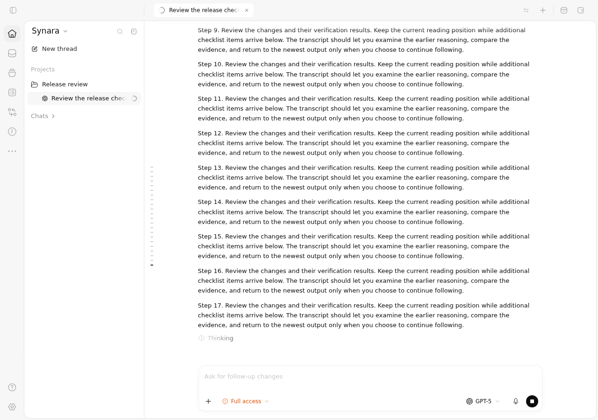

# PR #1821 — actual ChatView Before and After evidence

This package records the production ChatView in hosted Chromium on two immutable revisions. The full application shell, production stylesheet, router and LegendList transcript are rendered. PageUp, a wheel event with deltaY=-350, and the actual return-to-bottom button exercise reading ownership while controlled fixture output grows.

**Both ordinary component flows pass on both revisions.** These images qualify preserved visible behavior; they do not reproduce the rare virtual-row compensation race. The separate identical ten-test hook control retains the causal result: **Before 1 failure / 9 passes; After 10 passes**.

## Exact sources and execution

| Item | Before | After |
| --- | --- | --- |
| Source commit | `75ec05e69c819a57573a24be1a424f3e8420ebe8` | `ab8a77a873e2443ffc9a9570cbd2919219fd41c9` |
| Source tree | `833d32dfdc79af7a3e9d11f63924611e1d14dad7` | `cd1b99fed142f3d28cfa1aa93467f5f6b4d35c4f` |
| Production hook Git blob | `1d4378e9fced76ff2a13431f437fe0bf951bdca3` | `1e67805a6037c8cd7728919da35cc7530b69ad73` |
| Capture job | `114531501426` | `114531501510` |
| Actual Vitest exit | 0 — two cases pass | 0 — two cases pass |
| GitHub artifact | `11710146165` | `11708879967` |
| Downloaded ZIP SHA-256 | `3b2547c50693ff4a03abf84da95d16f0100a24963aadc83a82d92ce6ee04a27a` | `e8171f95a70e55d2b4b01537e2959548c5d0a4d1ea2dab010380615ba213563d` |

Successful capture run: [38160262893](https://github.com/Emanuele-web04/synara/actions/runs/38160262893). Independently reviewed driver: `dd5b1f1cca2719185cca99c876e80a93da95030a`, tree `c3d923eee524f2f748fe64d60061adf47241e154`. Both source checkouts retain the same original ChatView browser suite blob `73c366c47798f7b505ed3a1c293ae3b893953b5c`; the same appended fixture has SHA-256 `8f68e9acc05153cfa5ea6bf4b16ec1f133425cf78668f5cf4de58670b1015bb0`. The driver checks the original source and overlay hashes before and after running tests.

Each variant includes eight untouched 1280×900 screenshots, its complete original WebM recording, actual process status, raw Vitest log and JSON result, and provenance containing hashes and measured positions. The ZIP digests and every extracted PNG/WebM hash were verified before publication. An independent pixel review covered all sixteen original screenshots; representative screenshots and recording frames were also reviewed during preparation.

## Before versus After screenshots

| State | Before | After |
| --- | --- | --- |
| Reading after PageUp |  |  |
| More output while reading |  |  |
| Wheel reading |  |  |
| Return to following |  |  |

In both runs, PageUp moves 732px above the bottom; the visible paragraph anchor stays at 23px while three paragraphs are appended, with measured drift 0px. The wheel case moves 350px above the bottom and retains its anchor at 43.1875px, again with drift 0px. Clicking the real arrow resumes following; after two more paragraphs the bottom distance returns to 0px. These are fixture observations from these runs, not universal input distances.

## Short interaction recordings

- [Before — continuous interaction clip](before/interaction.mp4): original WebM interval 65.00–83.92 seconds, duration 18.92 seconds.
- [After — continuous interaction clip](after/interaction.mp4): original WebM interval 86.00–107.56 seconds, duration 21.56 seconds.

Clips retain full 1280×900 frames and original playback speed; only the earlier browser/test loading interval is omitted. H.264 re-encoding uses CRF18 without cropping, annotations, inserted frames or speed changes. The complete original WebMs remain in each `video/` directory. `clips.json` records original and clip hashes, exact timing, encoder arguments, and representative transition-frame timestamps/hashes. The original PNG screenshots remain the unchanged pixel evidence.

## Causal compensation control

[Run 38153628677](https://github.com/Emanuele-web04/synara/actions/runs/38153628677) uses independently reviewed driver `9cfabdafaaa4f30ecbc2ae2300630dc3da4e2a12` and the same ten-test suite SHA-256 `0bbe24f062d132bb3fbbe4c5da0c47e4a24a97f9acfb79e2375a57e091aea634` on the same Before/After source pins. Before job `114511998907` exits 1 with the single compensated-keyboard failure and nine passes; After job `114511999167` passes all ten. The expected Before failure remains a failed job. Raw logs, results and source/count verification are retained under `compensation-control/`. That control uses the real production React hook and Chromium with controlled geometry and handler input; the actual ChatView captures above use real browser input without geometry or hook mocks.

## Historical failed capture and boundaries

The first capture attempt [38159683861](https://github.com/Emanuele-web04/synara/actions/runs/38159683861) failed when Vite denied the first screenshot path outside its source workspace. Neither scrolling gesture ran. Its full Before and After job logs are included under `historical-path-failure/`. The reviewed driver correction moved output to a non-hidden directory within the source workspace; it changed no fixture, application code, assertion, count gate, or source pin.

Orchestration, streamed output and native APIs remain canonical controlled fixtures. No authenticated provider, native Electron/macOS input, native AppSnap helper, or packaged desktop lifecycle execution is claimed by these images. The visible `Working 221d 5h` label comes from the fixed March fixture timestamp relative to the October runner clock; it is not elapsed execution time. These captures cover only the scroll requirement. Separate PR evidence covers PreInvocation and AppSnap cleanup ownership. The broader PreToolUse approval requirement in #490 remains unfinished.
