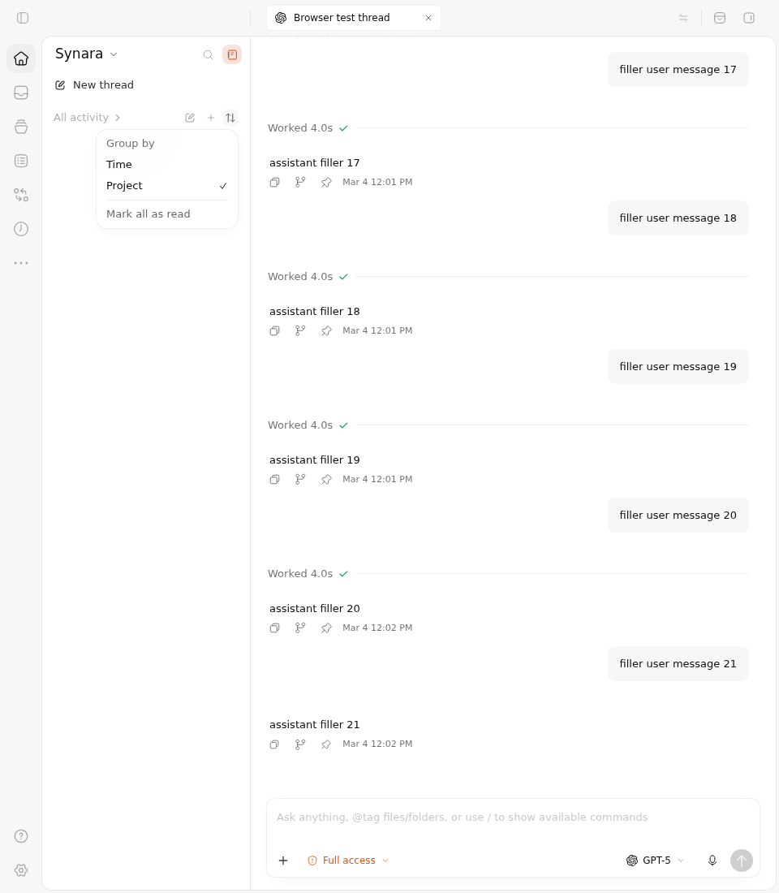

# PR #1827 — Activity grouping before and after

The same two original browser cases fail on Before and pass on After. Selecting **Project** initially works on both. On Before, returning from classic view resets the grouping to **Time**, and a stored Project preference is not restored on mount. After retains Project across the view change, restores it on mount, adopts the fixture's external storage event selecting Time, and persists the next Project selection.

## Exact sources and results

| Boundary | Immutable source | Result |
| --- | --- | --- |
| Before | `ec8c940e07582454a475250ade40147e3c89d59f`, tree `26c3b060469f224dce8135d8046697eb43fe0794` | 2 failed, 0 passed; both failures are the unchanged expectation that Project has `aria-checked="true"`. It actually has `false`. |
| After captured | `d9a84cc8a58abf49181ee28c3d800b7d0d2c6923`, tree `82f64c2afaa63b28ca168881d9b1eec9f654f2ec` | Both selected cases passed. |
| Current PR head | `cd63cea4dec2b51cc79be8c5480956696cf82b23` | Normal child of the captured After with exactly the same complete tree. It only retriggered missing canonical CI. All 18 canonical jobs passed in [run 38160806178](https://github.com/Emanuele-web04/synara/actions/runs/38160806178); the fresh exact-head read has 23 successful check runs. |
| Capture driver | `9131385930f1554f9739e4190a3d398270eab2da` | Same source-pinned full fixture and additive observations on both sources. |

[Capture run 38161540569](https://github.com/Emanuele-web04/synara/actions/runs/38161540569) retains Before's real failing job and After's successful job. The overall comparison workflow is therefore not all green. Both evidence verifiers reported no errors: five 960×1100 PNGs were produced before the two original Before failures; seven 960×1100 PNGs were produced on After. Each head has one original full-context WebM. The other 223 cases in the common fixture were excluded by the explicit two-case selector and are not counted as passes. The raw Vitest counts and exits remain in each directory; `actual-result.json` makes that selection explicit.

## Before vs After screenshots

| State | Before | After |
| --- | --- | --- |
| Select Project, switch to classic, then return to Activity |  |  |
| Mount with Project stored |  |  |

The other original images retain the initial Time menu, successful first Project selection and intervening classic view on both sources. After additionally records [the external Time selection](after/external-time.png) and [Project selected again afterward](after/project-after-external-change.png). Before stops at the original assertion that fails on mount, so it has no images or result claim for the later external-change steps.

## Short interaction videos

- [Before — actual Project selection, classic view, then Time restored](before/interaction.mp4): full-frame real-time interval **88.00–93.00 seconds** from the 254.88-second original WebM; 5.00 seconds long.
- [After — actual Project selection and retention across the view change, followed by the stored-state case](after/interaction.mp4): full-frame real-time interval **106.40–112.00 seconds** from the 112.84-second original WebM; 5.60 seconds long. The original unmount/loading transition between the two cases is retained.

Both clips are H.264, 960×1100 at 25 fps. They have no overlays, crop, scaling, inserted frames or speed change. They omit the long Vite/fixture startup and, on Before, the remaining assertion timeout waits. The full unmodified WebMs remain under each `video/` directory. `clips.json` gives the raw and clip SHA256 values, exact intervals, encoder arguments and ten independently inspectable clip frames. Screenshots are the original Playwright PNG bytes, not frames recreated from video.

## What this evidence covers

This is the actual full ChatView route, Sidebar, Activity menu, production CSS and theme under the existing MSW/orchestration browser fixtures. The observed theme is light. Menus and view changes use the original pointer interactions. The second case explicitly seeds localStorage and dispatches a browser `storage` event to exercise the external-write listener; it does not open a second native app instance. Fixture projects and thread transcripts are controlled, and the empty Activity list and fixed March thread timestamps are part of that fixture. These images and tests do not claim a live provider, live account, native desktop, OS-level storage delivery or every project-list shape.

The runner checks both exact source commits and trees, source-file Git/SHA256 identities, the unchanged original fixture blob `6e470f593c119400528ccd50cc7089b3cb601568`, and the same additive overlay. Application files and tracked tests stay unmodified. The original two tests' assertions, storage inputs, interactions and 90-second failure boundaries remain intact. `provenance.json`, the original/observed full fixture copies, the raw test reports and real Vitest/tee exits are included.

## Historical diagnostic and current-main compatibility

The first [capture run 38160292177](https://github.com/Emanuele-web04/synara/actions/runs/38160292177), driver `2cc79795594cdedc820cf1fd3bd1ed51a1ef9c01`, had the same two true Before assertion failures and two passing After cases. Both jobs also failed the evidence verifier because the browser iframe was scaled within the default Playwright context and the actual images were 629×720. The reviewed one-line driver correction explicitly sets the Playwright context to 960×1100 to match the iframe and recorder; it does not change assertions, source pins or application code. Historical full job logs, raw Vitest results, provenance and exits are preserved under `historical-viewport-failure/`. All four downloaded artifact ZIP digests were verified before safe extraction; their IDs and digests are recorded in `verified-artifacts.json`.

Main subsequently advanced to `f7173d190c07a3bbfdbd614d17680749d21012c7`. A read-only integration check found one shared file: its new folder/branch row layout merges cleanly with this feature's grouping-prop change, producing Git blob `c839bde9a2ddbd0929e9e440e0360d64e868eafb`. The other five feature paths are disjoint from those main changes. `compatibility-and-checks.json` and `remaining-feature-on-f717.patch` record this check. The branch was not rewritten, and these original-source captures and canonical checks are not represented as runtime tests of a new main-inclusive head.

The next main commit, `8ac0dfcd62f0e1adda9aff39f0fc7ded8d1276b7`, only adds the external #1806 nested Codex overlay repair across eleven server paths. All six grouping feature paths and the validated folder-row integration are unchanged; the complete additional path list is included in the compatibility receipt.
