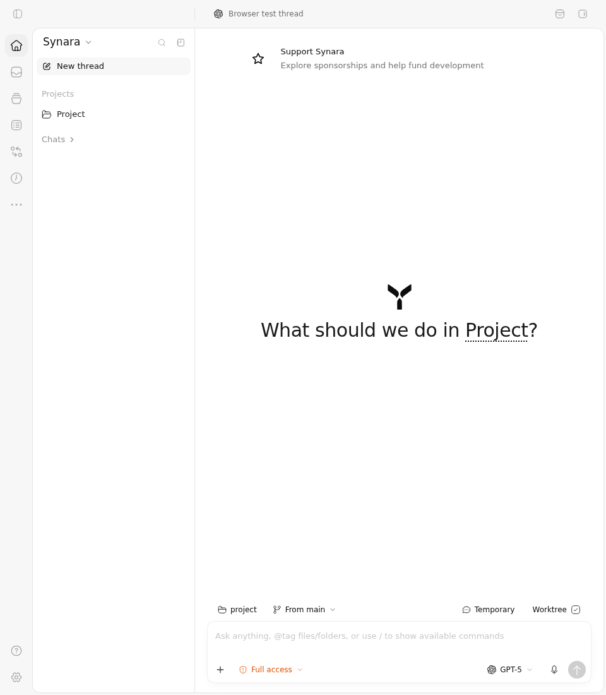
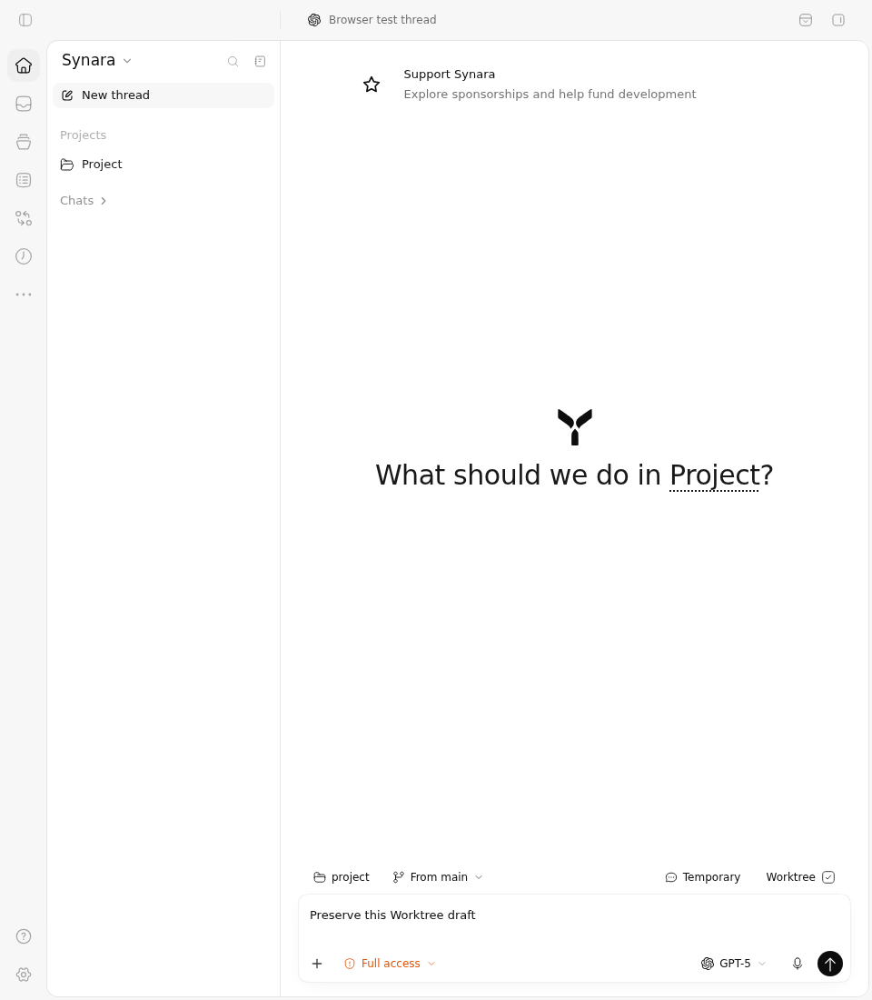
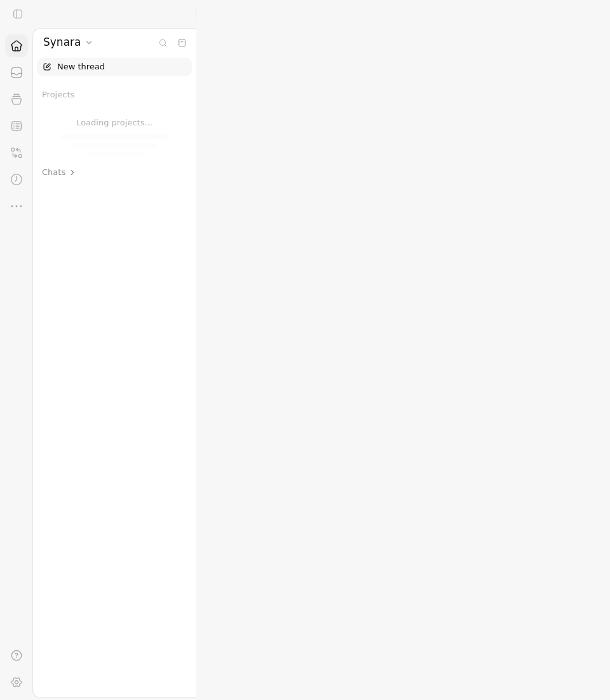

# #1832 Sidebar new-thread state: Before vs After

These are actual Chromium captures of the full production ChatView, Sidebar, routing, stores, hooks, CSS and theme under the canonical browser test's controlled MSW/orchestration/native API replies. Both sources passed all three unchanged selected cases. The comparison documents preserved behavior and the regression protection added alongside the focused click-time guard; it does not claim a reproduced Before failure.

## Exact sources and result

| Boundary | Before | After |
| --- | --- | --- |
| Source | `f73074c7a4e4145a8944292e2103964cdf83ecb8` | `4e1d1e040df853ddcaa8f30dabf8f913f67669ec` |
| Complete tree | `2d425cb0a78f67efaba133a7f15fba4342c9c6d5` | `dc329a9fdf37a09b994cc8de54c1c627d5d38642` |
| Capture job | `114539667806` | `114539667782` |
| Original selected cases | 3 passed, 0 failed | 3 passed, 0 failed |
| Vitest / tee exits | 0 / 0 | 0 / 0 |
| Unselected cases | 222 | 222 |
| Original screenshots | 6 at 960×1100 | 6 at 960×1100 |

Both jobs belong to [run 38162987534](https://github.com/Emanuele-web04/synara/actions/runs/38162987534), driven by independently reviewed commit `77bcc5a433881b6d24cb61f1be5cb20555149099`. Each source received the identical full common fixture blob `2ecb7492036aae7f5cdb50e0a6f2a479e50f0a1c`, SHA-256 `ec34302f40f6e14470a3971d45b4c71d274ab2d2447e6720b39a6315b5ad9da5`, as a separate untracked test filename. Six observations and a read-only screenshot helper were added at reviewed boundaries. Every original action and assertion remains intact; all tracked source files and their staged/unstaged state were verified before and after execution. The original fixture, observed fixture, observer specification, full report, raw console log, exit receipt and completed provenance are included for each source.

The published feature later integrated main `8ac0dfcd62f0e1adda9aff39f0fc7ded8d1276b7` as a normal author-preserving child `8aabe73b6732adabaad7cf3480ca376700196656`, tree `a8a35b4705242d55cca4cb4556db2cd077b532be`. Its ordered parents are captured After `4e1d1e...` and main `8ac0df...`. Both feature blobs remain byte-identical: Sidebar `06594db921139944052c222b10b6d28f80d320c3` and ChatView browser suite `2ecb7492036aae7f5cdb50e0a6f2a479e50f0a1c`. `source-equivalence.json` records the immutable commit and exact two-path main-relative comparison. The whole application source is not claimed identical across that main integration; these images retain their actual old source labels. Current-head canonical CI is reported separately in the PR.

## What the comparison establishes

| Case | Before | After | State established by the unchanged assertions and read-only observations |
| --- | --- | --- | --- |
| Saved project choice |  |  | Global New thread from Home creates a draft with the project's saved Worktree environment despite the global Local default; the actual Worktree checkbox is checked. New draft IDs are naturally different between independent executions. |
| Stored draft choice |  |  | The stored Worktree draft is reopened despite the project's saved Local choice. The same controlled draft ID `00000000-0000-4000-8000-000000000369`, prompt “Preserve this Worktree draft”, and checked Worktree control are retained. |
| Unhydrated state |  |  | The author's controlled hydration case has `threadsHydrated=false` and zero loaded projects. Clicking New thread retains the initial route and Loading projects state, with no Add project dialog. |

The hydration fixture deliberately clears its projects/snapshot; that is why its main content pane is empty. These loading images are not evidence of a physical content-blanking defect or a measured production race. The screenshots immediately before each action are also included. The observed appearance is the light theme.

The project/draft precedence already works on Before. These controls protect it while the source repair moves the live hydration check ahead of explicit model prefetch and rejects a rendered project target that is no longer in the live store. Neither the still images nor these three cases establish a particular historical stale-render interleaving. No model-capability requirements from the separate #369 core continuation, native desktop processes, live provider execution, or OS-level environment setup are claimed here.

## Interaction clips and original recordings

- [Before interaction clip](before/interaction.mp4): requested original video window 73.30–77.78 seconds; encoded clip duration 4.44 seconds.
- [After interaction clip](after/interaction.mp4): requested original video window 108.50–113.66 seconds; encoded clip duration 5.12 seconds.

Each clip shows the real global-button interactions, the Worktree draft landing, reopening the existing draft with its prompt, and the controlled hydration case. Original between-case unmount/loading remains visible. The clips are full-frame 960×1100 at 25 fps, without cropping, overlays, speed changes, inserted frames or recreated UI. Encoding is H.264 CRF 18 with the precise arguments, source/clip hashes, requested offsets, actual probes and representative frame hashes in `clips.json`; extraction follows the original frame boundaries. The original complete WebMs remain in `before/video` and `after/video`; screenshots are copied without pixel modification.

## Artifact integrity

The downloaded ZIPs were checked against fresh GitHub artifact metadata before safe extraction. Every file listed by each completed provenance, including all twelve PNGs and both original WebMs, was hash-verified; raw report/log hashes were checked separately. The manifest lists every packaged file's size, SHA-256 and Git blob ID.

| Artifact | ZIP bytes | SHA-256 |
| --- | ---: | --- |
| Before `11711235863` | 704676 | `96a9c9cd3357a033f0058c2997615efbb464783d5ec19d927208af95e0c40eab` |
| After `11711490420` | 743369 | `18d2153d030dfe29f283b5ecb45f6d7add0cacef2673427148eed37a429d8a2c` |

All three selected cases passed on both sources, with empty verifier-error lists. Other 222 cases were deliberately unselected by the focused driver and are not counted as passes. Feature-head canonical checks remain a separate readiness gate.
