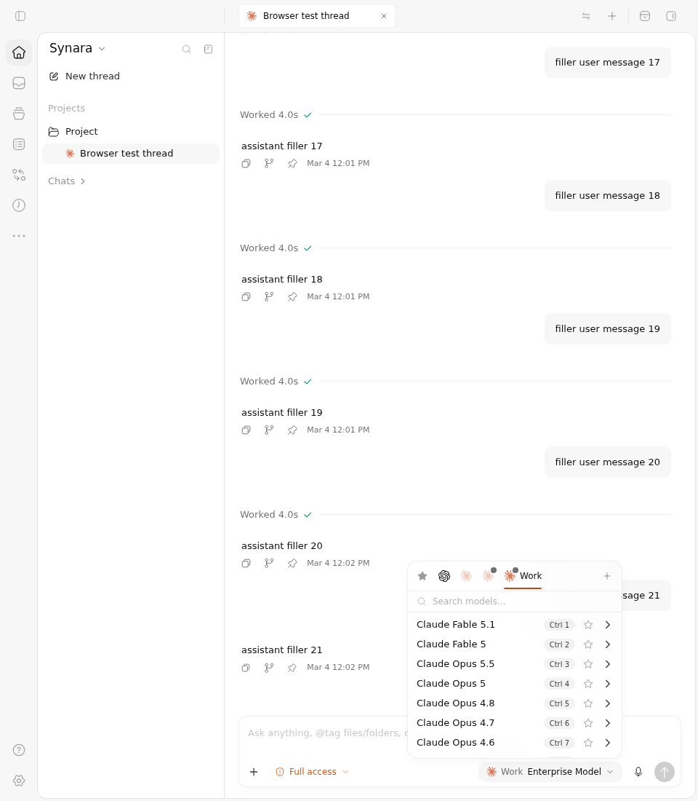
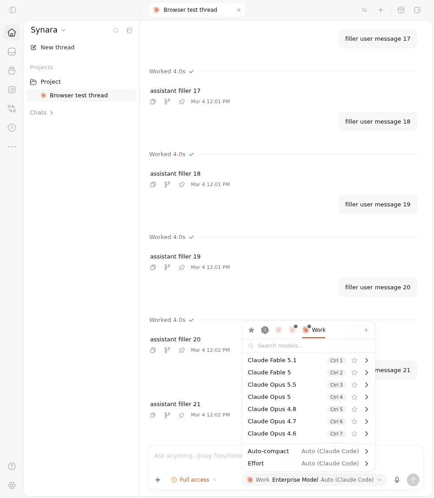
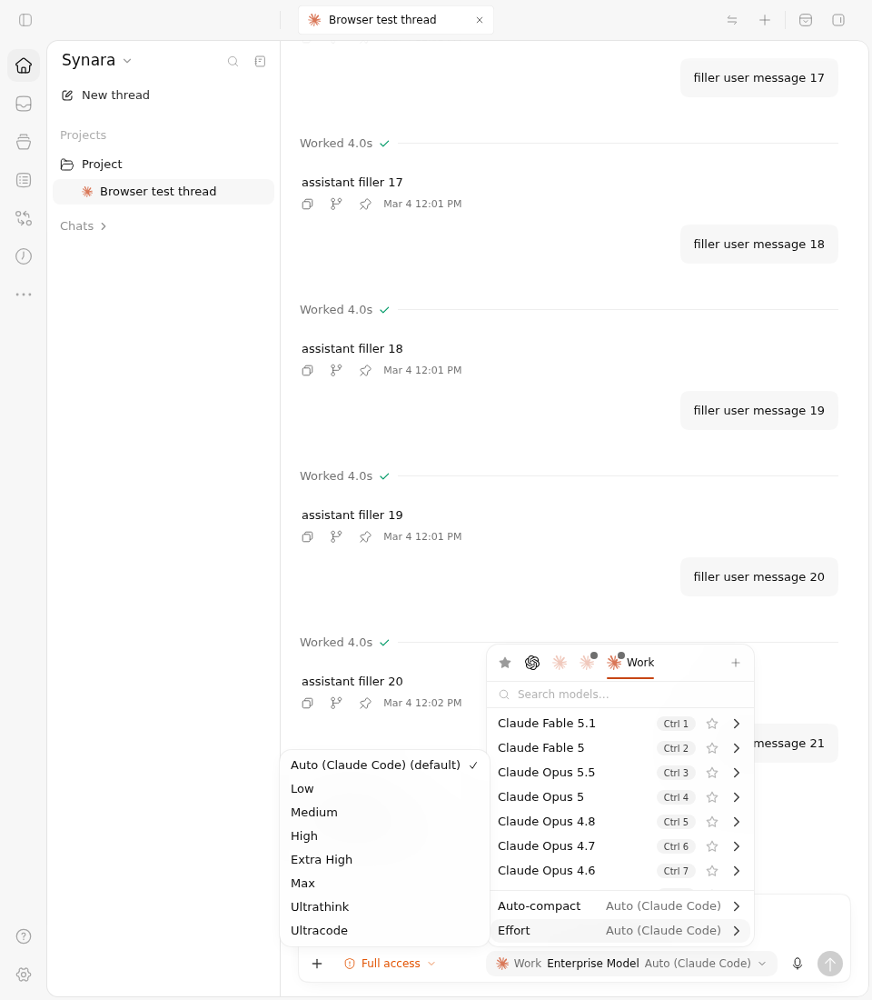
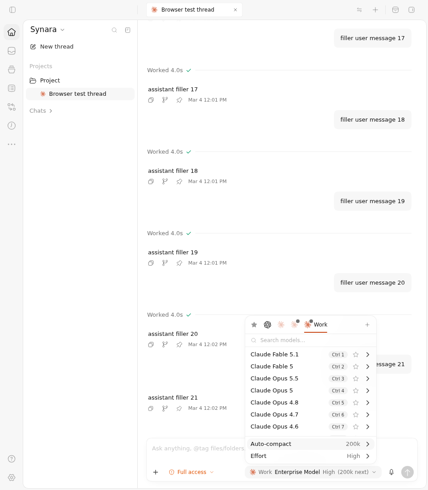
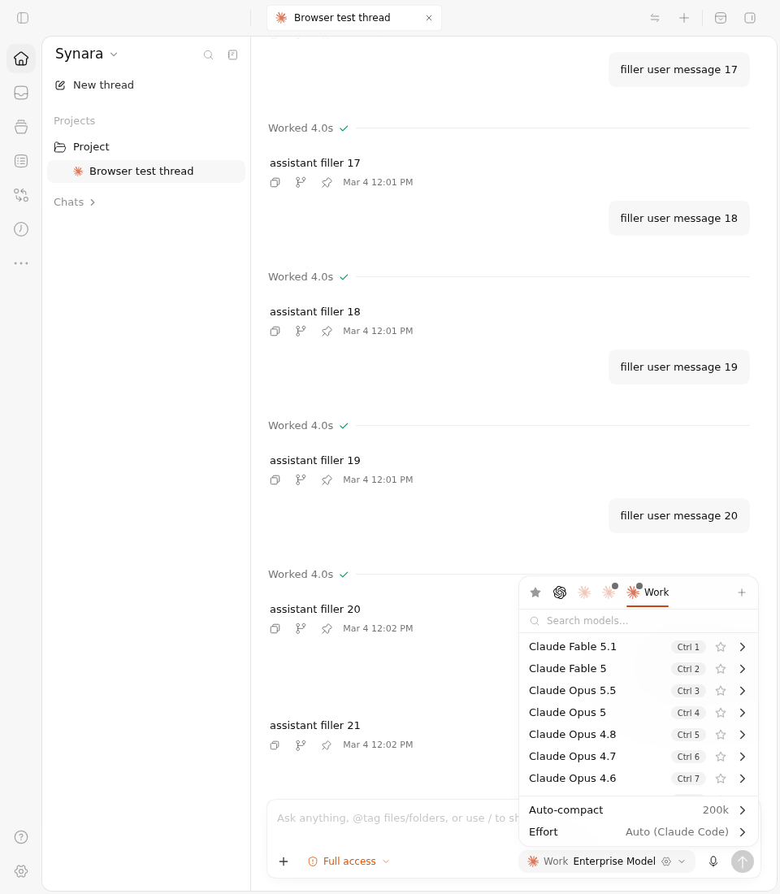
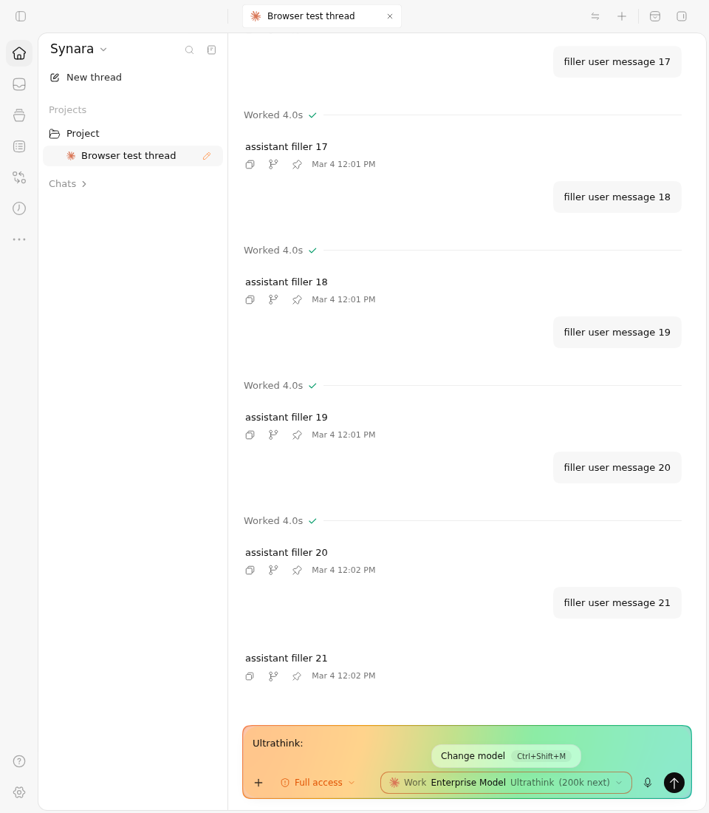

# PR #1835 — configured Claude model controls, Before vs After

This comparison renders the actual full ChatView, composer, model menu, provider catalog, draft actions, persistence, theme and CSS in Chromium at **960 × 1100**. The existing canonical MSW/orchestration/native API fixture supplies controlled threads and provider settings. The visible light theme and generated filler transcript are the actual captured fixture, not a native desktop session or live Claude account.

## Exact sources and actual result

| Side | Immutable source | Full Git tree | Three selected cases | Unselected original cases |
| --- | --- | --- | --- | --- |
| Before | `101a3c9653f2feeab0c7bf3dbcbe163bf01d6869` | `dccbd99d1def4b2e9ad2efcc4c489895739ec39d` | **1 failed, 2 passed** | 225 |
| After | `9fb04ac2735b42efbdfd615efec723673395bab0` | `5347993312c4a6d7ec61edbd3827582fa102a812` | **3 passed** | 225 |

Both sources include main `3270dcf89bb60745ac568803a940cd7e7ac676a7` and the same #1832 Sidebar prerequisite. Their 32-file difference is the custom-model feature and its tests. The After head is the published #1835 feature head, including the independently reviewed three-literal TraitsPicker assertion correction; no production source changed for this capture.

Execution: [GitHub Actions run 38168618786](https://github.com/Emanuele-web04/synara/actions/runs/38168618786), reviewed isolated driver `2694d577152639d1a190901caa203113ad0fd270`. Before job `114556350089` and its verifier remain failed; After job `114556350046` passed. Actual Vitest/tee exit pairs are **1/0** and **0/0**, respectively. Failed Before is not converted into workflow success. The full raw logs, JSON reports, source provenance and both original/observed fixture files are included.

The configured Work account's Before menu opens normally but lacks the **Effort** row; that is the genuine assertion failure. The After exposes Effort and Auto-compact, permits High and 200k selections, clears explicit effort when Auto is selected, preserves the 200k budget across actual persistence rehydration, and inserts the real `Ultrathink:\n` prompt prefix when selected. Both sources pass the sibling-account and unknown-model negative controls.

## Before vs After screenshots

| Before: configured Work menu lacks optional controls | After: configured Work menu offers Effort and Auto-compact |
| --- | --- |
|  |  |

The menu uses its real scrollable model list; lower model rows are outside the visible list viewport in these screenshots. The actual role queries, selected account, draft state and persisted JSON are independently recorded in `parsed-observations.json` and the untouched raw log. Pixels alone are not used to prove hidden model rows or persisted values.

| After effort choices | After selected High and 200k |
| --- | --- |
|  |  |

| After rehydrated Auto and 200k | After real Ultrathink insertion |
| --- | --- |
|  |  |

The source-native “200k next” wording is retained. This comparison does not measure model capacity, context consumption, a provider request, or whether a live remote service honors those options. No turn is sent.

All **19 original PNGs** are included: six Before phases and thirteen After phases. The `sibling-*` captures show the Empty account with the same opaque model hint but no inherited controls; `unknown-*` shows an unconfigured Work hint without invented controls. Initial `*-thread.png` images retain the whole application context.

## Short interaction clips and original recordings

- [Before: opening the configured model menu](before/interaction.mp4), 4.00 seconds, from original source video 108.00–112.00 seconds.
- [After: opening the menu, choosing options, rehydrating, and inserting Ultrathink](after/interaction.mp4), 6.72 seconds, beginning at original source video 106.25 seconds.

Both clips are contiguous full-frame, real-time H.264 transcodes from the original context WebMs, without cropping, annotations, frame replacement, or speed changes. `clips.json` records precise source/clip SHA-256, requested trim interval, actual probe duration, encoding arguments and eight representative extracted frames. Codec frame rounding makes the After duration 6.72 seconds for the requested 6.75-second interval. The complete original 184.84-second Before and 118.72-second After WebMs remain in each `video/` directory, including setup and the real Before assertion timeout.

## Honest scope and retained earlier failures

The current fixture first clicks the real composer and requires actual document/editor focus before performing the unchanged model-menu gesture. Each successful precondition is recorded as `PR_MODEL_FOCUS_PRECONDITION`. This qualifies ordinary already-focused use; it does **not** repair or prove first window activation. That separately diagnosed product defect is now isolated in draft PR #1841.

Earlier failures remain under `historical-failures/`, with each original full Vitest log/report, real exits, source provenance, and available downloaded-artifact metadata:

| Run | Exact driver and sources | Actual outcome and boundary |
| --- | --- | --- |
| `38165453277` | driver `b904cc8b67aed55985c365738f449f3945575a8c`; Before `8aabe73b6732adabaad7cf3480ca376700196656`, After `dd0c5ba49b69c06d3681d6d9fdb612a93c7c08f6` | Both first configured cases failed at Search models visibility before feature controls were asserted. Two negative cases were accidentally unselected because the original filter omitted Vitest's quotes. Actual exits were 1/0 on both sides. |
| `38167573917` | driver `205a220c22ef68332cea0493cd99b7afa662f2aa`; current Before `101a3c9653f2feeab0c7bf3dbcbe163bf01d6869`, After `9fb04ac2735b42efbdfd615efec723673395bab0` | Both returned 1 failed / 2 passed / 225 unselected. Read-only observers recorded a real first activation opening the popup, then composer focus closing it. Before briefly saw the closing popup and later lacked Effort; After failed Search models visibility. These are activation failures, not proof of the feature comparison. |

Earlier partial screenshots and full videos remain in their original Actions artifacts and the campaign's separately hash-verified archive copies; this package includes their failure logs and receipts without relabelling them as current successful captures. Current source pins and the successful focus precondition appear in the latest provenance and log.

Persistence qualification uses the production Zustand store and the **unmodified bytes it actually saved**: clear in-memory state, restore those same bytes, run the actual `persist.rehydrate()`, then mount the full component again. It is not a browser-process or native-app restart. Controlled ready provider instances and configured model lists are explicit fixture inputs; no runtime capability descriptor, component, hook, DOM geometry, selection result or desired persisted JSON is manufactured. The original 225-case fixture is reconstructed byte-for-byte after reversing only the reviewed added observations/setup extension.

## Artifact integrity

| Side | GitHub artifact | Downloaded ZIP bytes | SHA-256 |
| --- | --- | --- | --- |
| Before | `11712974736` | 2,209,349 | `e483827bcdb9938cc8e221a3beef34072530529292b44a012ccd69647534f638` |
| After | `11713370805` | 1,843,552 | `83463079eb6d1f829de4f2dd831d459053a65cf5917efb7105e71fa7a2517811` |

Both ZIPs match freshly retrieved GitHub artifact digests and sizes. Their paths, links and expanded sizes were checked before extraction. Every current raw member is byte-identical to its ZIP entry. `manifest.json` records every published file's size, SHA-256 and Git blob identity; `parsed-observations.json`, this README, clip receipts and extracted frames are explicitly derived review aids. See `driver-boundaries.md` for the complete independently reviewed execution and fixture boundaries.
