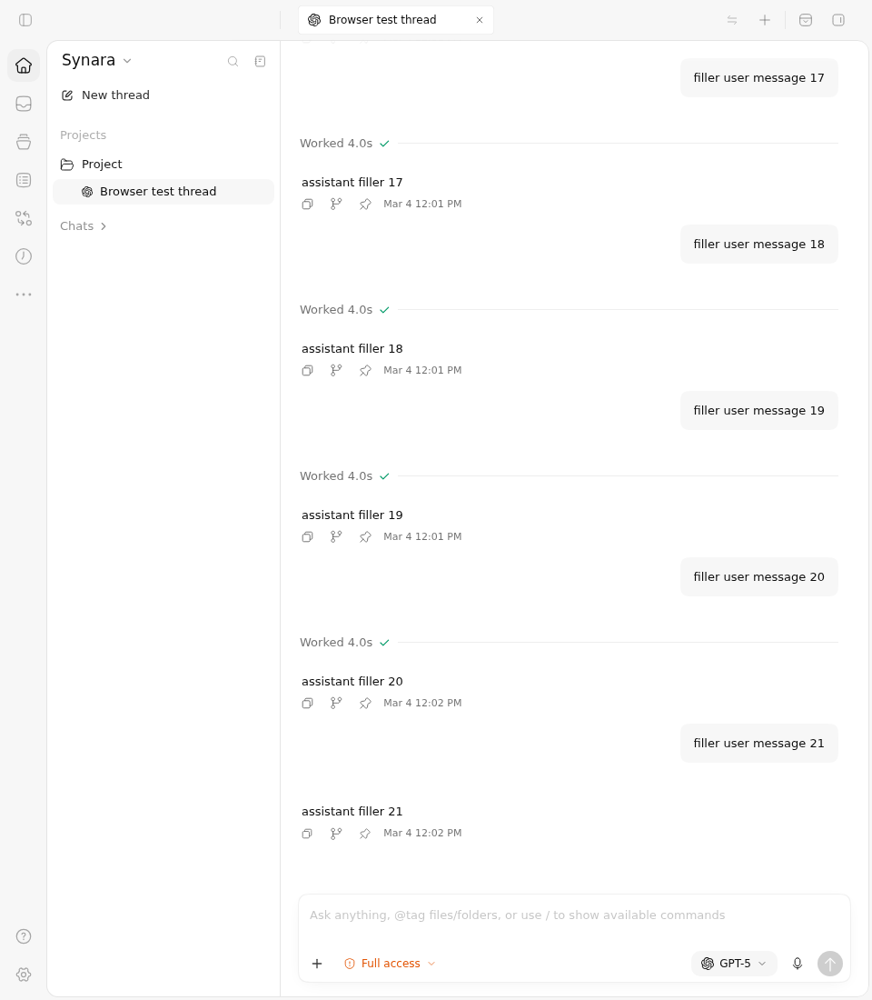
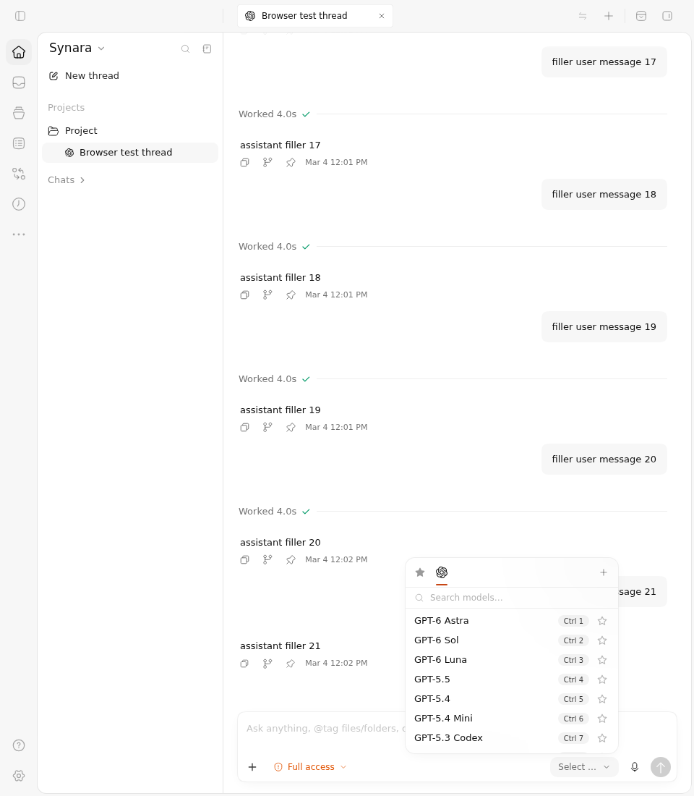
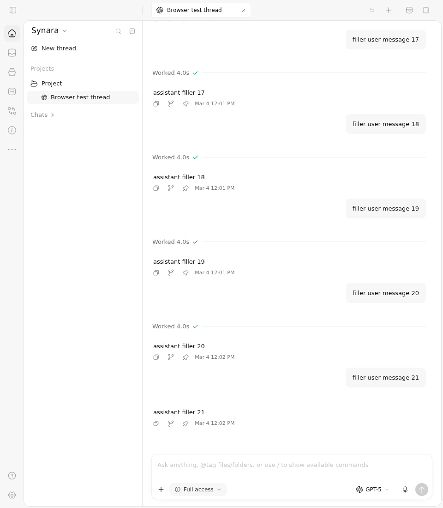
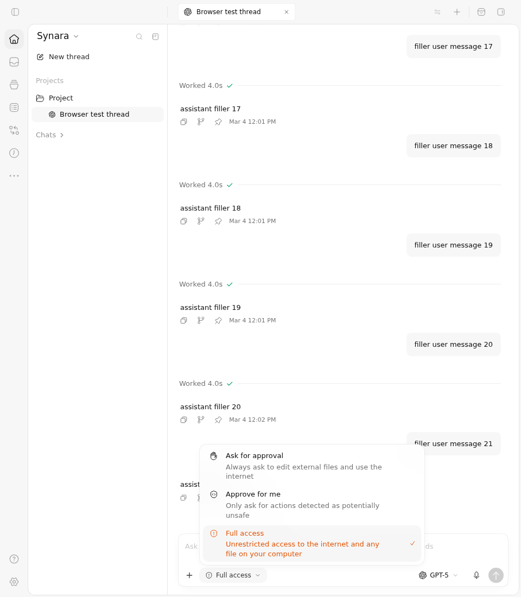

# PR1841: preserve the control clicked during browser-frame activation

These are source-pinned captures of the actual full ChatView, production theme, model picker and permission menu. Before the repair, the pending composer focus callback steals focus after the first pointer click and closes the selected menu. After the repair, the selected menu retains focus, stays open across the original four layout checks, and closes with Escape.

## Exact sources and actual results

| Boundary | Before | After |
| --- | --- | --- |
| Application commit | `110cc88e3ca24f54748d49fd7f20d4c434ee12a0` | `a2f1f846c15d98b734ac39d2b889ffade38496f9` |
| Application tree | `3c1d0c3aa2559fb37da21dc88025d3adf6ae7a90` | `4c72b2b17e63bfb786c5f9e280a0579bbb776af7` |
| Selected browser cases | 2 failed | 2 passed |
| Unselected cases | 223 | 223 |
| Actual Vitest / tee exit | 1 / 0 | 0 / 0 |
| Original PNGs | 4 | 8 |
| Original full WebM | 268.32 seconds | 114.16 seconds |

Both sources ran the same complete two-case control, with the same read-only capture additions, in [run 38172838752](https://github.com/Emanuele-web04/synara/actions/runs/38172838752). The independently reviewed driver is `0cc8b3ca9f085fd235c26aeb77be840cce8f4ea6`. The common canonical fixture is Git blob `d86dd91606f75ca0a4ab5850cee5bda866b7ebeb`, SHA256 `8bc297ba2c0c2cfb6797837352febdb433579c3ff49d6e3e14adb7707fb79605`. Its observed copy is SHA256 `411dd66357777b8ffcc5a91d60bd311fc7c4c642a639200e34d40da26ab1cc85`. Both exact fixture versions are retained under each side.

The original failing exits remain failures. The Before failures are the unchanged `aria-expanded=true` assertions after the real click: the observed value is false. An empty evidence-verification error list means the failed run was captured consistently; it does not turn the test or job green.

## Before Vs After

| Actual first activation | Before | After |
| --- | --- | --- |
| Model picker |  |  |
| Permission menu |  |  |

The original Before and After pre-click model frames are byte-identical. Both start with the application document unfocused and neither editor nor menu focused. After the Before click, the application document is focused but the editor owns focus and the menu is closed. After the repaired click, the model search input or permission menu owns focus, the editor does not, and the chosen menu remains open. These focus observations come from the retained production DOM state and the unchanged assertions; pixels alone cannot prove focus ownership.

The After `*-settled.png` frames preserve both menus after all four original layout checks. The After `*-closed.png` frames show Escape returning to the corresponding trigger. The model trigger tooltip visible after Escape is ordinary production UI. No model or permission change is submitted by these controls.

## Short real-time recordings

| Control | Before | After |
| --- | --- | --- |
| Model | [4.00-second clip](before/model-interaction.mp4) | [2.36-second clip](after/model-interaction.mp4) |
| Permissions | [3.96-second clip](before/permissions-interaction.mp4) | [2.36-second clip](after/permissions-interaction.mp4) |

The clips retain the complete 960 × 1100 frame at the original 25 fps. They trim time and encode H.264 only: no crop, scale, overlay, compositing or retiming. The original full WebMs remain in each side's `video/` directory. The full recordings include startup and the canonical setup between the two cases. Short clips show bounded interaction segments and do not replace the full failure duration or test receipts.

[clips.json](clips.json) records each full-video hash, requested source seek and duration, encoder arguments, measured video-stream duration/start/frame count, final clip hash and representative frame seeks. The requested source intervals are Before model 104.0–108.0 seconds, Before permissions 178.5–182.5 seconds, After model 108.5–110.9 seconds, and After permissions 111.5–113.9 seconds. At the original 25 fps, the encoded model Before clip contains 100 frames over 4.00 seconds starting at 0.00; the permissions Before clip contains 99 frames over 3.96 seconds starting at 0.04; both After clips contain 59 frames over 2.36 seconds starting at 0.04. These measurements preserve the original encoded bytes and distinguish one-frame timestamp quantization from the requested trim duration. Nominal source frame times are the requested source seek plus the representative clip seek. The eight representative clip frames are separate from the 12 untouched original PNGs.

## Scope and current-head qualification

The browser uses real Chromium focus between a same-origin Vitest parent and the application frame. The fixture first focuses a real parent-document control, then performs one pointer click on the real application trigger. It does not mock focus events, `document.hasFocus`, animation frames, layout, hooks or production components. The surrounding orchestration, provider catalog and chat messages are controlled by the existing full ChatView fixture. The visible thread contents and March dates are synthetic fixture data.

This establishes the browser-frame activation defect and its repair. It does not establish native OS application switching, Electron window activation, live provider behavior or persisted account/model changes. The separate custom-model feature and its already-focused captures are outside this repair.

Current published feature head `a3098848972482e13d772bd7581a6c1203650586`, tree `3080a0f811f0f465732166776d1fe9319c002b90`, preserves this independently reviewed focus repair and both canonical controls after integration with main52's paging/state changes. Its exact canonical CI has passed independently. Main's later `fc6fd90c1f3854719ef83fcdb3ee7e57a8437986` changes do not overlap these two feature paths. The screenshots and recordings remain labelled **110cc88 → a2f1f846**; they are not represented as captures of a309 or fc6. Current-head source review and CI are separate evidence.

## Retained diagnostic history

The initial [run 38170868308](https://github.com/Emanuele-web04/synara/actions/runs/38170868308), driver `cac858b5e4a519302981abc4b73b3251d8f0c2fd`, compared `3270dcf89bb60745ac568803a940cd7e7ac676a7` with `cc8f74c746bcf120d0f0d953d4fb6ebd29d04983`. Before had two failures; After had one pass and one failure. The model case already failed Before and passed After. The second case asked for a traits trigger that the fixture did not configure, so both sources failed to find it. That setup failure is retained and is not treated as a traits feature defect.

The reviewed correction replaced that single invalid table entry with the existing permission menu, while preserving the parent-focus precondition, one real click, four layout assertions, Escape and cleanup. Its complete raw reports, logs, exits, provenance and overlay receipts remain under `historical-first-run/`. No original failure is hidden or relabelled as a successful check.

## Integrity

All four downloaded ZIPs were verified against fresh GitHub artifact sizes and SHA256 digests. [artifact-metadata.json](artifact-metadata.json) retains the public artifact identities; the per-side download receipts retain the local byte checks. Every retained raw final artifact member is byte-identical to its source ZIP. Original PNG/WebM, fixture, report and log hashes also match their source provenance.

The final artifact IDs are Before `11714472949` and After `11715365045`. The historical artifact IDs are Before `11714385124` and After `11713318197`. [manifest.json](manifest.json) covers every other file in this evidence package with byte length, SHA256 and Git blob identity. The asset-only commit and branch preserve the feature head and add only this review packet.
