# PR #1847 — worktree documentation Before Vs After

These twelve unedited Chromium screenshots show the actual built Synara documentation before and after the reviewed worktree-link feature. Both six-view jobs passed in [run 38182580196](https://github.com/Emanuele-web04/synara/actions/runs/38182580196). This packet qualifies the documentation and its layout; native filesystem behavior has separate test results.

## Exact sources

| Role | Commit | Git tree |
| --- | --- | --- |
| Before | `52f06318fdb3c0b4b310a8d55d0083cba0bde1a0` | `a4159d11d36ade68727a11503a3912d973bad66f` |
| After | `a1b087d984a39cf9df936d5da9465db9e7679600` | `6011b0c1b9d93e2dcbf9b78b79c981d587cf4a4b` |
| Reviewed capture driver | `cc681aa0b416ad12cc3bb4a4a34771bb0a06350e` | `e1b999de58bd877656e0c83b1d62fb8c737409ad` |

The two changed production MDX files are `workflows/worktrees.mdx` and `troubleshooting/git-and-worktrees.mdx`. The After blobs are `4ce7108bdb099272b9037b309b4d4acefbf54109` and `c4a6cdef035ade671c26a63c6d03e03b4457dd5d`. The source heads above describe the actual captures even when main advances.

The workflow installs each exact source with its frozen workspace setup and builds the real Next/Fumadocs application. Captures use production page components and CSS, light theme, reduced motion, deterministic `VISUAL_TEST` marketing data, and ordinary page scrolling. No rendered text, DOM content or CSS is substituted. The desktop viewport is 1440 × 1100; the mobile viewport is 390 × 844. These are static documentation changes, so no motion video is presented.

## Before Vs After screenshots

| View | Before | After |
| --- | --- | --- |
| Desktop: surrounding worktree workflow | 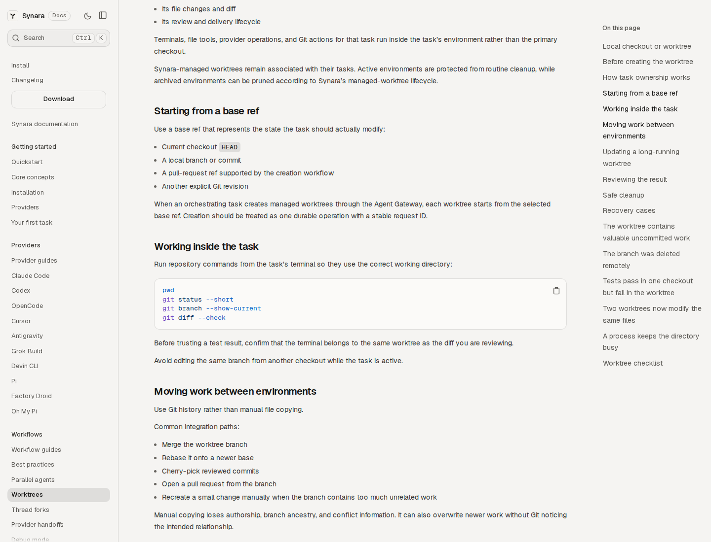 | 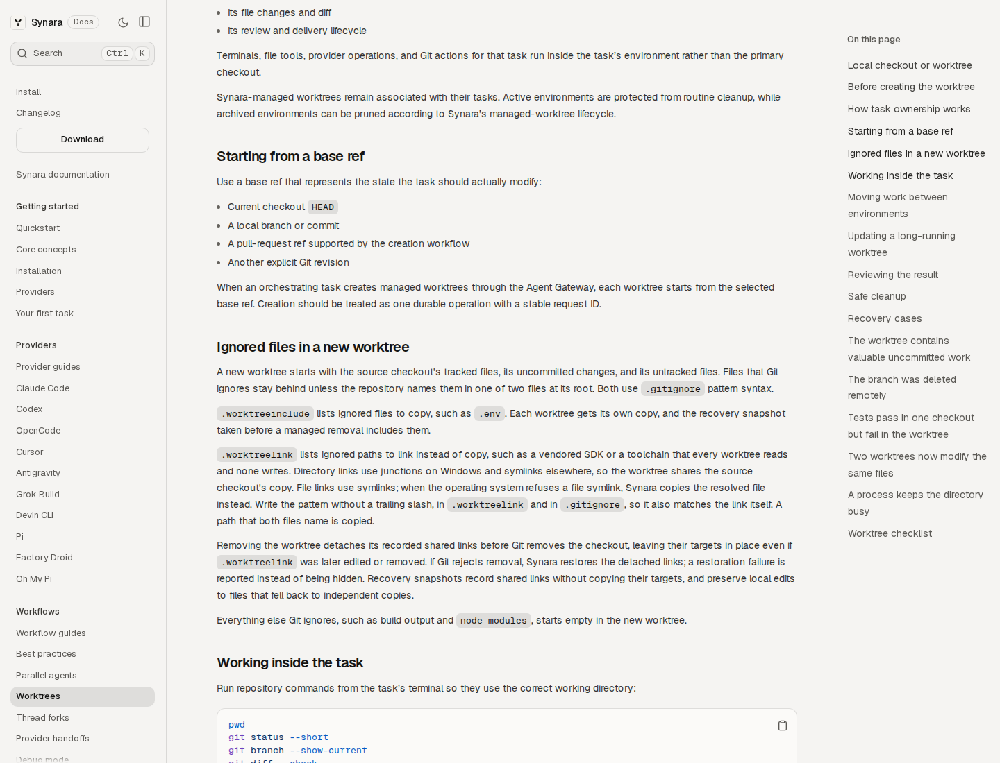 |
| Mobile: surrounding worktree workflow | 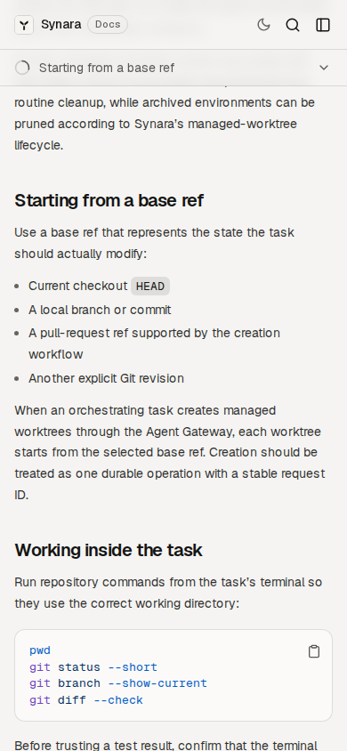 | 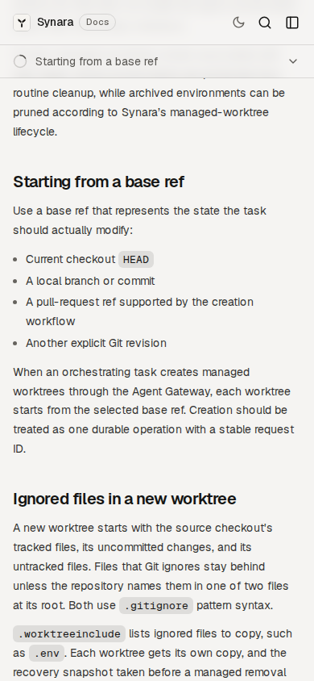 |
| Desktop: policy detail | 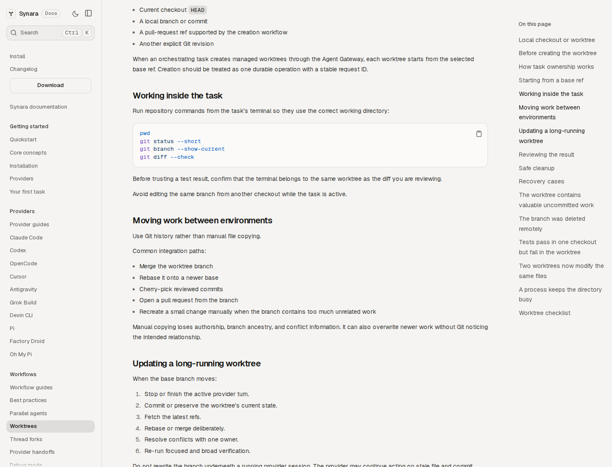 | 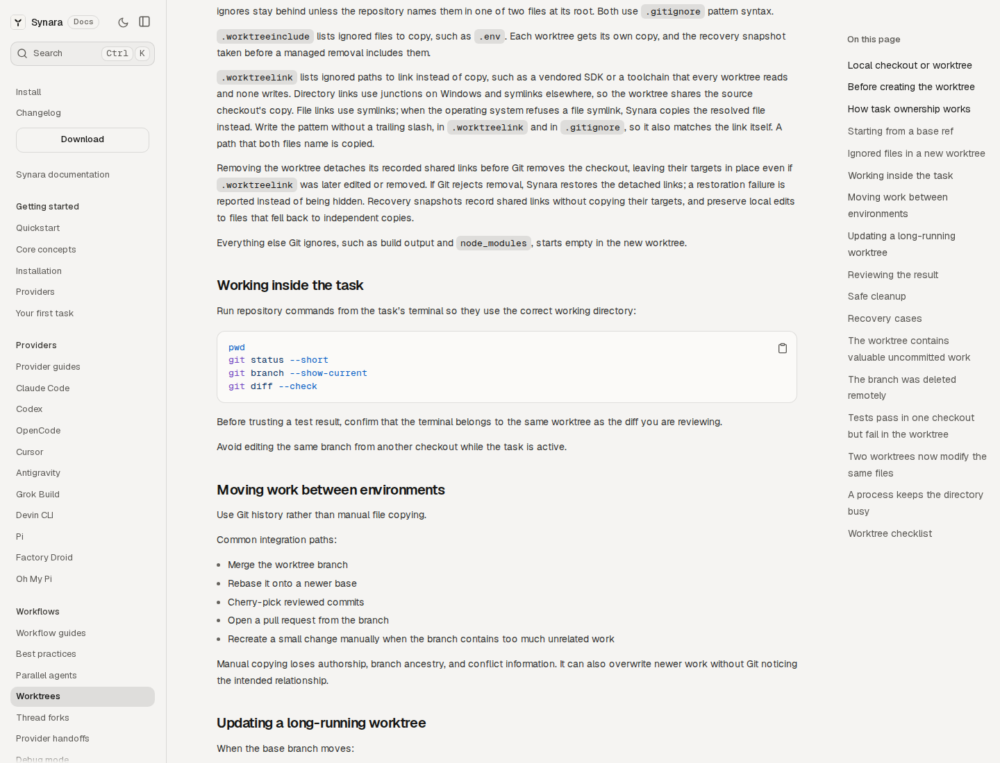 |
| Mobile: policy detail | 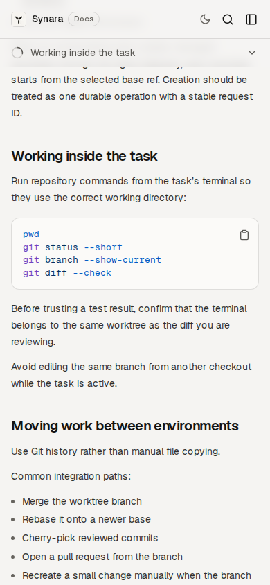 | 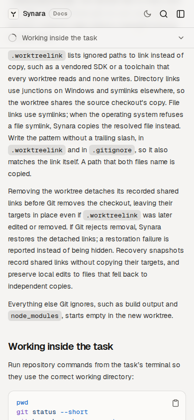 |
| Desktop: slow worktree troubleshooting | 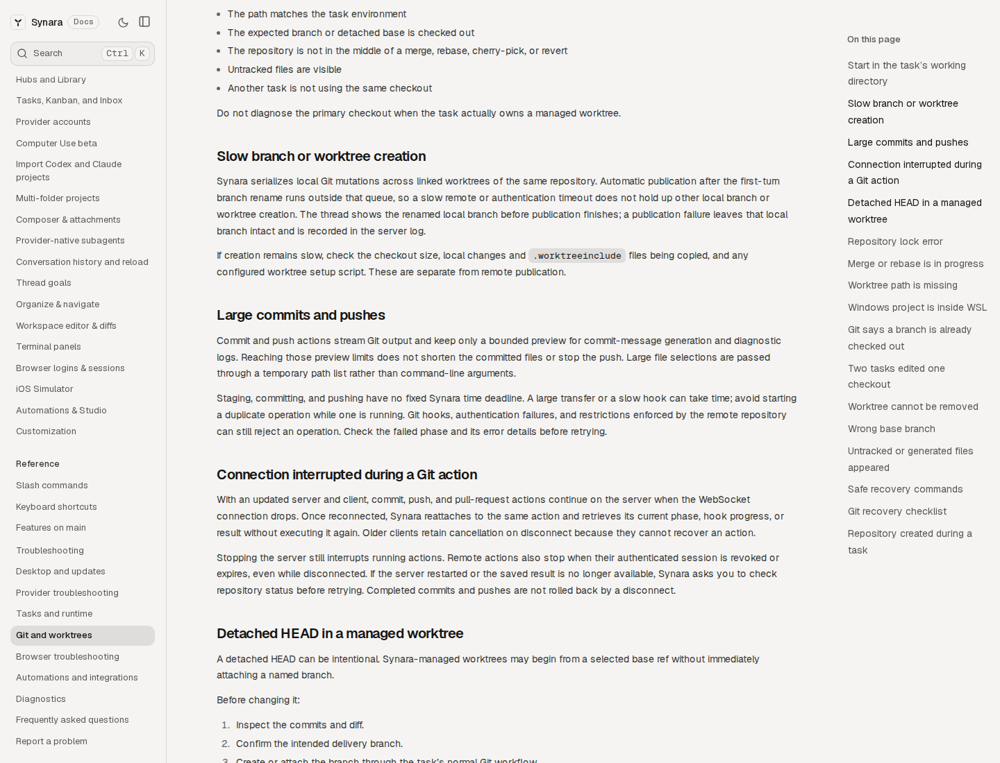 | 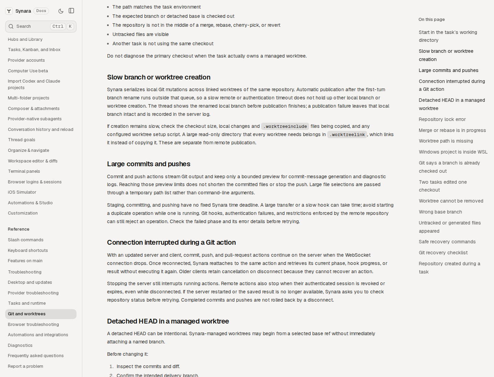 |
| Mobile: slow worktree troubleshooting | 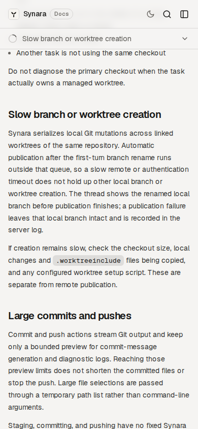 | 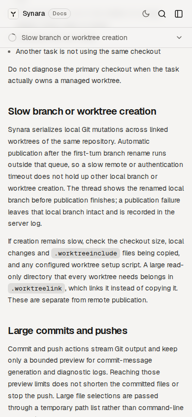 |

The context pair uses the same existing “Starting from a base ref” heading. The After image shows the new ignored-file section inserted before “Working inside the task.” The detailed policy view deliberately uses different documented anchors: the neighboring old “Working inside the task” section Before and the new `.worktreelink` paragraph After. It is a comparison of the old neighboring content with the inserted policy, not a claim that those views have identical scroll offsets. The After detail places the new section heading above the viewport to show the complete linking/removal paragraphs; the context pair shows the heading.

The new text explains copied ignored files, shared read-only links, Windows directory junctions, symlink fallback, recorded-link detachment/restoration and recovery snapshots. The troubleshooting pair adds the suggestion to link a large shared read-only directory. Screenshots visibly preserve readable wrapping and the actual Fumadocs navigation at both widths. Each corresponding JSON file records the target anchor, geometry, source/tree, page errors and observed policy presence.

## Actual execution and artifact integrity

| Check | Before | After |
| --- | --- | --- |
| Production build and tee exits | 0 / 0 | 0 / 0 |
| Playwright and tee exits | 0 / 0 | 0 / 0 |
| Assertions | 6 passed; 0 skipped, unexpected or flaky | 6 passed; 0 skipped, unexpected or flaky |
| Required screenshots | 6 exact viewport PNGs | 6 exact viewport PNGs |
| Source/driver verification | Passed | Passed |
| Complete original artifact | 25 ZIP members | 25 ZIP members |
| Raw manifest verification | All 24 named entries verified | All 24 named entries verified |

The twenty-fifth ZIP member is the raw manifest itself, which does not hash itself. Both final archives include the completion receipt omitted by the earlier upload. The frozen Playwright report is copied from a runner-owned live path outside the uploaded directory before parsing and hashing. Command failures, page errors, missing images, overflow and source changes remain failures.

Both original final ZIPs are preserved, together with GitHub artifact metadata, download receipts, complete raw reports/logs, source and driver hashes, and per-view observations. The final artifact IDs are `11718586688` Before and `11717954233` After. Their SHA256 values are respectively `1f7f39c0447b3c5facacdf1ea6d1050c2ab6dc41d6fc53d90cdaa789d425ed87` and `aa814169f96431c5747e94202461a84e7313a6fbe1c00fd726ee4882a6e4864e`.

## Preserved diagnostic history

- [Run 38180189373](https://github.com/Emanuele-web04/synara/actions/runs/38180189373) failed workflow validation before any job ran. Its run/jobs/checks receipt is retained under `historical/zero-job-workflow-failure.json`. The rejected job-level context was moved to an ordinary runner environment initialization step.
- [Run 38180452895](https://github.com/Emanuele-web04/synara/actions/runs/38180452895) reached both real builds and failed because the diagnostic Playwright preference was at the wrong configuration level. Neither source reached browser capture. Both original ZIPs and failure receipts remain under `historical/diagnostic-build-failure/`. The same reduced-motion preference was moved into the supported context options.
- [Run 38181440682](https://github.com/Emanuele-web04/synara/actions/runs/38181440682) genuinely passed both six-view jobs, but the default artifact filter omitted one manifest-named completion file per ZIP. All original ZIP bytes, test results, manifests and the precise missing-entry receipts remain under `historical/diagnostic-incomplete-export/`. This export gap is not described as full manifest verification. The final driver enabled complete upload only within its owned evidence directory and reran both unchanged source/fixture pairs.

## Native boundary and remaining work

The documentation pictures do not prove junction safety, checkout removal, cancellation, snapshot durability or Windows process cleanup. The separate full GitCore execution in [run 38178926396](https://github.com/Emanuele-web04/synara/actions/runs/38178926396) reported 144 passes on Ubuntu and 132 passes / 12 failures on Windows at the exact After source. Those Windows failures remain real and under investigation; no assertion was removed and this documentation success does not make that native job green. The new managed-link lifecycle cases passed there, while the whole-suite Windows qualification is still incomplete.

The later isolated fixture probe in [run 38182476930](https://github.com/Emanuele-web04/synara/actions/runs/38182476930) showed three candidate Windows setup repairs passing and two filename cases still failing. That probe uses finite owned Git fixtures and is diagnostic evidence, not a replacement for the unchanged full GitCore suite. PR readiness must use the current feature head and all applicable source/native checks, separately from this source-labelled documentation packet.
