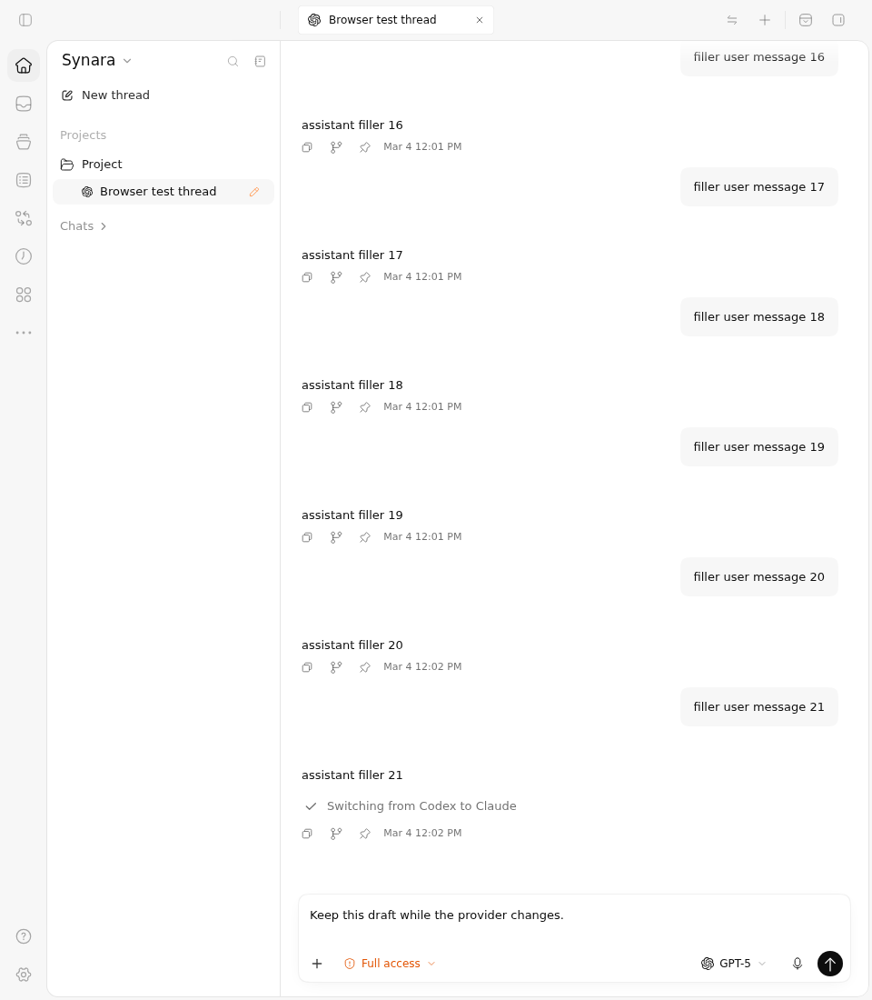
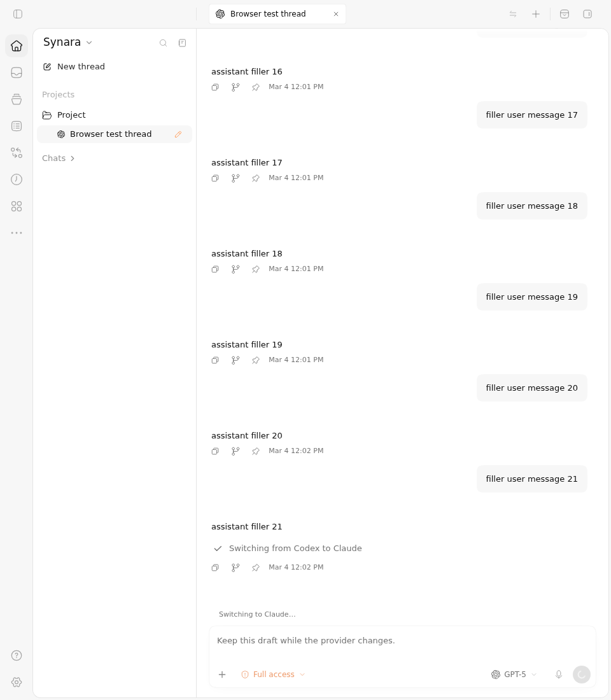
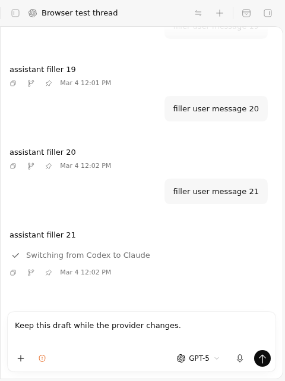
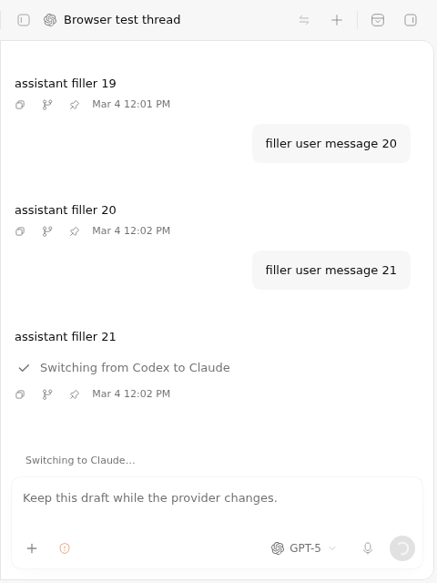
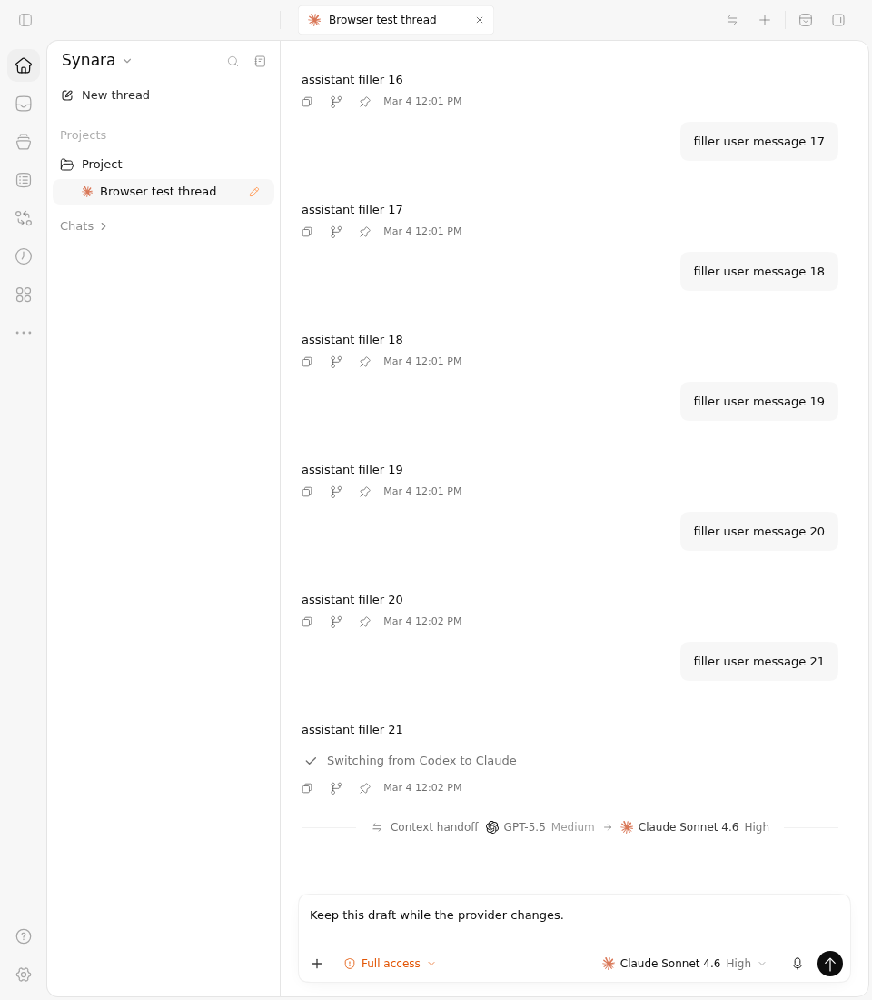
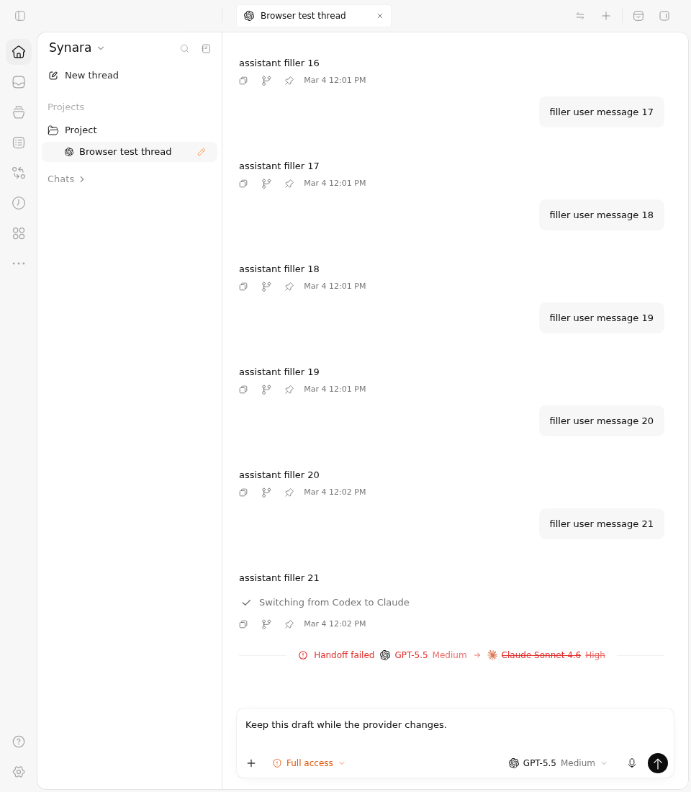
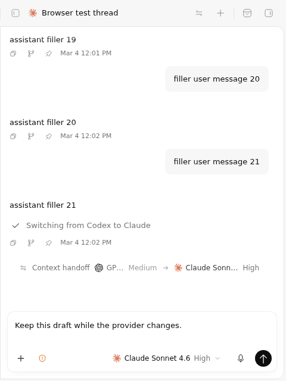
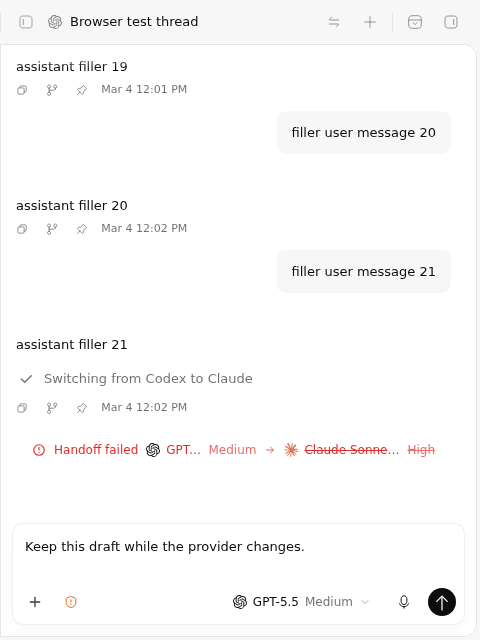

# PR #1145 — provider handoff Before Vs After

The repaired production composer keeps the existing draft visible and prevents editing or submission while a durable provider handoff is pending. A matching completion restores editing with the new provider; a matching failure restores editing with the original provider and a visible failure status. Ordinary connecting or running turns retain their existing Stop behavior.

These are actual Chromium renders of the production Router, ChatView, composer and theme under controlled orchestration snapshots. The same two complete regression cases execute against both sources. The desktop viewport is 960 × 1100 and the narrow viewport is 480 × 640. Fixtures use a synthetic conversation and draft, not an authenticated provider account. No application DOM or CSS is substituted for the captures.

## Before Vs After: pending request

| View | Before — `1a9d7098` | After — `2a53c3c7` |
| --- | --- | --- |
| Desktop |  |  |
| Narrow |  |  |

The final observed Before DOM has `contenteditable=true`, an enabled `Send message` button and no durable handoff status. The After DOM has `contenteditable=false`, one disabled `Connecting` submit button and the visible switching status. Both sources keep the exact draft text. The observed document width equals the requested viewport width in every captured phase.

## After: completion and rollback

These are different outcomes in the same complete fixture, not a fabricated second provider session.

| View | Matching completion — new provider | Matching failure — original provider |
| --- | --- | --- |
| Desktop |  |  |
| Narrow |  |  |

The failed-outcome pending captures are also retained without modification: [Before desktop](before/failed-pending-desktop.png), [Before narrow](before/failed-pending-narrow.png), [After desktop](after/failed-pending-desktop.png) and [After narrow](after/failed-pending-narrow.png). The final packet contains all twelve current ChatView PNGs, not only the images selected for the tables.

## Exact sources and observed results

| Check | Before | After |
| --- | --- | --- |
| Full ChatView source | `1a9d70983750bc771e850d72a858c541bac52885` / tree `6479afa46f65f176445f51a8fe9a859f67c4ab17` | `2a53c3c7c20e6aec90f6eaf3067d292955d2686e` / tree `4505c81b9128f56a758708c0581106490b3a5859` |
| Full ChatView cases | **0 passed, 2 failed; 220 filtered**; actual exit 1 | **2 passed, 0 failed; 220 filtered**; actual exit 0 |
| Isolated footer source | Prior repaired head `53248e7ed92a1d14147cd66822cfa982b0d6baef` / tree `c22c3af445bd06fb427814cf5a7428eec25a2edd` | The same final `2a53c3c7` source |
| Complete footer cases | **3 passed, 3 failed**, no name filtering; actual exit 1 | **6 passed, 0 failed**, no name filtering; actual exit 0 |

The three existing footer cases pass on both implementations: interrupt a connecting turn; dictate a follow-up next to Stop; and show the recorder's own Stop during dictation. The three added cases apply pending handoff state over ready, connecting and running phases. Each requires one disabled submit button, no generation Stop, no admitted voice/interrupt callback and restored Send after the matching settled input. The Before component ignores the new input and fails those three assertions. Its expected control result is recorded separately from its actual failed job; the failure is never relabelled as a pass.

[Run 38195141054](https://github.com/Emanuele-web04/synara/actions/runs/38195141054) uses driver `a8e31e6a897ccdfa7babd66275798925fe904553`, tree `78f26d6bb6a9f88ddb2e51e0d1c4d6f58c97dd8d`, with ordered parents `[f9e18e56, 2a53c3c7]`. The run's overall conclusion remains **failure**, because the two Before jobs remain failed. Both After jobs succeeded. The job IDs are ChatView Before `114636052932`, ChatView After `114636052854`, footer Before `114636018306` and footer After `114636018139`.

Separately, the final feature head has **24 successful check runs** in the retained API observation, including [canonical CI 38194565419](https://github.com/Emanuele-web04/synara/actions/runs/38194565419) and [marketing 38194565465](https://github.com/Emanuele-web04/synara/actions/runs/38194565465). Those are checks of the feature head. The selective diagnostic's 220 filtered cases are not counted as executed or passing evidence.

## Recordings and reproducible trims

[Before excerpt](clips/before.webm) · [After excerpt](clips/after.webm)

The two excerpts retain the complete 960 × 1100 recorded frame at normal speed. They include the real initial loading and viewport resize activity. There is no crop, overlay, inserted frame or time acceleration. The Before excerpt shows the first pending fixture; that complete case later fails. The After excerpt reaches the matching completed projection and restores the draft. Failure rollback is established separately by its actual test, DOM observation and screenshots above.

| Recording | Untouched source | Requested excerpt | Measured excerpt |
| --- | --- | --- | --- |
| Before | [267.92-second WebM](before/video/page@87696a081fdc78423960300832751940.webm), 6698 frames at 25 fps | Seek 99.4 s, duration 5.5 s | 5.52 s, 138 frames at 25 fps |
| After | [98.16-second WebM](after/video/page@0a2eea0c37634c20b6eb19c5dc3d385c.webm), 2454 frames at 25 fps | Seek 84.6 s, duration 7.8 s | 7.8 s, 195 frames at 25 fps |

`reproduce-clips.py` contains the exact FFmpeg arguments, source hashes and registered sample times. `clips.json` records measured streams and every output digest. Running `python reproduce-clips.py --verify` regenerates both clips and all six registered frames into a fresh temporary directory and compares their bytes. The recorded independent local rerun exited 0. Full-frame decoding receipts locate non-white intervals for inspection; that numeric threshold alone makes no semantic claim about what the UI is doing.

## Earlier failures are retained

The first canonical browser failure at `1b5ad7bd` expected Send while the status label was changing. The one-literal `53248e7e` correction was insufficient: the enclosing ordinary connecting branch still rendered an enabled Stop button, so there was no disabled submit to find. The actual failed canonical logs from runs `38191448841` and `38192727438` are retained under `history/`. The source repair at `2a53c3c7` adds a separate `handoffPending` route rather than removing ordinary connecting cancellation.

The original diagnostic [run 38193107887](https://github.com/Emanuele-web04/synara/actions/runs/38193107887), driver `f9e18e56c90159c06ee7cce409c5933dface9807`, is preserved under `previous/`, with both original ZIPs and all 28 raw members. Both Before and After had 0 passed / 2 failed / 220 filtered, actual exit 1. The old After source was `53248e7e`; it produced no successful named capture because the unique form submit assertion failed. It is not evidence for the final repair.

An early inspection sampled only white frames from that prior After recording. A complete 2822-frame decode later found actual application content at 104.68–109.68 s and 109.92–111.68 s. The preserved [107.18-second frame](analysis/previous-after-frame-107.18.png) shows the incorrect Stop state; the [110.8-second frame](analysis/previous-after-frame-110.8.png) shows the next actual fixture. The earlier whole-recording “blank” inference was incorrect. No claim is made that the recording belongs to a coordinator page.

The three automatically produced footer Before failure PNGs are blank. They remain in the original archive and in `footer-before/failure-screenshots/`, but are **not visual proof of footer behavior**. That negative control is supported by its actual six test results, raw DOM error output, source identities and unchanged assertions. The full ChatView captures supply the visible Before/After comparison.

## Integrity and reproduction

All six original GitHub artifact ZIPs are retained under `archives/`. `original-artifacts.json` maps all **85 raw members** to their unchanged portable copies. Their exact ZIP SHA-256 values and byte lengths match the retained GitHub artifact metadata. All **79 declared manifest entries** are present; each artifact manifest itself is one additional archive member. No hidden bookkeeping file or failed raw observation was dropped.

| Run / artifact | GitHub artifact ID | Original ZIP SHA-256 |
| --- | --- | --- |
| Current ChatView Before | `11723710296` | `d719bb98096e9ad429637f924f76d4db8a317ce5e5a739a8ef816b6ff06ecd6e` |
| Current ChatView After | `11722348891` | `e44ec83dc313b8babb7186409dd131471fb02244a5564b8e3f6c0aa769d37070` |
| Current footer Before | `11723172081` | `e78673574647a5a2c72d506a67841d860e0128995e9addc162bd878fa2297054` |
| Current footer After | `11723640026` | `a6c18f2748a35d8338a4f696409dcc959fb30f603d59d7b4edafabbe1f11a1eb` |
| Previous ChatView Before | `11722382600` | `ab7035b2d404a2323e40ae0e5b214bede5d35798635ad1bd1ee2f01e7d75498d` |
| Previous ChatView After | `11722062983` | `d0fa50ee6b74c7f97aa084fccc490cd4052733f7cf8ed49016f20e498a021c73` |

`verify-packet.py` independently rebuilds all three source Git tree hashes and both source-plus-driver trees from the retained complete leaf inventories. It checks the current and previous driver bytes, all raw archive members, manifest entries, source identities, actual job exits, full fixture reversals, stable snapshots, PNG dimensions and clip digests. Removing only the two new ChatView cases recovers every byte of the main fixture; removing only the additive capture calls and helper recovers every byte of the common canonical fixture. The footer runs use the identical complete six-case final canonical fixture.

At execution the driver checks the exact source HEAD/tree, clean tracked Git state and the declared raw source blob hashes. This does not claim that it individually read every source leaf during the browser run. Live reports and logs are held outside the uploaded directory, media is held in a distinct allowed workspace directory, and bounded stable reads copy each regular file once before parsing or hashing. All **41 retained snapshot receipts** show the same file identity, size and timestamps before and after copying. A failed, changed, capped or incomplete capture remains failure. The real browser step outcome is passed to verification.

## Requirements and limits

The original author history remains in the feature ancestry. This repair strengthens durable provider-change admission, matching lifecycle settlement and composer behavior within the existing same-thread implementation. The separate opt-in/history-navigation work in [#1717](https://github.com/Emanuele-web04/synara/pull/1717) remains distinct; [issue #1136](https://github.com/Emanuele-web04/synara/issues/1136) is not declared fully fulfilled by this packet.

These fixtures establish actual production UI behavior under controlled state and preserve both complete canonical browser regressions. They do not establish a live Claude, Codex, Pi or other provider process, an authenticated remote exchange, native desktop behavior or an operating-system handoff. The source review and broader feature CI provide separate repository evidence; this package does not replace those requirements or convert historical failed checks into successes.
