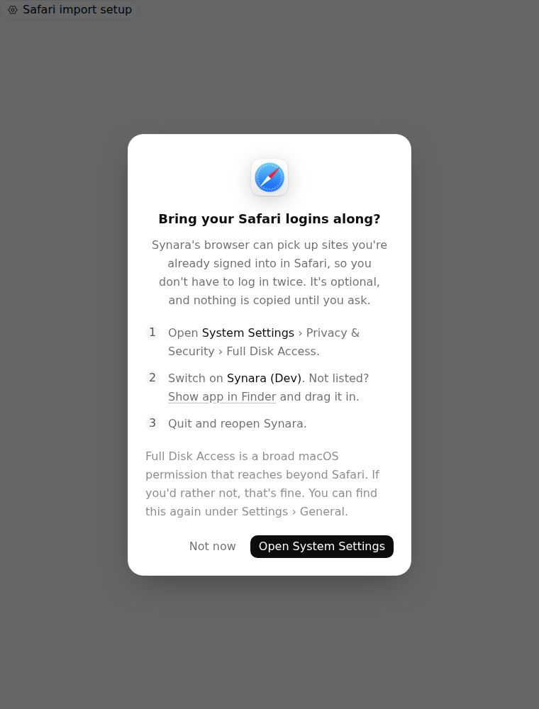
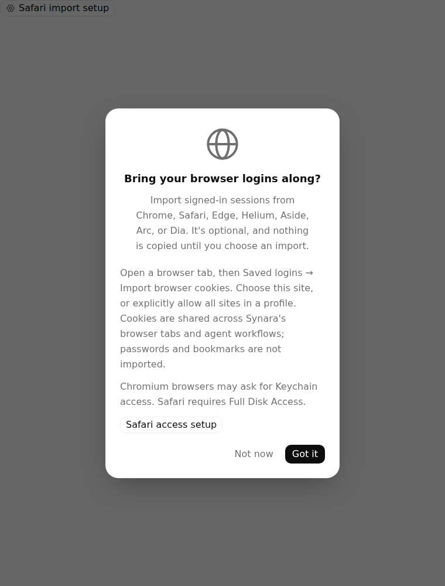
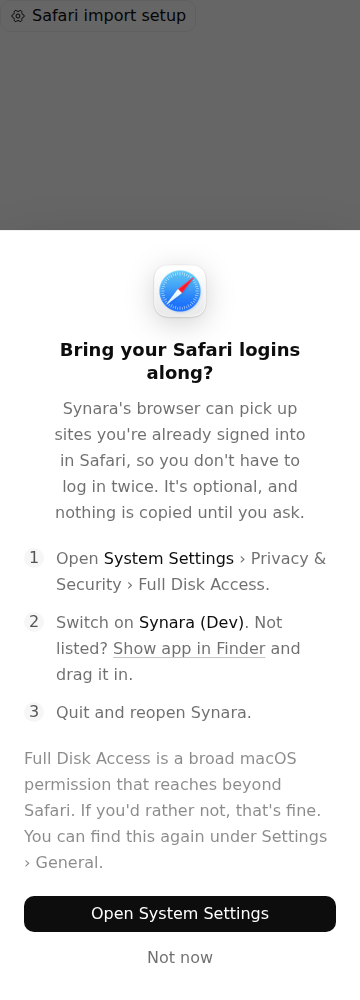
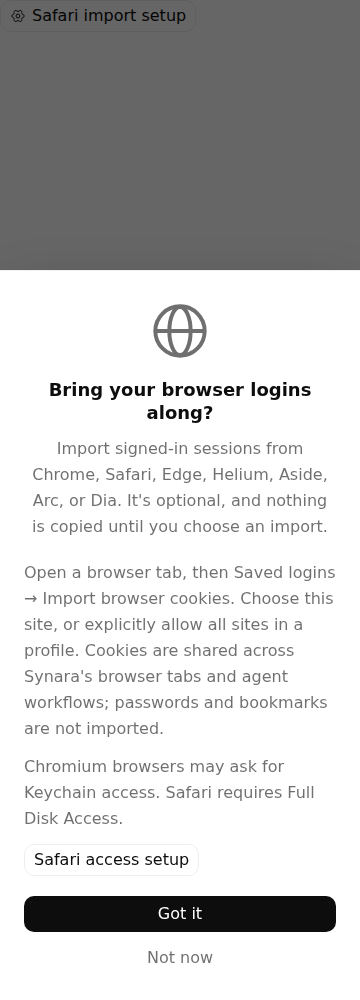
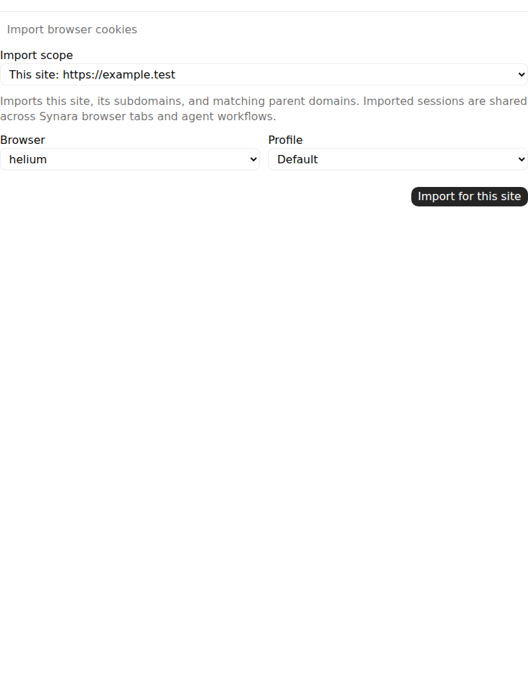
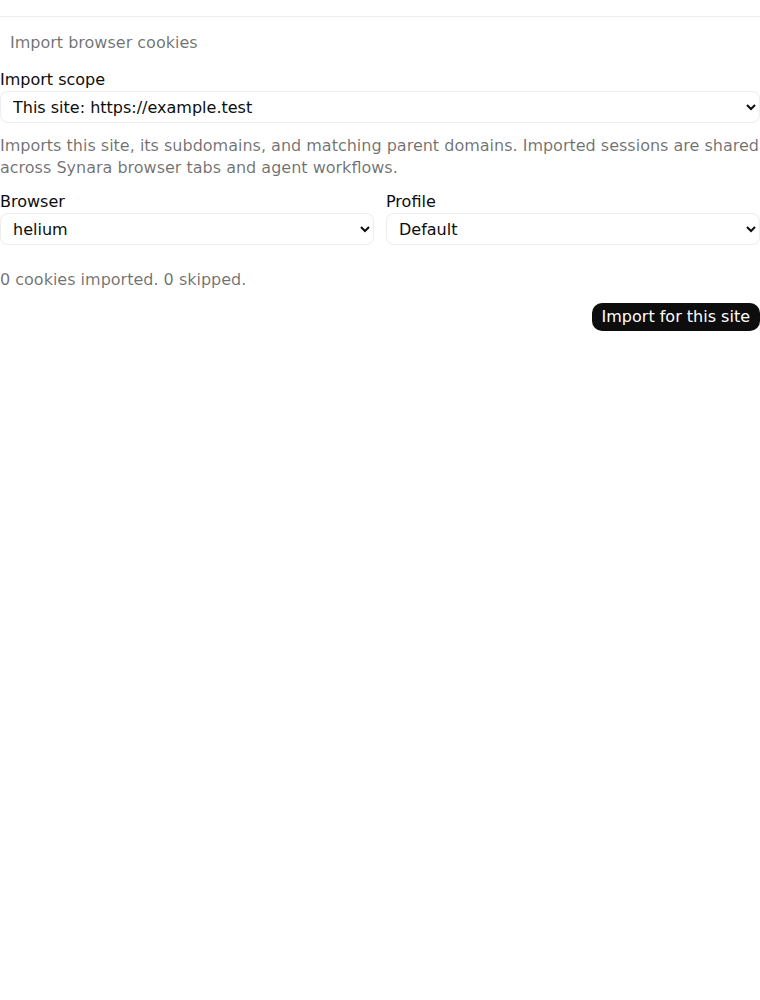
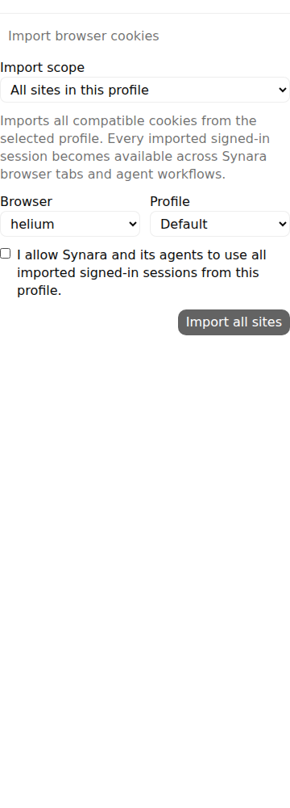
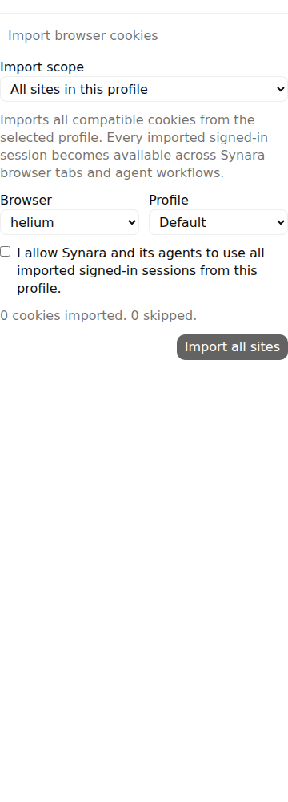

# Before Vs After — browser cookie import and optional guidance

This packet qualifies the implemented UI in #1856, the history-preserving continuation of #1830. The PR remains a draft because the original broader onboarding/import requirements are unfinished.

| Source | Immutable application head | Application tree |
| --- | --- | --- |
| Before — main 9e plus the shared changelog-format repair | `1a9d70983750bc771e850d72a858c541bac52885` | `6479afa46f65f176445f51a8fe9a859f67c4ab17` |
| After — #1856 | `be4186e34d1e0437ee9b3c671a9fb3652ab599de` | `79b50df78f7514303a692cf65cbf04f5d68bb875` |

The comparison uses the actual BrowserCookieImport, BrowserVault and SafariAccessOnboarding components, production CSS and useTheme, with their canonical controlled native replies. The surrounding white page is the component fixture. It is not a whole desktop application or a live browser-account import.

## Before Vs After screenshots

All 18 current PNGs are original, unedited Chromium captures. Desktop is 760×1000; mobile is 360×1000. The input data and test actions are identical on each source.

| Optional startup guidance — desktop Before | Desktop After |
| --- | --- |
|  |  |

| Optional startup guidance — mobile Before | Mobile After |
| --- | --- |
|  |  |

| Import interaction — desktop Before | Desktop After |
| --- | --- |
|  |  |

Both sides display Helium because the same controlled available-browser reply supplies it. The Before defect is that clicking the import action does not call the supplied import API. On After, the exact expected browser/profile/site request reaches that controlled callback and the UI displays its synthetic **0 cookies imported, 0 skipped** result. These pixels do not establish installed-browser detection or actual cookie transfer.

| Preserved explicit consent — After mobile | Consent renewed after the controlled import |
| --- | --- |
|  |  |

The remaining original captures include the initial Helium picker on both sources and widths, the mobile site-result pair, desktop whole-profile consent, and [manual Safari setup on desktop](after-desktop/manual-safari-setup.png) and [mobile](after-mobile/manual-safari-setup.png). The manual setup continues to explain the existing macOS permission boundary; opening Settings is not treated as permission approval.

## Actual browser results

[Run 38186606080](https://github.com/Emanuele-web04/synara/actions/runs/38186606080) used independently reviewed driver `4d6bb4dc34283605037d1cc64a2874fca435276b`, tree `caa8a97d352e6b1c892d941d0814e5e5e70c9fa8`. It ran the complete 15-case BrowserVault and 12-case onboarding fixtures from the After source unchanged on both application heads. Only additive observations, theme initialization and renamed fixture files were used. Both overlays reverse byte-for-byte to those common canonical fixtures.

| Target | Passed | Failed | Skipped | Actual Vitest / tee exit |
| --- | ---: | ---: | ---: | --- |
| Before desktop | 17 | 10 | 0 | 1 / 0 |
| Before mobile | 17 | 10 | 0 | 1 / 0 |
| After desktop | 27 | 0 | 0 | 0 / 0 |
| After mobile | 27 | 0 | 0 | 0 / 0 |

The two Before jobs are real failed jobs. Four failures exercise Helium, Aside, Arc and Dia import callbacks; six exercise the new optional onboarding, acknowledgment and manual-revisit flow. No failures were changed into skips or expected successes. The remaining cases cover existing saved-login privacy, explicit whole-profile consent, permission-denial results, late replies, reveal cancellation and deletion confirmation. Passing browser cases exercise their controlled API boundary, not native readers or real credentials.

The final observations wait up to two seconds for already-running finite browser animations to finish naturally; they do not disable or finish an animation programmatically. The final dialog captures record opacity 1. Existing theme initialization acknowledges the mocked native theme call and uses the actual production hook. The unmodified test gestures and assertions remain in the retained observed fixtures.

## Recordings

All four original complete WebMs are retained in the respective target `video` directories, at 25 fps and the original full frame. Their measured durations are 551.72 seconds Before desktop, 554.68 seconds Before mobile, 12.76 seconds After desktop and 15.76 seconds After mobile. The long Before recordings include six genuine 90-second test timeouts. No timeout segment has been removed from those originals.

The short recordings below extract the actual onboarding portion at normal speed. They retain rapid test-fixture remounts, blank handoff frames and manual Safari revisits. The screenshots above provide stable readable comparisons; the clips do not imply one uninterrupted user session or synchronized timing between sources.

| Onboarding sequence | Requested source seek / length | Measured clip duration / start / frames |
| --- | --- | --- |
| [Before desktop](clips/before-desktop.mp4) | 9.75s / 4.00s | 4.000s / 0.000s / 100 |
| [After desktop](clips/after-desktop.mp4) | 9.30s / 2.50s | 2.480s / 0.040s / 62 |
| [Before mobile](clips/before-mobile.mp4) | 12.70s / 4.00s | 3.960s / 0.040s / 99 |
| [After mobile](clips/after-mobile.mp4) | 12.60s / 2.80s | 2.800s / 0.000s / 70 |

[clips.json](clips.json) records source/output hashes, exact encoder arguments and measured metadata. There is no crop, speed change, overlay, generated imagery or reconstructed UI. Representative original-video and clip frames were inspected, including the After desktop general-guidance frame at clip 0.28s and After mobile at 1.40s.

## Earlier failures and transitional evidence

- [Run 38183778847](https://github.com/Emanuele-web04/synara/actions/runs/38183778847) failed in all four capture jobs before browser execution because the package script and command both supplied a Vitest config. The reviewed invocation-only child called the installed Vitest executable with one config. All four original ZIPs and raw exits/logs remain.
- [Run 38184528360](https://github.com/Emanuele-web04/synara/actions/runs/38184528360) produced the same 17/10 Before and 27/0 After test results, but an After mobile guidance PNG caught a dialog transition. Both historical After startup PNGs, all four original ZIPs, raw results and exits remain under `history/38184528360` and `original-artifacts`.
- [Run 38185712851](https://github.com/Emanuele-web04/synara/actions/runs/38185712851) failed during preparation after the natural-animation observer changed but its two derived fixture hashes were stale. The strict guard correctly refused to run the browser. All four complete job logs and remote metadata remain. The final child corrected only those two derived hashes and its README, after independently rebuilding and reversing both fixtures.

All 12 downloaded ZIPs are retained byte-for-byte and matched against fresh GitHub artifact digests and sizes. Their 184 members are inventoried in [archive-verification.json](archive-verification.json); all 70 current members are separately retained under the four target directories. The 66 current manifest entries, all four manifests, original reports, actual exits, report snapshots, source/driver pins and complete videos remain available. The artifact branch does not change any application code.

## Remaining feature scope

Installed-browser discovery and hiding absent choices, direct onboarding selection of browser and import categories, and bookmarks/history/password import remain unfinished requirements of the original proposal. This packet neither completes nor removes them. Arc/Dia native reader behavior, signed macOS permission flows, packaged Windows, and an end-to-end import of real cookies are not established by these browser fixtures. Source review and canonical CI are documented separately in the PR; future heads require their own qualification.
