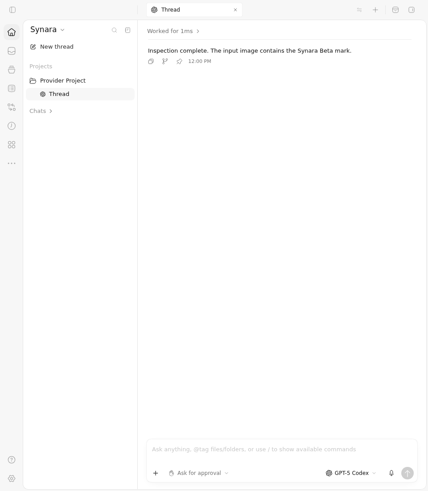
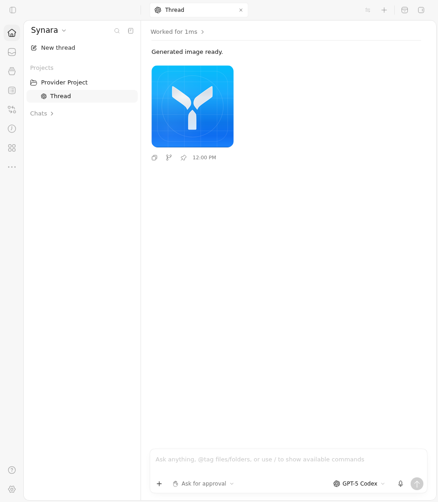

# Before Vs After — image provenance in #1857

The real ChatView renders the text-only result after an image-view event on the repaired source. Current main incorrectly appends that inspected image as if it had been generated. The separate true-generation control still renders the image on both sources.

| Source | Immutable application head | Application tree |
| --- | --- | --- |
| Before — current main at capture | `9e01962e0b1e8fec9fb0e17f17a64017bc4eaf94` | `81b2ce105b3362e1266bb15916e0b16633f3843d` |
| After — #1857, continuation of #1069 | `00d069ea71154ae11b87944a542bb845878b7050` | `eeeb0b2796614b2680ea36ed27c77f3bdd161303` |

## Before Vs After screenshots

These are the original, unedited 960×1100 Chromium screenshots. The controlled event time displayed in the UI is fixture data; actual capture times are retained in the workflow logs.

| Scenario | Before | After |
| --- | --- | --- |
| Image inspection result — image must not be appended |  |  |
| True image generation — image must remain visible |  |  |

## Executed checks

[Actions run 38185895366](https://github.com/Emanuele-web04/synara/actions/runs/38185895366) used isolated driver `e7ea6a83362bc11270ecce170eba3c5cd873bee1`, tree `156b6f0300920f5ae49700b9f297f47d2facdc29`. The two image jobs completed successfully after verifying these precise raw results:

| Actual selected checks | Before | After |
| --- | --- | --- |
| Production SQLite ingestion | 1 pass / 1 expected failure | 2 pass |
| Production ChatView in Chromium | 1 pass / 1 expected failure | 2 pass |
| Inspected-image DOM count | 1, the reproduced defect | 0 |
| Genuine-generation DOM count | 1 | 1 |

The Before failures remain nonzero Vitest exits and failed assertions in the original reports. There were 162 unselected server cases and 220 unselected browser cases per source; those cases are not claimed as passes by this diagnostic. The separately executed canonical PR CI remains linked in the PR body. The unrelated settings After job in this four-target run failed its observer verifier; that failure does not change the two completed image jobs and is retained in the settings evidence history.

## Evidence and scope

Both sources receive the same five controlled provider events in the production SQLite runtime journal. Only the unique owned temporary file path differs. The full canonical ingestion fixture and full ChatView fixture are preserved, with reversible observer additions. Each browser receives the exact persisted thread detail, activities, project/space shell, and image bytes exported by that source; no message is rewritten to manufacture a visual difference.

The fixture PNG is the repository's existing 180px Synara Beta asset copied into the real allowlisted generated-image directory. A narrow controlled HTTP handler returns those exact bytes for the exact source-produced local-image path. This exercises real ingestion and UI rendering, with controlled RPC and image delivery. It does not claim a live Codex conversation, the native local-image HTTP route, packaged Electron, or newly generated artwork.

Original ZIPs and all 50 ZIP members are retained byte-for-byte under [original-artifacts](original-artifacts/), [before](before/), and [after](after/). Each source includes the full copied fixtures, raw projections, exact command and process exits, logs, PNGs, original VP8 WebM, source/driver guards, snapshot cutoff records, and exhaustive per-file SHA256/Git-blob manifests. The root verification also compares the canonical fixture reversals, identical input event semantics, unchanged projection imports, 20 source-file pins and both sets of 11 driver-file hashes. Original videos probe as 960×1100 VP8, 107.40 seconds Before and 91.24 seconds After.

See [remote run and artifact metadata](remote-evidence.json), [root verification](image-pair-root-review.json), [original archive digests](download-receipt.json), and [video probes](image-video-probes.json). SHA256 verification covers each original archive and every retained member. These files record evidence for the stated immutable sources; future heads require separate qualification.

