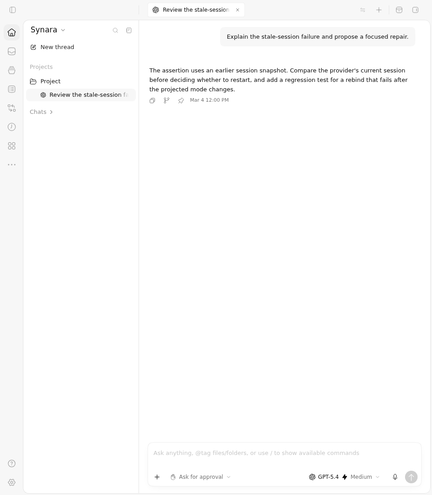
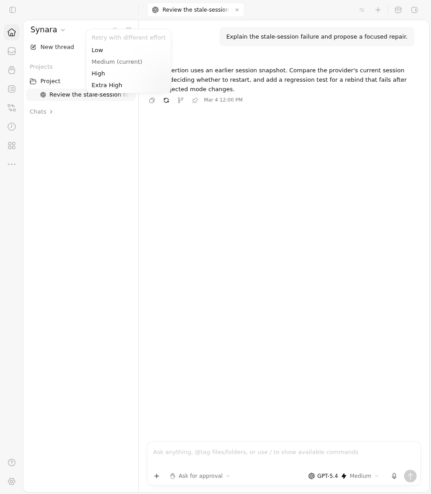
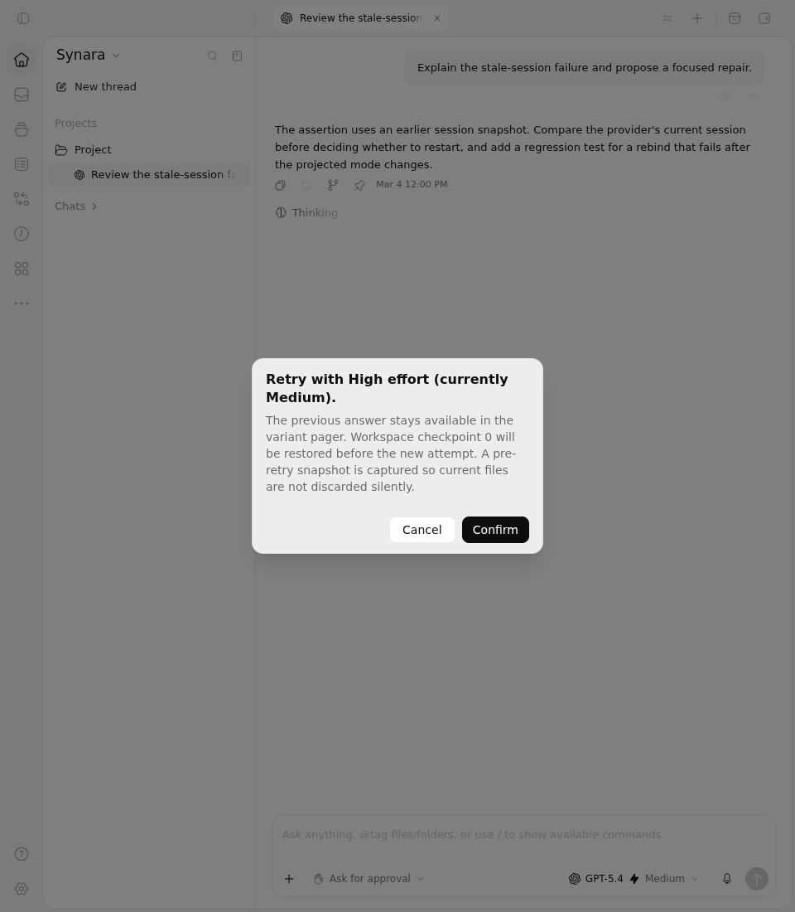
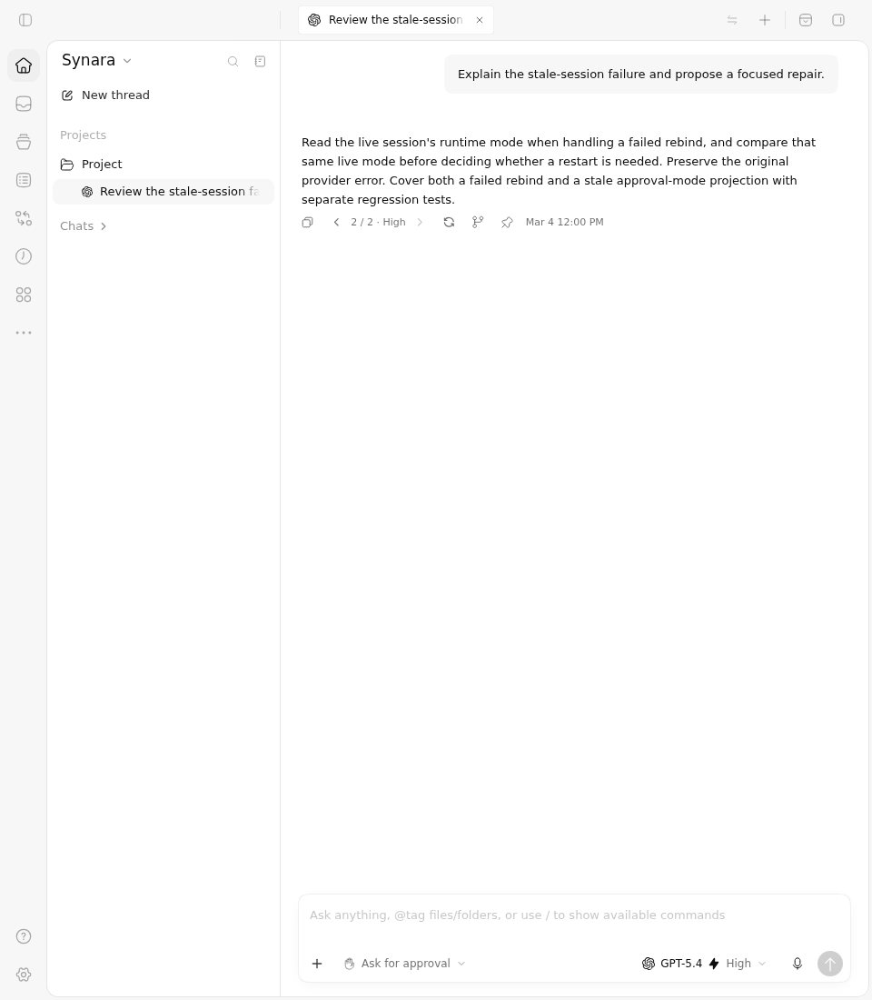

# PR1858 — Before vs After retrying with a different effort

This evidence compares the real ChatView at **Before `9e01962e0b1e8fec9fb0e17f17a64017bc4eaf94`** with the repaired feature at **After `b7fd69812cb169c60a5b9fac17b05b6ff81b5322`**. The paired [hosted run 38187434334](https://github.com/Emanuele-web04/synara/actions/runs/38187434334) used independently reviewed driver `cbc0116fc8ad607fd0f68f0665b2806bf6dcdb80`. The Before interaction passed its one selected case; After passed all five canonical retry cases and the additional recorded interaction. Both actual Vitest exits were zero.

## Before vs After

| Before: settled answer actions | After: effort menu for that answer |
| --- | --- |
|  |  |

The baseline answer has no retry action. The feature adds a retry menu whose **Medium (current)** value comes from the settled turn. Selecting **High** opens the real confirmation dialog. Its text explains the checkpoint and pre-retry snapshot behavior implemented by the server; the browser fixture does not execute those native operations.

| Confirmation | Latest acknowledged attempt | Preserved earlier answer |
| --- | --- | --- |
|  |  |  |

The final [returned latest answer](after/06-returned-latest.png) verifies that paging back to the High attempt restores the latest answer. All nine original PNGs are included. The two baseline phases have identical pixels; both original captures are retained.

## Actual interaction clips and original recordings

- [Before interaction clip](clips/before-interaction.webm), 5.44 seconds: continuous interval starting at 101.00 seconds of the original recording.
- [After interaction clip](clips/after-interaction.webm), 3.52 seconds: continuous interval starting at 72.40 seconds of the original recording; it includes the menu, confirmation, acknowledgement, previous-answer paging and return.
- [Complete Before recording](before/video/page@9ad0386c13f955f4542b6f972ac5d07f.webm), 106.44 seconds.
- [Complete After recording](after/video/page@8dbd6182ca981133a95990d37b9fbe03.webm), 75.92 seconds.

The short clips preserve the original full 960×1100 viewport and speed. They are re-encoded solely to trim continuous intervals; no interaction, overlay, pause or frame hold is synthesized. The full recordings retain browser/test startup and the other selected cases. These are newly generated derivatives with a complete [reproduction script](reproduce-trims.py). Run `python3 reproduce-trims.py --verify` from the package to regenerate both clips and all nine review frames in a temporary directory and compare every byte; the [actual second-run receipt](derivative-reproduction.json) records success with FFmpeg 6.1.1. Exact encoder arguments, source hashes, offsets, actual decoded dimensions and durations are in [clips.json](clips.json). The frames in [frames.json](frames.json) are actual clip frames supplied for independent visual review.

## What was exercised

These captures use the production ChatView, styles, router, menus, confirmation, pager and real browser clicks. The five unchanged canonical After controls verify settled model/instance ownership despite a different composer draft, stale-confirmation refusal, paging and copying a durable previous answer from another client, clearing history after an ordinary edit, and disabling retry when the settled turn has no checkpoint.

The native API acknowledgement is controlled, followed explicitly by a projected server snapshot. This is component and browser evidence; no provider execution, workspace restoration, checkpoint creation, live model output or native process shutdown is claimed. The March timestamps are fixed fixture data, not observed model latency or test runtime. The Before/After pair is not a causal control for every server repair.

## Preserved failures and the focus repair

The first capture [38184609411](https://github.com/Emanuele-web04/synara/actions/runs/38184609411), at After `21fe82fd87581515e975a75325ea6e791536ed23`, failed the first canonical retry case while finding **High** (one failed, five passed). The next, instrumented [38186101796](https://github.com/Emanuele-web04/synara/actions/runs/38186101796), failed while finding **Medium (current)** in that case (one failed, five passed). These are distinct observed failures.

The second run's delegated focus trace records an actual window-focus RAF, the Retry button receiving focus and opening its menu, then that same ChatView RAF focusing the composer and closing the menu. Independent review confirmed this owned-callback race. The repaired head imports the reviewed pending-window-focus fix and its two original first-activation regressions from PR1841, preserving all five retry controls. The successful run retains the same observer, cases and single-click interactions; those two additional activation regressions are exercised by canonical CI separately.

The four original failed-run pair ZIPs, their actual nonzero After results, original complete videos and provenance remain under [history/](history/history.json). No historical failure is reclassified as a pass.

## Integrity and remaining work

The two successful ZIPs were verified against GitHub's artifact size and SHA256 metadata before extraction. Every retained file, driver blob, canonical fixture, append-only overlay reversal and before/after tracked-source guard was checked independently. See [download-receipt.json](download-receipt.json), [independent-verification.json](independent-verification.json), and each side's `provenance.json`, `verified.json`, source guards and immutable output-copy receipts. No private download URL is included.

The original canonical server 3/3 job [114612552287](https://github.com/Emanuele-web04/synara/actions/runs/38187373364/job/114612552287) failed at this same feature head; its log was unavailable through the connector. The separate [retained-log diagnostic 38188706612](https://github.com/Emanuele-web04/synara/actions/runs/38188706612) ran the exact unchanged command against the same source: **3,362 passed, 17 skipped**, with zero cached tasks and an actual process exit and pipe close of zero. Its complete 5,061,356-byte raw log, process receipts and exact 9,035-file source guards are retained in [the original verified artifact ZIP](ci/server3-diagnostic.zip). The [independent verification](ci/independent-verification.json) records the API size/hash and all seven retained file hashes. This separate pass does not establish the original failure’s cause or reclassify that failed canonical job. After that retained diagnostic, the failed-jobs-only second canonical attempt completed successfully at the unchanged head: **all 23 checks and all 18 quality jobs passed**. The [fresh canonical receipt](ci/canonical-attempt2.json) preserves those exact identities. This recheck establishes the current gate; the first failure and its unknown cause remain visible.

PR1858 remains draft for the broader original issue1092 requirements: per-attempt usage/latency, explicit workspace-edit keep/stash/discard/restore choices, keyboard/automation flows, and complete end-to-end historical-model qualification. This package documents the completed repair and observed browser behavior without claiming those unfinished requirements.
