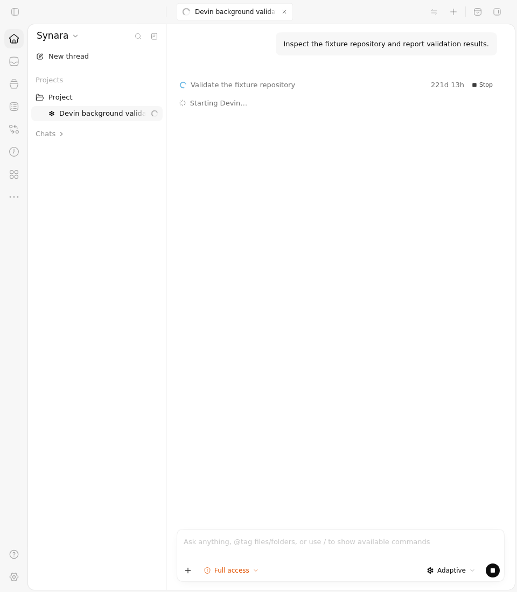
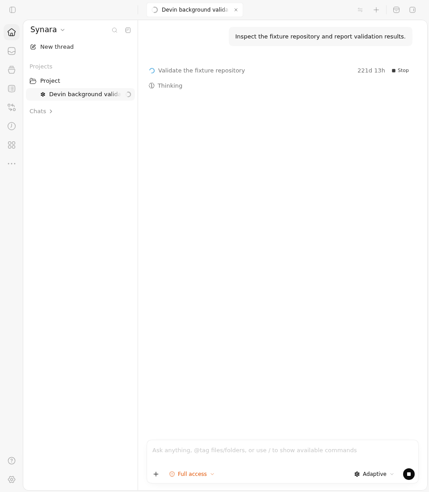
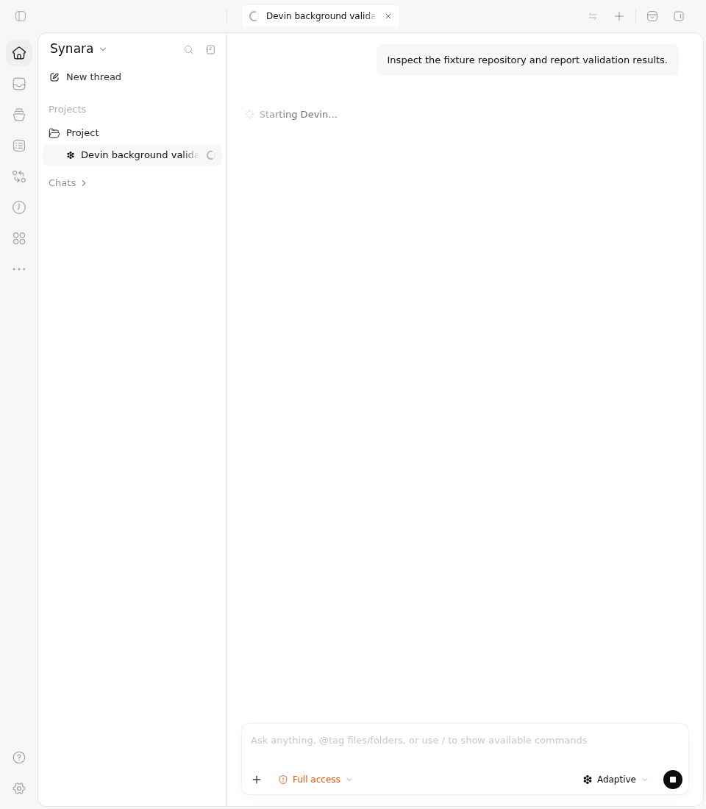
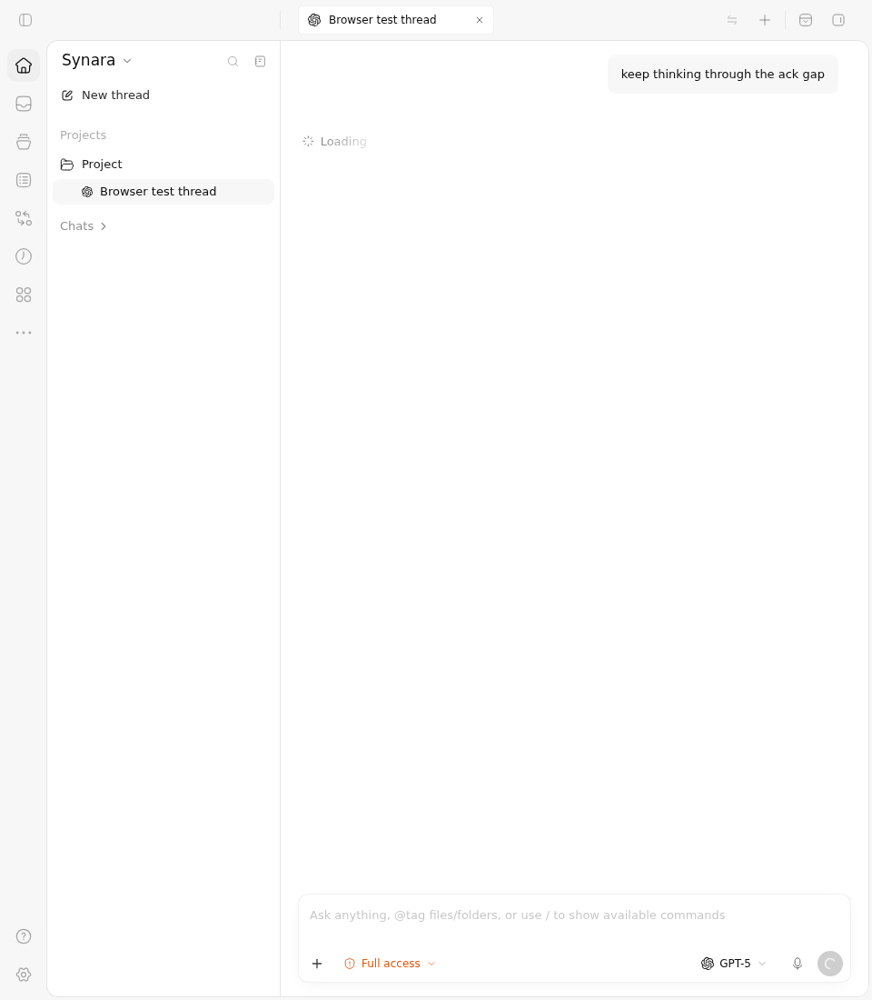
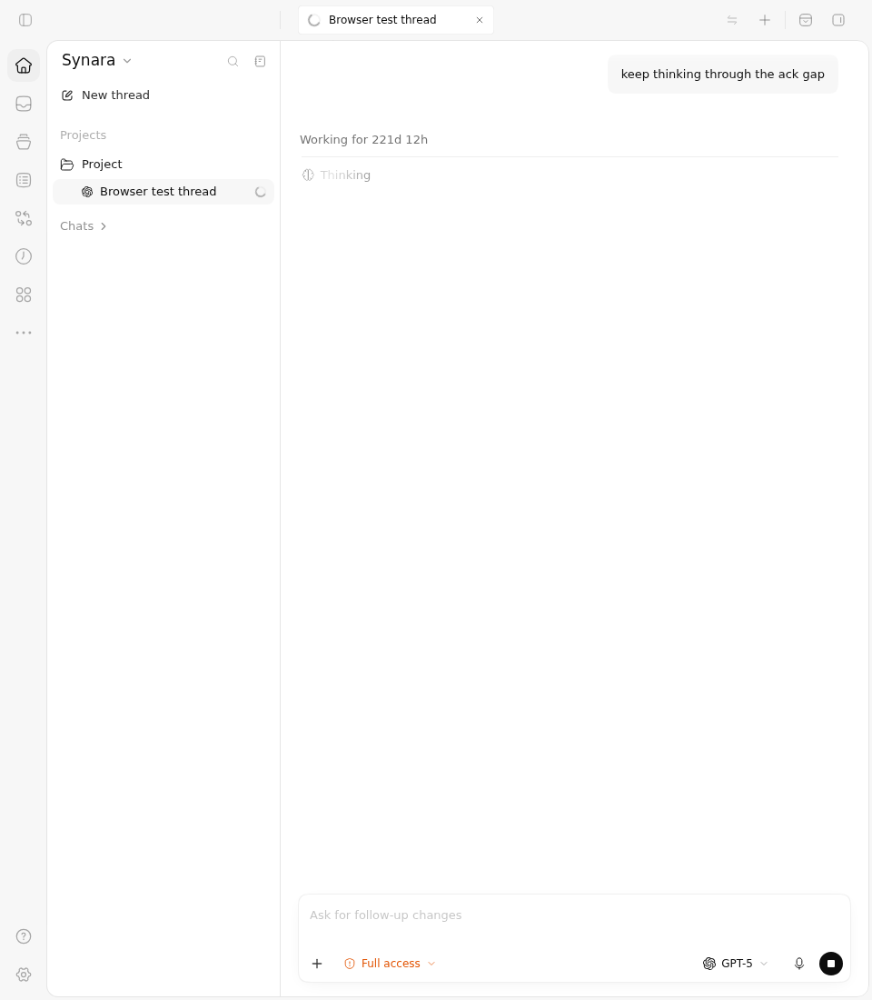
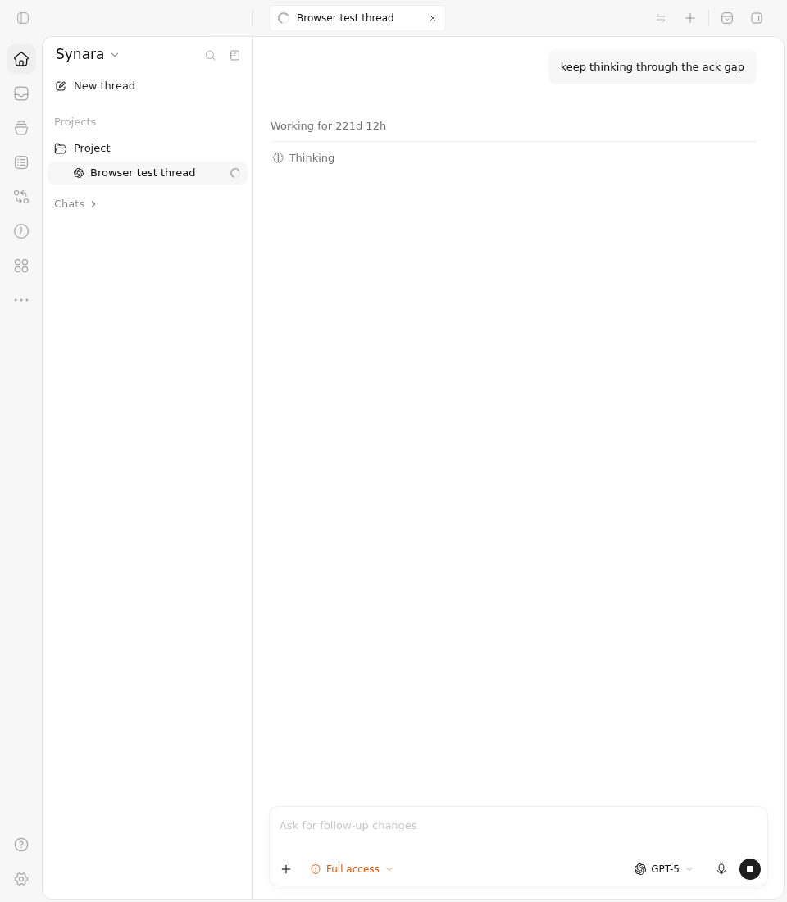
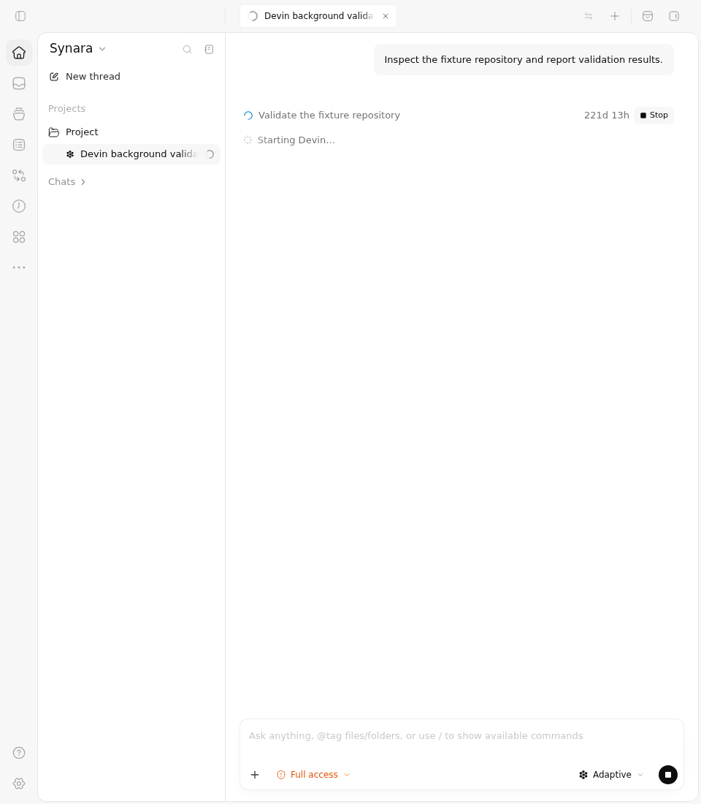
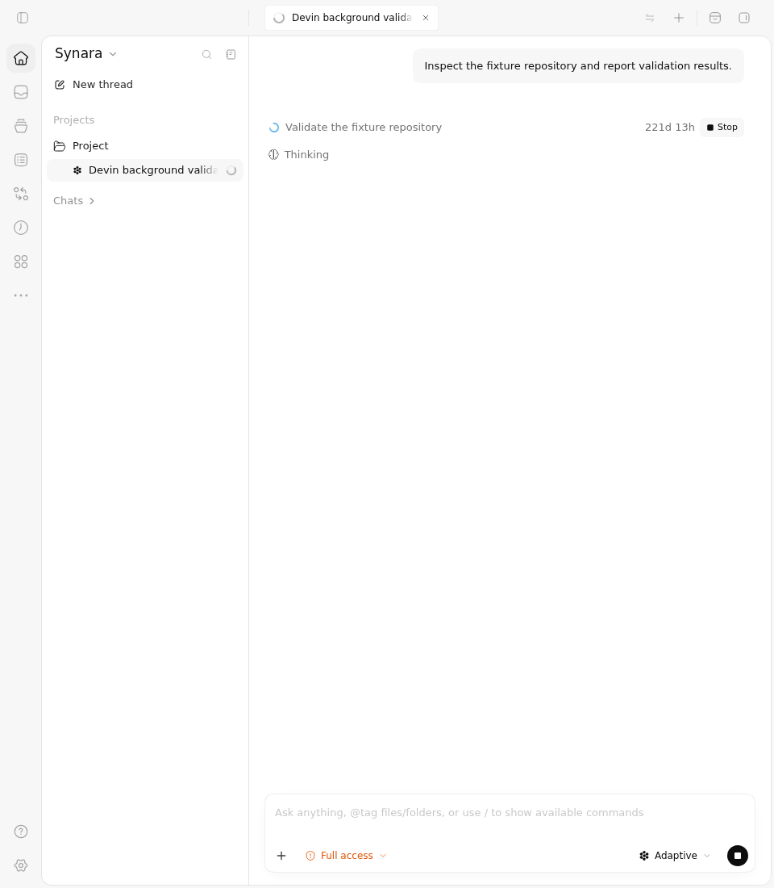

# PR #1859 — Devin activity status, Before Vs After

The same production ChatView now shows **Thinking** when a Devin session already has a running turn and a visible background task. The original source incorrectly continues to show **Starting Devin…** for that input. The startup-only control still shows **Starting Devin…** on both sources, and the existing Loading-to-Thinking send control passes unchanged on both.

This is an actual Chromium capture of the production ChatView, router, CSS and task row with **identical controlled read-model and RPC inputs**. It is not a live Devin run or native desktop capture. The task Stop click proves the exact outgoing command; it does not prove provider cancellation, process cleanup or durable backend completion.

## Exact sources and results

| Boundary | Before | After |
| --- | --- | --- |
| Source commit | [`9e01962e0b1e8fec9fb0e17f17a64017bc4eaf94`](https://github.com/Emanuele-web04/synara/commit/9e01962e0b1e8fec9fb0e17f17a64017bc4eaf94) | [`86caa8ca8c25c06809a20abd058473b41de7b630`](https://github.com/Emanuele-web04/synara/commit/86caa8ca8c25c06809a20abd058473b41de7b630) |
| Complete source tree | `81b2ce105b3362e1266bb15916e0b16633f3843d` | `7757705a5437174d5150c1810aaaaa3d6c4b2885` |
| Selected cases | **2 pass, 1 fail** | **3 pass, 0 fail** |
| Unselected canonical cases | 219 | 219 |
| Actual Vitest / tee exits | **1 / 0** | **0 / 0** |
| Actual hosted job | [Failed job 114623913291](https://github.com/Emanuele-web04/synara/actions/runs/38191112310/job/114623913291) | [Successful job 114623913279](https://github.com/Emanuele-web04/synara/actions/runs/38191112310/job/114623913279) |
| Viewport and appearance | 960 × 1100, observed light theme | 960 × 1100, observed light theme |

Both jobs use independently reviewed driver [`19a5cfdaeab80e8ec2a7d44bfa10c2ac77c199b9`](https://github.com/Emanuele-web04/synara/commit/19a5cfdaeab80e8ec2a7d44bfa10c2ac77c199b9), tree `9c753258efdf0a7efd28ce1d51cfe8ff70141dbf`, in [run 38191112310](https://github.com/Emanuele-web04/synara/actions/runs/38191112310). The Before failure is the strict missing-**Thinking** assertion after the same task-stop gesture. Its failed test, step, verifier and job remain failures in the retained reports. The two controls are actual passing tests, not filtered or expected failures.

## Before Vs After screenshots

### Running turn and background task

| Before — stale Starting Devin… | After — Thinking |
| --- | --- |
|  |  |

### Startup-only control

| Before | After |
| --- | --- |
|  |  |

### Existing send control, before acknowledgement

| Before | After |
| --- | --- |
|  |  |

### Existing send control, after acknowledgement

| Before | After |
| --- | --- |
|  |  |

### Actual task Stop request

| Before | After |
| --- | --- |
|  |  |

On both sources, the real task-row button sends exactly one `thread.task.stop` command for thread `thread-browser-test` and task `pr1859-check-task`. The controlled reply does not project a stopped task, so the row remains running in these images. The source snapshots deliberately use fixed March timestamps: visible durations such as **221d 13h** are fixture age, not test duration or measured model latency.

## Short interaction clips

[Before clip — approximately 5.5 seconds](clips/before.webm) · [After clip — approximately 4.5 seconds](clips/after.webm)

The clips retain the full 960 × 1100 frame and original playback speed. They contain the sequence of **three separate fixture cases**, including their unmount/mount transitions; they do not show one continuous live Devin session. The original recordings include compilation/setup and remain available in full: [Before, 207.8 seconds](before/video/page@34fe129622ad8c3fea3656dd7c26897d.webm) and [After, 78.32 seconds](after/video/page@f68e32c1c0682ebe0e20da2843d185cb.webm).

| Clip | Requested source seek / duration | Measured encoded duration | Stream start / frames |
| --- | --- | --- | --- |
| Before | 113.5 s / 5.5 s | 5.52 s | 0.04 s / 137 frames at 25 fps |
| After | 73.5 s / 4.5 s | 4.52 s | 0.04 s / 112 frames at 25 fps |

[clips.json](clips.json) records the exact source hashes, requested intervals, actual FFmpeg arguments, measured metadata and six registered review-frame hashes. [reproduce-clips.py](reproduce-clips.py) regenerates the two derivatives and all six frames from the untouched recordings; a second actual `--verify` execution reproduced every byte, recorded in [derivative-reproduction.json](derivative-reproduction.json). No crop, overlay, inserted frame or speed change was applied.

## Evidence and scope

The full canonical browser fixture is identical on both sources: blob `db12f5f41a85d2cfc5fb9face0d8edbcd7ad6a57`, 577,781 bytes. The shared diagnostic adds only two read-only capture calls inside the existing Loading-to-Thinking case and appends the identical helper plus two Devin cases. Reversing those additions recovers every canonical byte. The complete observed fixture, assertion bodies, config and append are byte-identical across the two jobs. No production source was edited by the driver.

The source guard checks all **9,025 tracked file bytes and modes** before and after each browser job. [source-trees](source-trees) contains compressed exact leaf manifests whose reconstructed trees and Git listing hashes match the immutable source commits and hosted guards. The seven driver files are retained with their identities in [driver-manifest.json](driver-manifest.json). All subprocess-written media, logs and reports were copied once to separate retained paths before parsing and hashing; the 18 snapshot receipts report no cap, truncation or concurrent change.

Both original ZIPs are retained under [archives](archives), with all **40 original members copied byte for byte**, including all ten PNGs, two complete WebMs, original reports, logs, exits and source proofs. The ZIP sizes and SHA-256 digests match the fresh GitHub artifact metadata in [api/artifacts.json](api/artifacts.json). [original-artifacts.json](original-artifacts.json) records the exact inventories. [verify-packet.py](verify-packet.py) rechecks archives, source trees, full fixture reversals, driver identities, observed labels, exact task-stop command, result counts, failed Before exits, retained snapshots and media hashes. Its actual completed result is [packet-verification.json](packet-verification.json).

This packet qualifies the UI status decision and retained send/task-control behavior. The PR's server recovery, credential fencing, late-event ownership and native Devin integration require their own source review and backend checks; they are not inferred from these screenshots.
