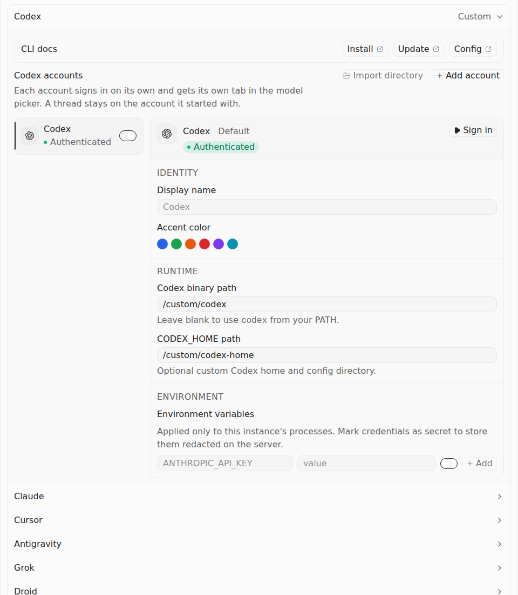
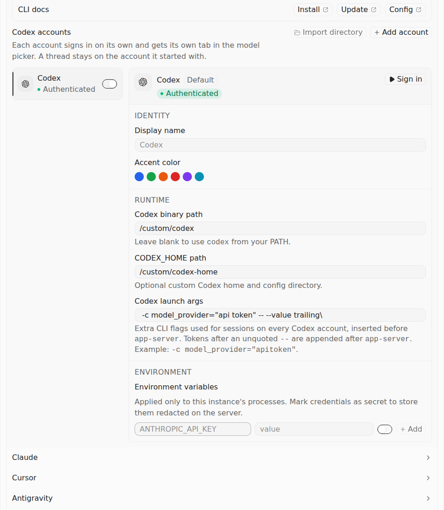

# Before Vs After — Codex launch arguments in #1860

The repaired production settings panel exposes Codex launch arguments. The browser enters a value containing quotes, a separator, a backslash and surrounding spaces, verifies the exact settings callback patch, and confirms that the binary and home paths remain unchanged.

| Source | Immutable application head | Application tree |
| --- | --- | --- |
| Before — current main at capture | `9e01962e0b1e8fec9fb0e17f17a64017bc4eaf94` | `81b2ce105b3362e1266bb15916e0b16633f3843d` |
| After — #1860, continuation of #1080 | `638e419bc952566932bbf7cddf0b129bafc4d434` | `f3534dbf68d6550206470e7614e9d477ccb5e837` |

## Before Vs After screenshots

These are the original, unedited 960×1100 Chromium captures of the actual ProvidersSettingsPanel. The controlled fixture supplies the account status and custom paths.

| Before — field absent | After — entered value retained |
| --- | --- |
|  |  |

[The After panel before entry](after/settings-initial.png) is retained as a separate original screenshot. Both original full recordings are in the respective `video` directories: measured duration 7.92 seconds Before and 7.24 seconds After, VP8 at 960×1100.

## Actual checks

[Run 38186426665](https://github.com/Emanuele-web04/synara/actions/runs/38186426665) completed both jobs successfully. Driver `f0d9f4d19fb7dce9aadfec2b8301f663379e12ef`, tree `439cd20d937ad396deaf71f7dd4a4aa3fc267fb9`, checks out each application head independently and verifies its complete source identity before and after execution.

| Selected canonical case | Before | After |
| --- | --- | --- |
| Raw launch arguments and unchanged account paths | 0 pass / 1 reproduced failure | 1 pass / 0 fail |
| Actual Vitest process exit | 1 | 0 |
| Launch-arguments field | Absent | Present; exact entered value retained |
| Codex binary path | `/custom/codex` | `/custom/codex` |
| CODEX_HOME path | `/custom/codex-home` | `/custom/codex-home` |

The original 20 other canonical settings cases remain in both full fixtures and are filtered out by this narrow comparison; they are not counted as executed passes. The Before process failure is retained, with the exact assertion that the required field is absent. The workflow succeeds only after verifying that expected Before defect and the successful After case.

The exact raw value is stored in `after/verification.json`, including its leading space, quoted `api token`, unquoted `--`, one backslash and trailing space. The canonical assertion compares the whole `updateSettings` callback argument to `{ codexLaunchArgs: launchArgs }`, then verifies both path fields. It is unchanged by the observer overlay.

## Earlier observer failure retained

The first [four-target run 38185895366](https://github.com/Emanuele-web04/synara/actions/runs/38185895366) produced a successful canonical After case and screenshots, but its settings evidence verifier failed. The observer read only `aria-label`; the actual inputs use associated native labels, so its recorded label strings were empty. The second driver also reads those associated labels. Application code, the canonical case, all verifier predicates and the stable-file safeguards were unchanged.

Both original settings ZIPs from that first run, the failed After job log and its raw verifier report remain under [original-artifacts](original-artifacts/) and [first-run](first-run/). The first failure is not counted as a successful evidence run. The two completed image-provenance jobs in that earlier run are documented separately in #1857.

## Verification and scope

The two current ZIP archives and all 31 members are retained byte-for-byte, including three PNGs, two original WebMs, full canonical and observed fixtures, raw reports and process exits, source/driver manifests, all 118 command receipts and immutable snapshot cutoffs. Root verification matched all 20 source-file pins and 22 driver-file pins, reconstructed both reversible observer overlays, checked the raw value and unchanged paths, and inspected all three original PNGs.

This evidence exercises the actual production settings component under its canonical controlled native/status fixture. It proves the displayed field and exact callback patch; it does not claim a live account, durable settings reload, actual Codex launch or packaged desktop. Parser and process argument tests, current-head canonical CI and the original author history are recorded in the PR.

See [current remote job/artifact metadata](remote-evidence.json), [root verification](settings-pair-root-review.json), [archive/member digests](download-receipt.json), [video probes](settings-video-probes.json), and [first-run metadata](first-run/remote-evidence.json). Future source heads require separate qualification.
