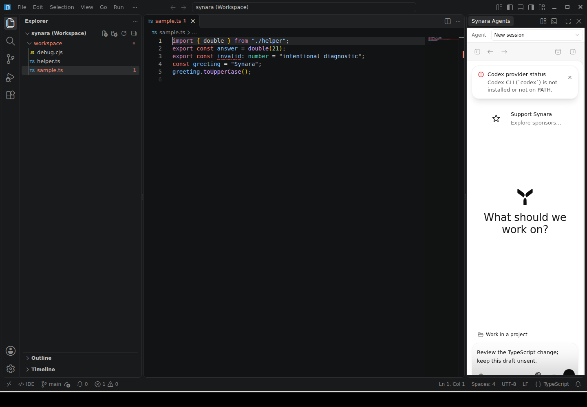
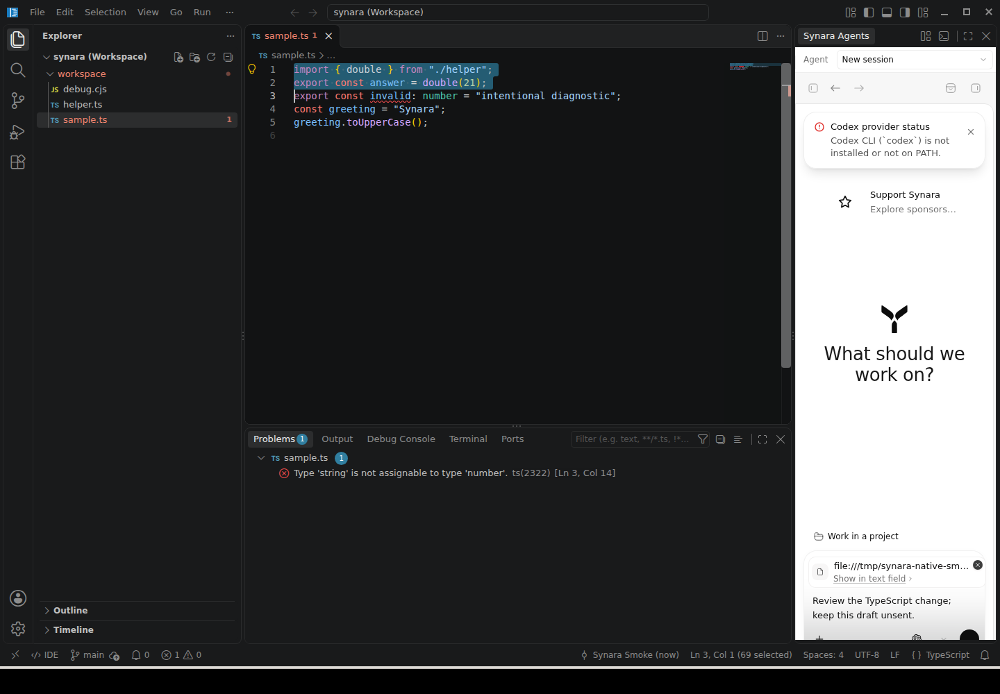
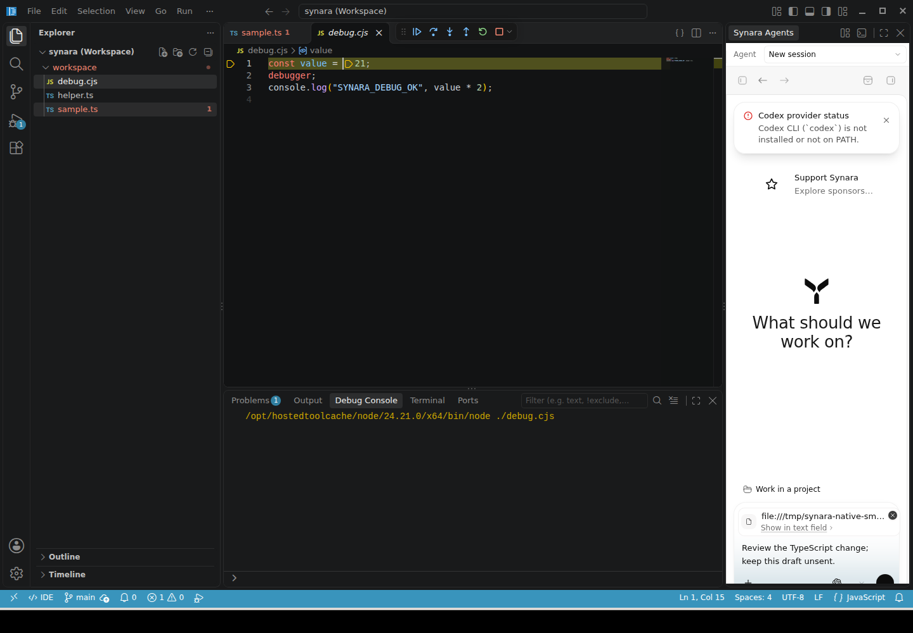
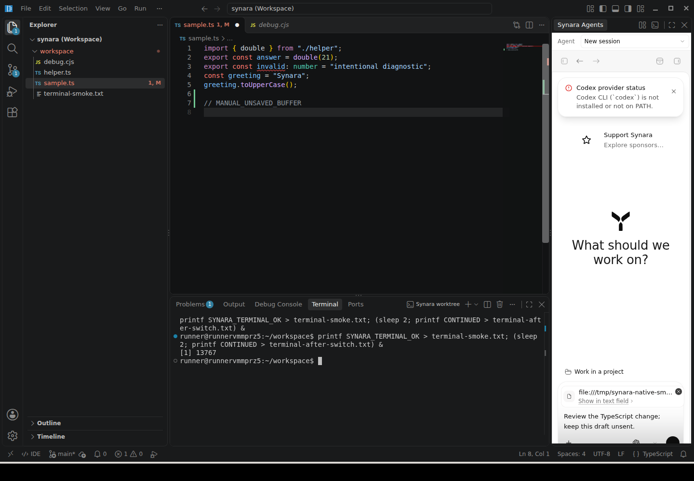
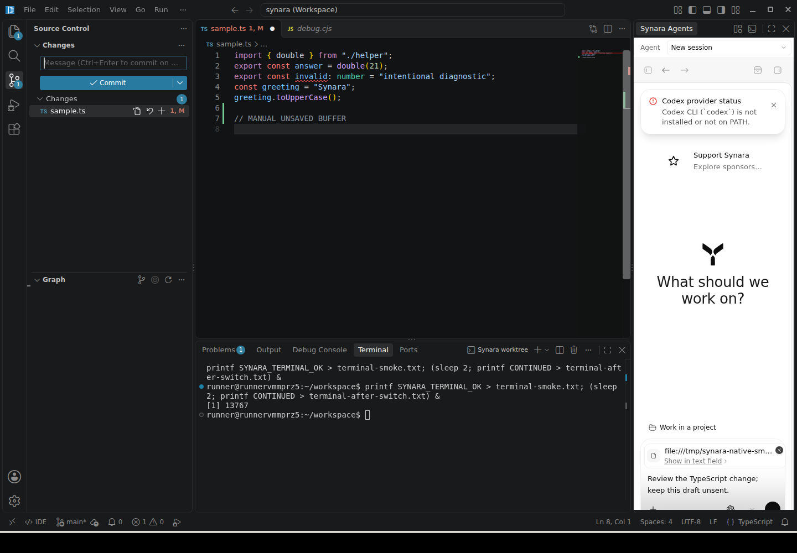
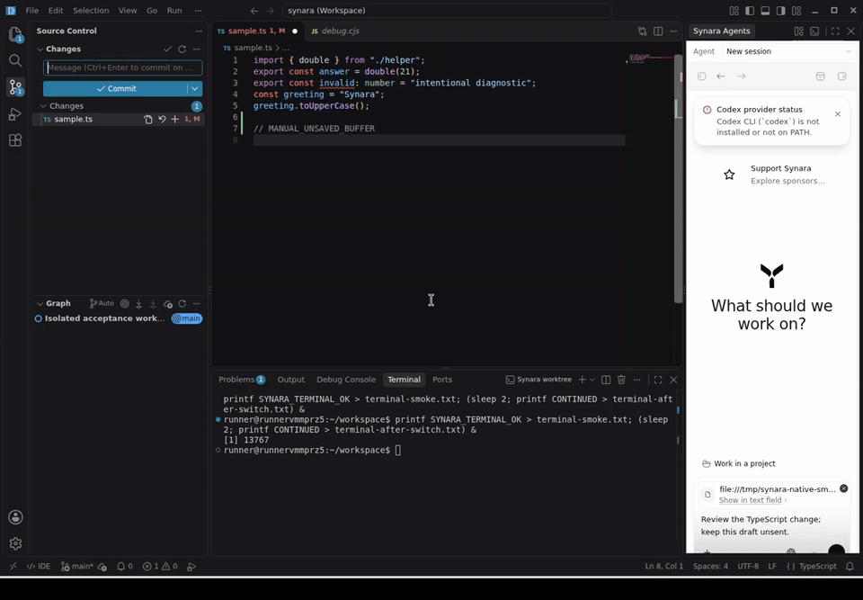

# Native Code-OSS in Synara

Synara keeps its existing Electron application, channel identity, profile, backend and database. Agent Mode remains the full existing React application. IDE Mode uses the native Microsoft Code-OSS desktop workbench, not Monaco alone, an iframe or an external IDE.

The native workbench owns the window and editor services. A retained sibling `WebContentsView` presents Agent Mode full-window or docks the same renderer in the workbench's Synara Agents pane. Mode switches resize and refocus views rather than recreating the renderer or orchestration client. The workbench owns its editors, language services, native extension hosts, debugging and terminals. Synara continues to own providers, approvals, conversations, browser automation and agent processes.

## Usage

Use the visible Agent / IDE control or `Ctrl/Cmd+Alt+G`. Configure `Synara: Switch Agent / IDE Mode` in the native Keyboard Shortcuts editor. Simple accelerators also work while the Synara composer is focused; multi-key chords are not mirrored there. The default avoids Code-OSS's `Ctrl/Cmd+G` navigation binding.

Select an existing Synara session in the docked picker. Project and worktree roots are added to the native multi-root workspace without removing older roots, unloading dirty editors or changing Git branches. Workspace Trust remains enabled. Removing accumulated roots is an explicit workbench operation.

The Command Palette includes Synara commands for attaching selected code, file diagnostics, terminal selection and the current debug stack to the existing conversation draft. They append context, never automatically submit an agent turn. Stale session generations are rejected. Native worktree terminal and Explorer commands use the selected session's root.

## Build and packaging

Use the repository's existing toolchain and an isolated `microsoft/vscode` source checkout at the exact commit in `apps/desktop/code-oss/upstream.json`. Use the same OS and architecture as the target runtime, and the upstream checkout's Node version for its build.

```sh
node apps/desktop/code-oss/scripts/prepare.mjs .code-oss/source production
node apps/desktop/code-oss/scripts/build.mjs .code-oss/source .code-oss/runtime
bun run build:desktop
```

The preparation overlay checks upstream source hashes and unique patch anchors. Use a pristine pinned checkout for another preparation and a fresh output directory for another build. The flavor must match the Synara build; `production` is Stable, not a new release channel. `.github/actions/setup-code-oss` performs this build for the existing release workflow. Native resources are staged inside the existing installer and validated against the pinned commit, Electron ABI, architecture, platform and flavor.

Both production browser resource roots retain the syntax WebAssembly assets required by upstream renderer and worker code. Privileged URL schemes are registered together before Electron readiness. Native modal editors temporarily hide the docked Agent view without destroying its state.

## Extensions and acceptance

The native gallery uses Open VSX. Compatibility depends on the extension's license, supported runtime and dependencies; Microsoft Marketplace-only or proprietary extensions are not universally supported. Upstream chat product metadata required by native account services is retained, but native AI features are disabled and no Copilot installation or license is implied.

The Linux acceptance harness runs the actual application in a disposable profile and uses a test-only local extension to inspect real TypeScript, debugger and Git services. It never installs that probe into production or starts authenticated provider turns. Run under Xvfb with `scrot` and `ffmpeg` installed:

```sh
xvfb-run -a -s '-screen 0 1440x1000x24' node apps/desktop/code-oss/scripts/smoke.mjs
```

[PR #1920](https://github.com/Emanuele-web04/synara/pull/1920) records current checks and release blockers. Signed macOS/Windows builds, updater installation, existing-user migration, dirty-quit cancellation and authenticated live-agent continuity require separate acceptance; a successful source build or isolated Linux test does not establish those results.

## Real application captures

These captures come from the original and integrated applications, not mockups. [Run 38543125228](https://github.com/Emanuele-web04/synara/actions/runs/38543125228) passed the native build, upstream client typecheck and the real Linux acceptance harness: source editing, TypeScript diagnostics/completion/definition, selected-code draft context, debugging and extension-host continuity, dirty buffers, modal stacking, terminal execution across mode switches, and Git. The same run captured the mode-switch recording. This is isolated Linux acceptance, not signed cross-platform release or authenticated provider acceptance.

[Before: original Agent Mode](images/code-oss/before-agent-mode.png)












