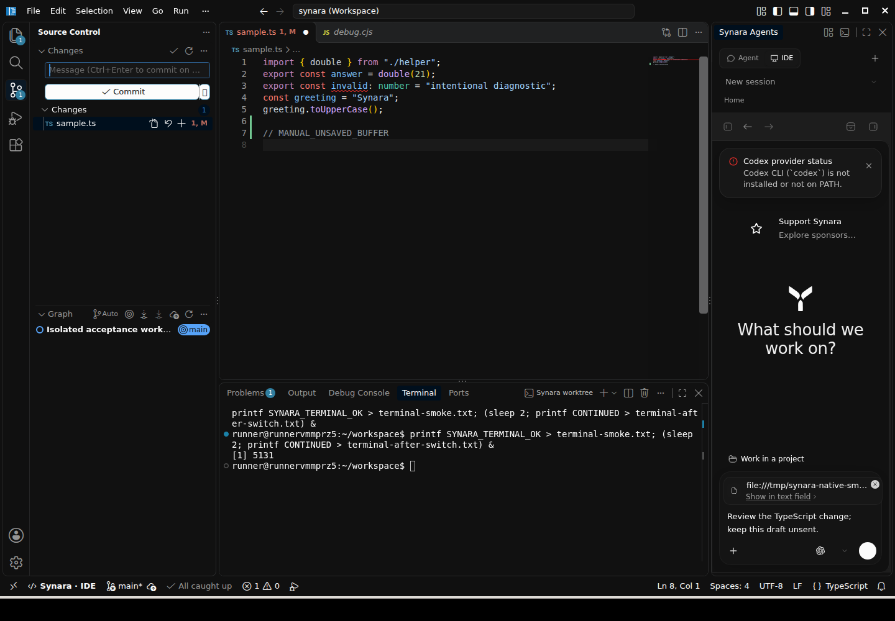
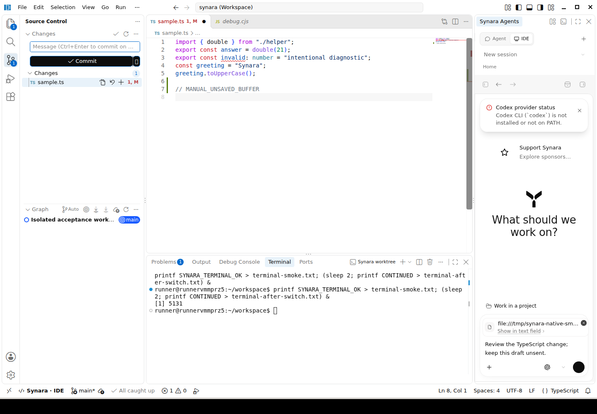
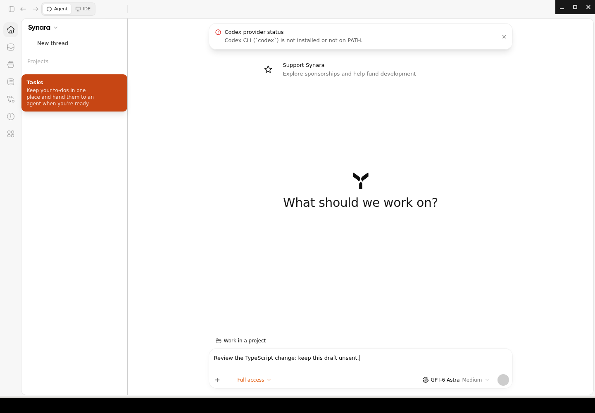
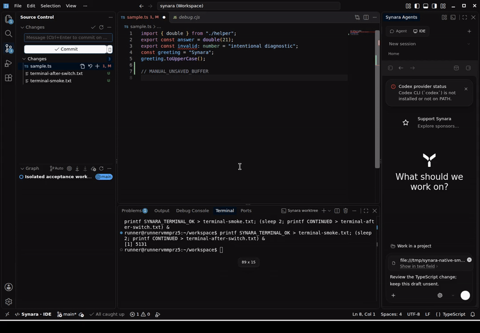

# Native Code-OSS in Synara

Synara keeps its existing Electron application, channel identity, profile, backend and database. Agent Mode remains the full existing React application. IDE Mode uses the native Microsoft Code-OSS desktop workbench, not Monaco alone, an iframe or an external IDE.

The native workbench owns the window and editor services. A retained sibling `WebContentsView` presents Agent Mode full-window or docks the same renderer in the workbench's Synara Agents pane. Mode switches resize and refocus views rather than recreating the renderer or orchestration client. The workbench owns its editors, language services, native extension hosts, debugging and terminals. Synara continues to own providers, approvals, conversations, browser automation and agent processes.

## Usage

Use the visible Agent / IDE control or `Ctrl/Cmd+Alt+G`. Configure `Synara: Switch Agent / IDE Mode` in the native Keyboard Shortcuts editor. Simple accelerators also work while the Synara composer is focused; multi-key chords are not mirrored there. The default avoids Code-OSS's `Ctrl/Cmd+G` navigation binding.

Select an existing Synara session in the docked picker. Project and worktree roots are added to the native multi-root workspace without removing older roots, unloading dirty editors or changing Git branches. Workspace Trust remains enabled. Removing accumulated roots is an explicit workbench operation.

The Command Palette includes Synara commands for attaching selected code, file diagnostics, terminal selection and the current debug stack to the existing conversation draft. They append context, never automatically submit an agent turn. Stale session generations are rejected. Native worktree terminal and Explorer commands use the selected session's root.

## Shared Synara appearance

The native IDE follows the active Synara light/dark theme, imported palette, UI font family, text size and control radius. Changes propagate live from the existing theme settings. Neutral chrome, tabs, lists, menus, inputs, the command palette and status bar use the same semantic surfaces, borders and accents as the Agent renderer.

The Agent / IDE switch is a compact segmented control with explicit selected and keyboard-focus states. The docked Agent header reuses Synara buttons and its session picker, displays readable session/project names, and opens a new session through the existing new-chat flow. The native status bar separates mode identity from agent attention. Compact controls reuse Synara's inline-SVG icons. The docked chat uses the space remaining below its header rather than full-window height, keeping the composer and toolbar visible after resizing.

Appearance changes are window-local Code-OSS color overlays, not writes to user or workspace settings. Native syntax-token colors, editor/terminal font settings, split geometry and layouts remain under Code-OSS control. Native high-contrast themes opt out of cosmetic colors and CSS. UI fonts must be installed on the operating system; the bridge does not fetch font URLs or grant the workbench access to arbitrary resources. macOS vibrancy and platform window materials still need platform-specific visual qualification.

The bridge accepts only bounded semantic colors, font-family text and numeric sizes. It does not accept arbitrary stylesheets. A frame-batched observer watches only theme-related root attributes, never the conversation subtree, and unchanged palettes are not retransmitted.

### Appearance acceptance and captures

[Run 38554432762](https://github.com/Emanuele-web04/synara/actions/runs/38554432762) passed formatting, lint, root typecheck, focused appearance-contract and UI-policy tests, the native production build, upstream client typecheck, and integrated desktop build. [Run 38555271552](https://github.com/Emanuele-web04/synara/actions/runs/38555271552) additionally checked the session-creation control and rebuilt the Synara application. The composer-height repair and resize acceptance passed in [run 38558941346](https://github.com/Emanuele-web04/synara/actions/runs/38558941346).

The final application job in [run 38559948020](https://github.com/Emanuele-web04/synara/actions/runs/38559948020/job/115838256748) passed the final control lint/typecheck, integrated build, all 19 runtime checks and recording. It reused the checked native resources and rebuilt the final Synara application. Checks cover native IDE services, live dark/light and custom-palette/font synchronization, visible inline control icons, settled status-bar colors, malformed appearance rejection, unchanged native settings and draft, the complete composer within its pane at both window sizes, and creating a fresh session without reloading the Agent renderer or leaving IDE Mode.

The run's subsequent source-blob export job encountered a GitHub HTTP 500 after storing the captures; this was not an application or test failure. The complete artifact was downloaded, SHA-256 verified and visually inspected, and the remaining checked source blobs were stored through the GitHub connector. The overall workflow is not claimed green. [Final evidence artifact](https://github.com/Emanuele-web04/synara/actions/runs/38559948020/artifacts/11891034236).

The disposable profile had no authenticated provider turn running. High-contrast handling and platform-specific window materials are not claimed as separately runtime-qualified by these checks. The Before image below is the preceding real integrated IDE capture. The After images and recording are from the final application job; older integration evidence remains available below.










Run the appearance and session-control acceptance with:

```sh
xvfb-run -a -s '-screen 0 1440x1000x24' node apps/desktop/code-oss/scripts/smoke.mjs --appearance
```

## Build and packaging

Use the repository's existing toolchain and an isolated `microsoft/vscode` source checkout at the exact commit in `apps/desktop/code-oss/upstream.json`. Use the same OS and architecture as the target runtime, and the upstream checkout's Node version for its build.

```sh
node apps/desktop/code-oss/scripts/prepare.mjs .code-oss/source production
node apps/desktop/code-oss/scripts/build.mjs .code-oss/source .code-oss/runtime
bun run build:desktop
```

The preparation overlay checks upstream source hashes and unique patch anchors. Use a pristine pinned checkout for another preparation and a fresh output directory for another build. The flavor must match the Synara build; `production` is Stable, not a new release channel. `.github/actions/setup-code-oss` performs this build for the existing release workflow. Native resources are staged inside the existing installer and validated against the pinned commit, Electron ABI, architecture, platform and flavor.

Both production browser resource roots retain the syntax WebAssembly assets required by upstream renderer and worker code. Privileged URL schemes are registered together before Electron readiness. Native modal editors temporarily hide the docked Agent view without destroying its state.

## Extensions and acceptance

The native gallery uses Open VSX. Compatibility depends on the extension's license, supported runtime and dependencies; Microsoft Marketplace-only or proprietary extensions are not universally supported. Upstream chat product metadata required by native account services is retained, but native AI features are disabled and no Copilot installation or license is implied.

The Linux acceptance harness runs the actual application in a disposable profile and uses a test-only local extension to inspect real TypeScript, debugger and Git services. It never installs that probe into production or starts authenticated provider turns. Run under Xvfb with `scrot` and `ffmpeg` installed:

```sh
xvfb-run -a -s '-screen 0 1440x1000x24' node apps/desktop/code-oss/scripts/smoke.mjs
```

[PR #1920](https://github.com/Emanuele-web04/synara/pull/1920) records current checks and release blockers. Signed macOS/Windows builds, updater installation, existing-user migration and authenticated live-agent continuity require separate acceptance; a successful source build or isolated Linux test does not establish those results.

Native dirty-save cancellation also passed in [run 38545799680](https://github.com/Emanuele-web04/synara/actions/runs/38545799680). After approving Synara's existing quit confirmation, an automated native-dialog responder selected Cancel. The real production lifecycle retained the dirty buffer, unsent Agent draft, extension-host process and usable single window; the fixture file was not saved. Only the dialog response was substituted in this disposable-profile check.

## Real application captures

These captures come from the original and integrated applications, not mockups. [Run 38543125228](https://github.com/Emanuele-web04/synara/actions/runs/38543125228) passed the native build, upstream client typecheck and the real Linux acceptance harness: source editing, TypeScript diagnostics/completion/definition, selected-code draft context, debugging and extension-host continuity, dirty buffers, modal stacking, terminal execution across mode switches, and Git. The same run captured the mode-switch recording. This is isolated Linux acceptance, not signed cross-platform release or authenticated provider acceptance.

[Before: original Agent Mode](images/code-oss/before-agent-mode.png)


