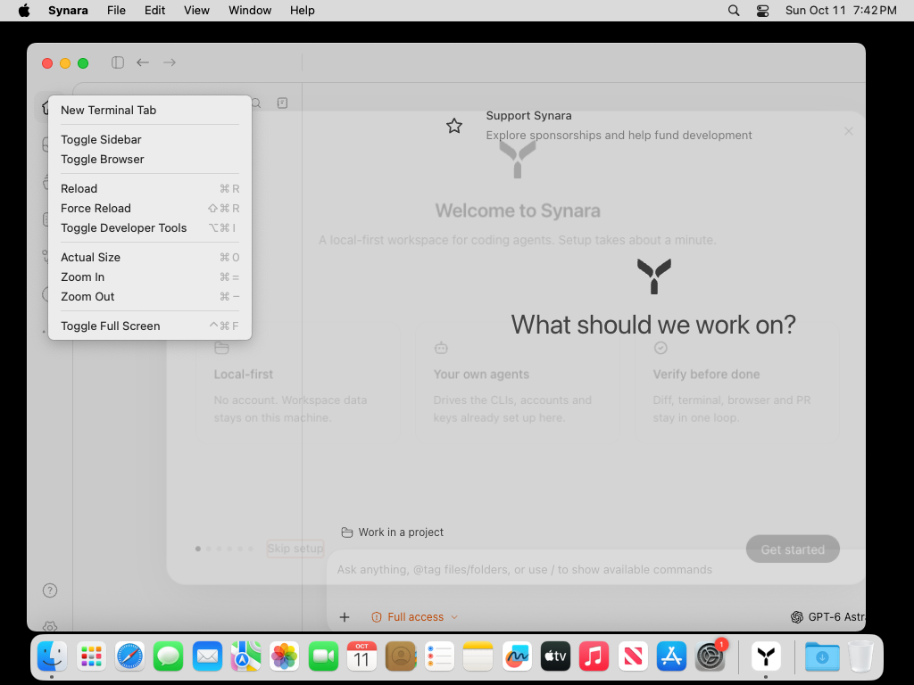
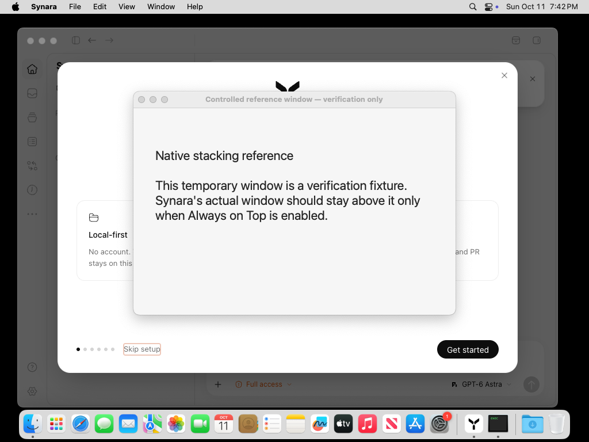
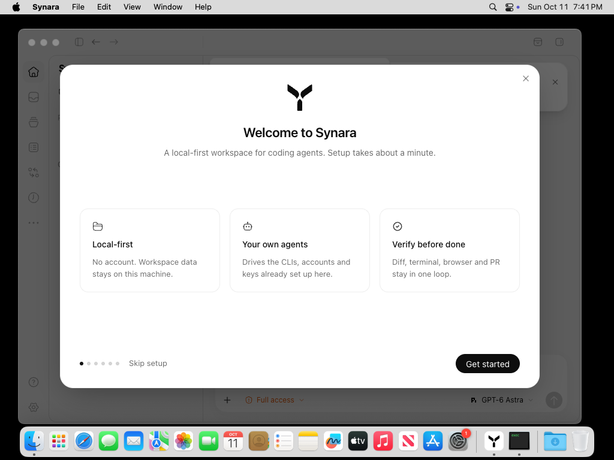
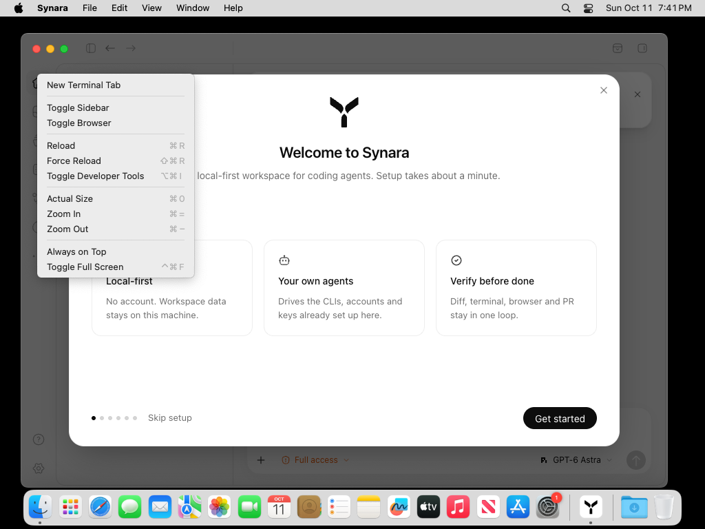
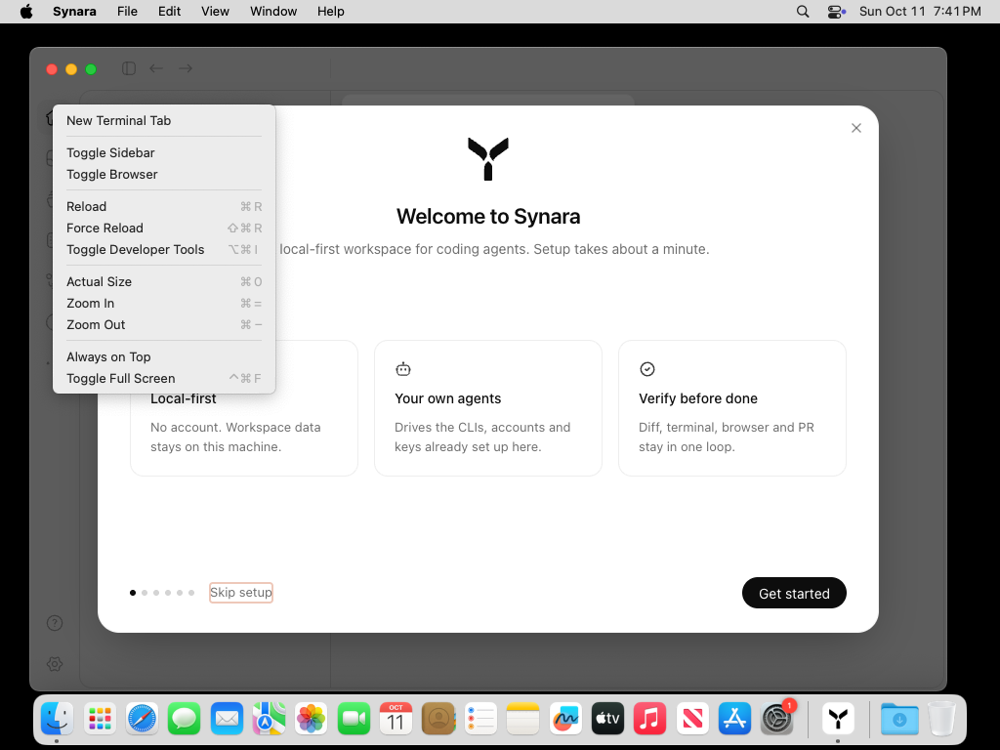
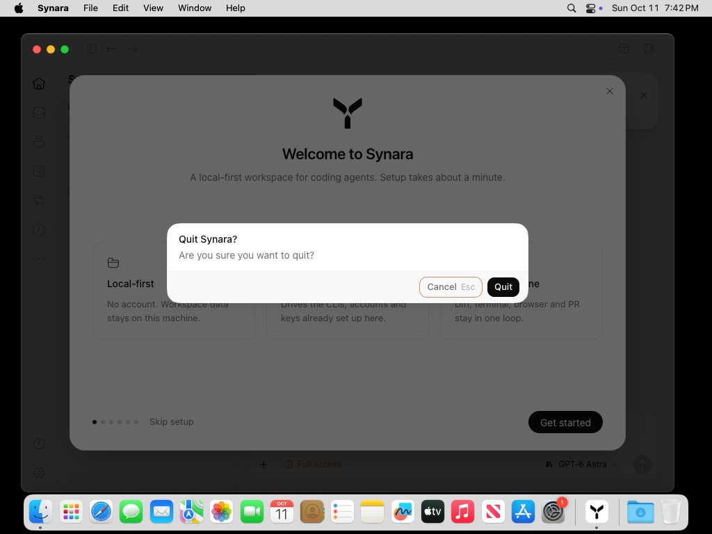
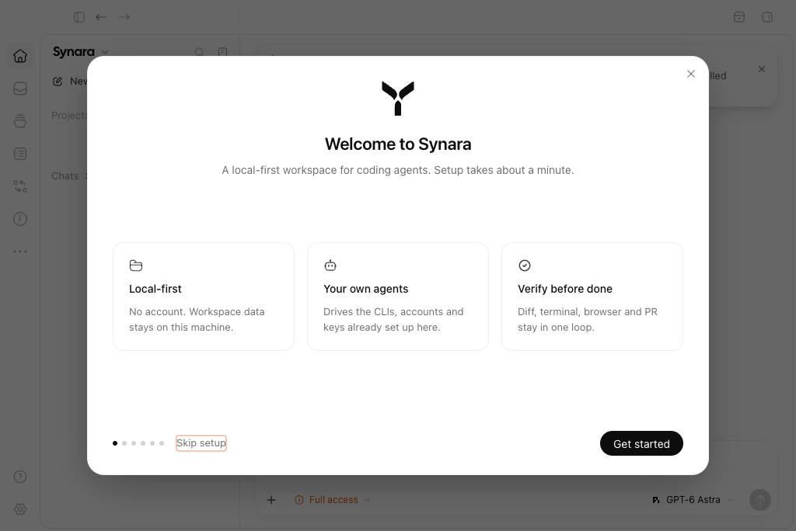
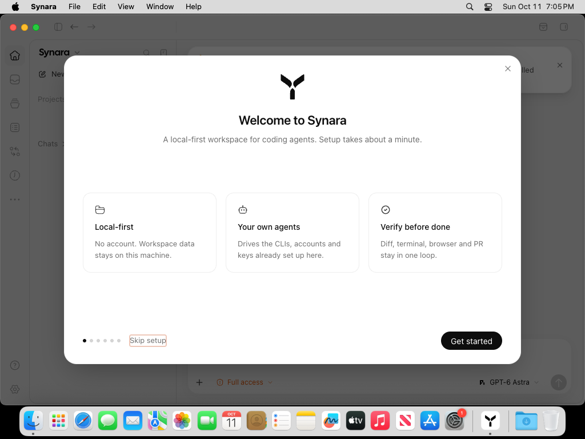

# Always on Top: actual native Before Vs After

This evidence supports [#1831](https://github.com/Emanuele-web04/synara/pull/1831), the author-preserving continuation of [#1504](https://github.com/Emanuele-web04/synara/pull/1504). The original proposal adds **View → Always on Top** and documents the option. The repaired feature also keeps the checkbox synchronized with native changes, disables it when no window exists, and resets it for a new window. The option remains off by default and is not persisted.

## Exact sources and observed result

| Item | Before | After |
| --- | --- | --- |
| Application source | `ec8c940e07582454a475250ade40147e3c89d59f` | `ac0e7f65b6860dbc4e7c308acbc01a886238f559` |
| Source tree | `26c3b060469f224dce8135d8046697eb43fe0794` | `57aefecc130961e170bc46ebfbafef8b6fd880eb` |
| Native menu | No Always on Top item | Enabled checkbox, initially unchecked |
| Window ordering | Normal app stays below the foreground reference window | Enabling the actual production handler raises the app above the foreground reference window; disabling restores normal ordering |
| Normal quit | Actual visible Quit confirmation clicked; exit `0`, no signal | Actual visible Quit confirmation clicked; exit `0`, no signal |
| Hosted native job | [114554480930](https://github.com/Emanuele-web04/synara/actions/runs/38167803772/job/114554480930): success | [114554480893](https://github.com/Emanuele-web04/synara/actions/runs/38167803772/job/114554480893): success |
| Original artifact | `11713601074`, 559,842 bytes | `11714070072`, 982,786 bytes |
| Artifact SHA-256 | `cf6a2a9f35f910053dcc6c7a17eff1ac66967e4a2d363f403cf745ce683532c7` | `bff351487f8818ba1e4a454727223746b9508a2403d249c05eac6b3e4f370b29` |

Both jobs ran the same independently reviewed diagnostic `296c27adfdc6fb74f869adae4d471e5b8d95415c` in [run38167803772](https://github.com/Emanuele-web04/synara/actions/runs/38167803772). They built actual unsigned production-flavor macOS arm64 packages with the explicit diagnostic version `1.0.2-beta.1`; that label does not identify a published release or a Beta-flavor installation. The packaged source, lockfile, native/core payload and source-built icon were checked, and the unchanged canonical packaged import/startup checks passed before native interaction.

The repaired head retains original author `b83d2aff8a5bc8d1cabec5523f07379d2e89325b` as first parent, then the contemporary main `ec8c940…` and reviewed shared retry-fixture donor `5e34d553…`. A normal fork update was actually denied; the original PR and author branch remain intact. The shared fixture is already present in later main and is not part of the Always on Top feature scope.

## Before Vs After screenshots

These are original captured PNGs, without cropping, editing or synthetic imagery. The native View submenu is opened through Electron's actual `Menu.popup`; the observer invokes the actual production `MenuItem.click` callback. This establishes the production callback and OS result, but does not claim a physical mouse click on the native menu.

| Before: native View menu | After: native option enabled |
| --- | --- |
|  |  |

| Before: normal ordering | After: Always on Top enabled |
| --- | --- |
|  |  |

The smaller window is labelled **Controlled reference window — verification only**. Actual CoreGraphics ordering puts the Before app at index7/layer0 below the reference at index6. In the After enabled case the app is index6/layer3 above the foreground reference at index7. The off-state After capture returns to index7/layer0 below the foreground reference. Index values are observations of these displays, not a universal ordering contract.

| After: off by default | After: recreated window starts off |
| --- | --- |
|  |  |

The full state receipts also verify a native change outside the menu updates its checkbox, controlled destruction leaves zero windows and a disabled unchecked item, and app activation creates a new window with the option off. The recreation control uses actual `BrowserWindow.destroy` and an `activate` event; it is explicitly separate from normal close-confirmation interaction. See [After native results](after/native-results.json), [state summary](native-final-receipt.json), and the [off-state ordering image](after/after-stacking-off.png).

| Before: normal Quit confirmation | After: normal Quit confirmation |
| --- | --- |
|  |  |

Both normal exits were observed as code0/signalnull after clicking the real visible renderer **Quit** button. Cleanup separately targets only the exact owned bundle URL. Remaining descendant teardown is runner-owned and unproven.

The Before menu image catches an opening Welcome animation in the background; the menu itself is visible. That timing differs from the settled After background and is not presented as an additional product change. Desktop preflight images are retained as observations of available screen capture, not screenshots of the feature.

## Source compatibility and limits

[source-compatibility.json](source-compatibility.json) records all **237 files under `apps/desktop/src`** with identical bytes in the captured Before source and current main `110cc88e3ca24f54748d49fd7f20d4c434ee12a0`. This supports the unchanged desktop code context. Dependencies, release/packaging helpers and other app inputs changed after the capture source; these native results retain their actual `ec8c940…`/`ac0e7f…` labels. A newer main package was not built by this run.

The captures use actual macOS15 display/window APIs and the actual packaged renderer in a fresh owned profile, without source/menu/reply mocks or TCC/accessibility changes. They do not establish Windows or Linux runtime behavior, Wayland support, live provider sessions, signing, notarization or release installation. The feature's documentation retains the Electron Wayland limitation.

## Retained earlier failure

[Run38165415846](https://github.com/Emanuele-web04/synara/actions/runs/38165415846) retained a real After readiness timeout with driver `76721af9214756296f7e178e22a11f4d0a5d05da`. Its independently captured native window showed Welcome/Get started while the automation's first selected target was empty. The final driver selects the live renderer by the owned BrowserWindow URL and channel; no feature source or acceptance assertion was weakened.

| Prior actual native window | Prior rendered display |
| --- | --- |
|  |  |

The [original capture failure](prior-failed-after-76721/original-capture-failure.json), [capture observation](prior-failed-after-76721/capture-failure.json), [verification failure](prior-failed-after-76721/verify-failure.json), [quit failure](prior-failed-after-76721/normal-quit-failure.json) and original native/provenance receipts are preserved. Earlier failed driver attempts remain visible in the PR history; the successful run does not relabel them as passing.

## Integrity

All **86 files declared by the two successful original qualification manifests** were downloaded and independently checked for byte count and SHA-256. The two original qualification files themselves retain `visualReviewPending:true` as emitted by the driver; subsequent visual assessment is recorded here separately. All11 final PNGs and the two retained failure PNGs were visually inspected. Each raw file keeps its original content.

[artifact-downloads.json](artifact-downloads.json) records all three original ZIP digests. [copy-origins.json](copy-origins.json) maps every copied file to its extracted source. [files.json](files.json) records every other file in this evidence directory, including original receipts and derived documentation. The package binaries themselves were qualified on the hosted runner; this evidence bundle contains receipts and screenshots rather than the unsigned app payload.
