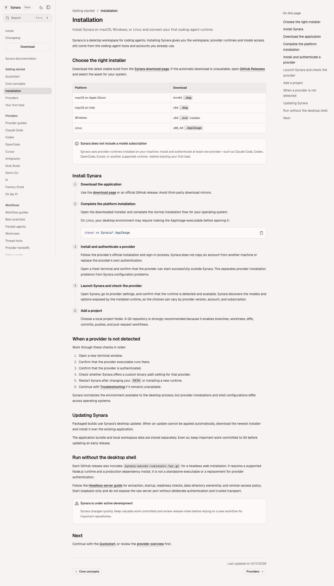
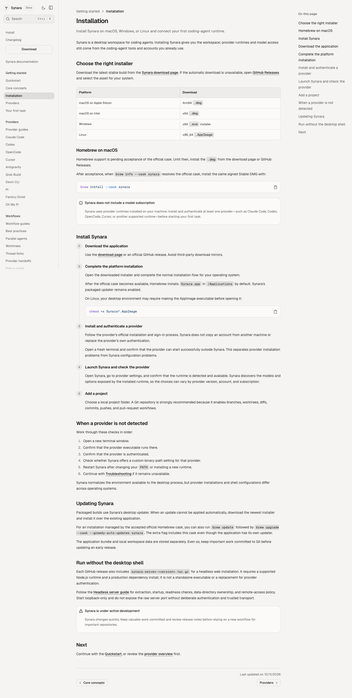
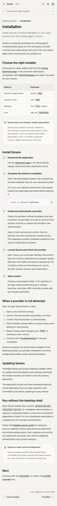
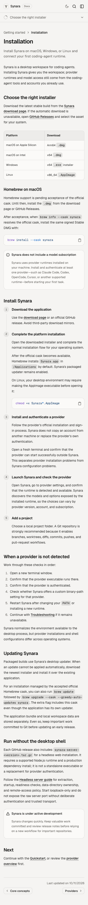
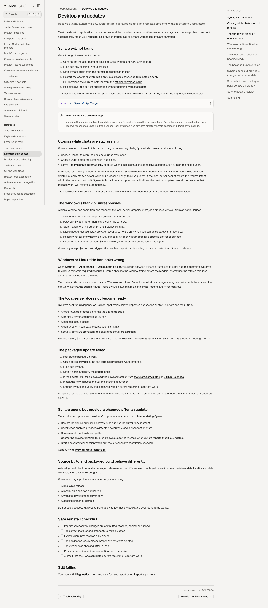
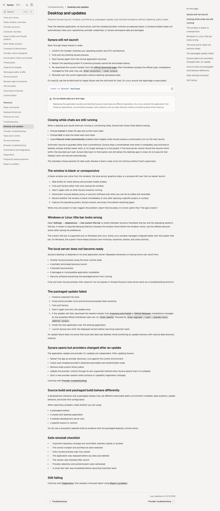
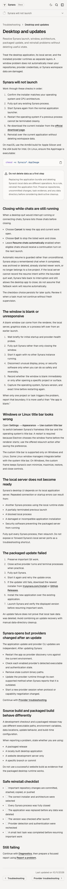
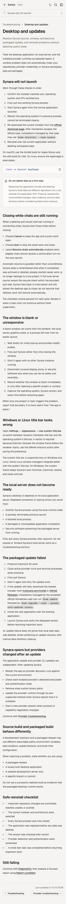
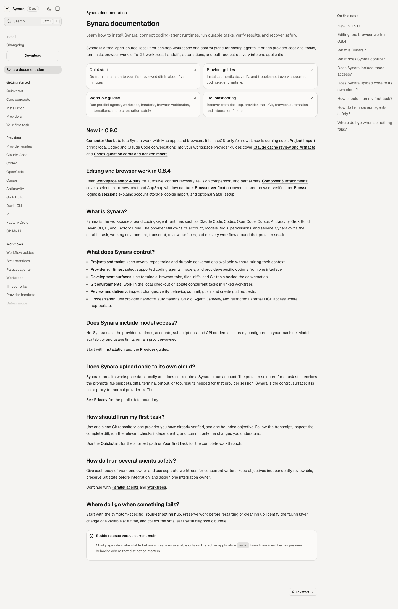
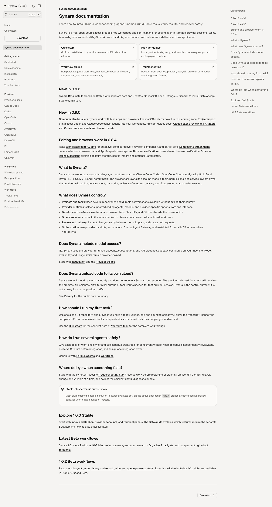

# Homebrew documentation — Before Vs After

These are unchanged screenshots of the actual production marketing application, captured by real Chromium on macOS 15. The page source, viewport, fonts, theme, motion preference and observed text are recorded in the receipts. No screenshot was synthesized, retouched or relabelled as another source.

| Capture | Immutable source | Tree |
| --- | --- | --- |
| Before: current main | `3270dcf89bb60745ac568803a940cd7e7ac676a7` | `3041a3cf0328b6e7e4d9b6c5027a2a1a09e33822` |
| After: #1836, continuing #1198 | `0d5f04b91d4bf7af72f6d9c017705183c3c89bef` | `ba99b66e786402f80124c4cf7368512908dee17f` |

The independently reviewed driver is [`aeba5cfaf1619ba8067e19a7d0d78d6c7b5d3dc3`](https://github.com/Emanuele-web04/synara/commit/aeba5cfaf1619ba8067e19a7d0d78d6c7b5d3dc3), tree `ecfa3917b5cecd21a5435c51301c9ca3ddacd8d6`. [Actual run 38167801738](https://github.com/Emanuele-web04/synara/actions/runs/38167801738) built both sources on Linux and macOS and passed all eight desktop/mobile documentation capture cases. Desktop viewport is 1440×1100; mobile viewport is 390×844. The images include each complete page, so their heights differ when content is added.

The unchanged checked-in `VISUAL_TEST` release fixture is **v0.8.1**. It makes the download page deterministic; it does not identify the release used for the separate native Homebrew tests, which examined the actual signed **v1.0.1** DMGs. The Playwright Desktop Chrome profile supplies a Windows user agent even on the Mac host, so the download-page capture's “Detected Windows” text is the expected test-profile result, not a claim about physical Mac platform detection.

## Installation instructions

The After page states that Homebrew support depends on acceptance of the official cask, gives the direct DMG route while that work is unfinished, and makes the `brew install --cask synara` instruction conditional on the official cask resolving.

| Desktop Before | Desktop After |
| --- | --- |
|  |  |

| Mobile Before | Mobile After |
| --- | --- |
|  |  |

## Updates and troubleshooting

The After page explains the Homebrew path conditionally, retains the app's own updater, and documents `--greedy-auto-updates` so the cask's `auto_updates` declaration does not silently exclude it from an explicit Homebrew update.

| Desktop Before | Desktop After |
| --- | --- |
|  |  |

| Mobile Before | Mobile After |
| --- | --- |
|  |  |

## Download-page preservation

The original feature intentionally removed the premature Homebrew download-page callout. Current Before and After `/install` captures are byte-identical on each OS and retain the direct downloads. The same real DOM assertions require the callout to be absent in all four cases. The shared macOS [desktop image](screenshots/macos/shared/install-page-desktop.png) and [mobile image](screenshots/macos/shared/install-page-mobile.png) therefore represent both actual captures without inventing a visual change.

## Preserved Darwin baseline failure

The original, unchanged `docs-desktop-light` assertion uses **`maxDiffPixels: 0`**. Both Linux cases pass. Both macOS cases fail with exactly the same result: the old saved image is 1440×2200; the actual current page is 1440×2681, with 120,533 differing pixels. The original job exits remain 1, with no deadline or truncated output.

The old image lacks existing “New in 0.9.2” and Stable/Beta workflow sections. The actual current-main `/docs` image, the actual Homebrew `/docs` image, and the independently generated current-main golden are byte-identical: SHA-256 `fa5611325a74380655ebd8a31be52ee3691d66a10879e2a20957e8c6a64eefca`. This isolates the stale Darwin baseline from the Homebrew documentation feature.

| Old checked-in expected image | Actual current-main image |
| --- | --- |
|  |  |

The [original Playwright diff](baseline/original-diff.png), [Before raw failure log](logs/mac-before/original-snapshot.log), and [After raw failure log](logs/mac-after/original-snapshot.log) are retained. A separately reviewed one-PNG prerequisite repairs that baseline; this packet does not relabel the original failures as passes or change any threshold.

## Artifact integrity and remaining transport gap

All four original ZIP SHA-256 values are recorded in [origins.json](origins.json). Every copied image/log/receipt is byte-identical to its stated origin, and each has a Git blob and SHA-256 digest. The native and documentation observations are kept separate.

The documentation manifests declare 115 files in total. All 105 files present in the downloaded ZIPs match their declared hashes and sizes. The upload action's default filtering omitted ten per-phase Playwright bookkeeping JSON files; those omissions are listed in [the verification receipt](receipts/docs-current-receipt.json). All PNGs, visible logs, traces and videos were present. The original manifests are retained unchanged, so this packet makes no claim that the ten omitted files were transported or verified. The follow-up diagnostic will include them explicitly. Full trace/video artifacts remain attached to the original run; this durable packet contains the reviewed screenshots and relevant receipts/logs.

## Actual native qualification remains separate

[Read-only published-DMG inspection](https://github.com/Emanuele-web04/synara/actions/runs/38163962883) verified both v1.0.1 release assets, 33 Mach-O files per architecture, strict code signatures, Gatekeeper and stapling. The app/Electron minimum is 12.0, while bundled Claude and Cua require 13.0.

[Actual Homebrew qualification](https://github.com/Emanuele-web04/synara/actions/runs/38166229495) passed style, checksum-pinned local-tap installation, signing/notarization checks, normal uninstall and owned-tap cleanup on ARM and Intel. **Strict online audit failed on both** because the cask's complete-bundle minimum of 13 disagrees with the old app plist's 12. ARM also hit an unauthenticated public GitHub rate limit. The [actual observation receipt](receipts/native-first-qualified-observations.json) preserves each outcome.

The separate [#1839 metadata prerequisite](https://github.com/Emanuele-web04/synara/pull/1839) changes future app metadata. A matching published release and upstream Homebrew acceptance remain unfinished requirements. These screenshots do not prove native app launch, macOS 13 runtime behavior, upgrade behavior or official-cask availability. No release, tag, main merge, auto-merge or upstream Homebrew write was performed.
