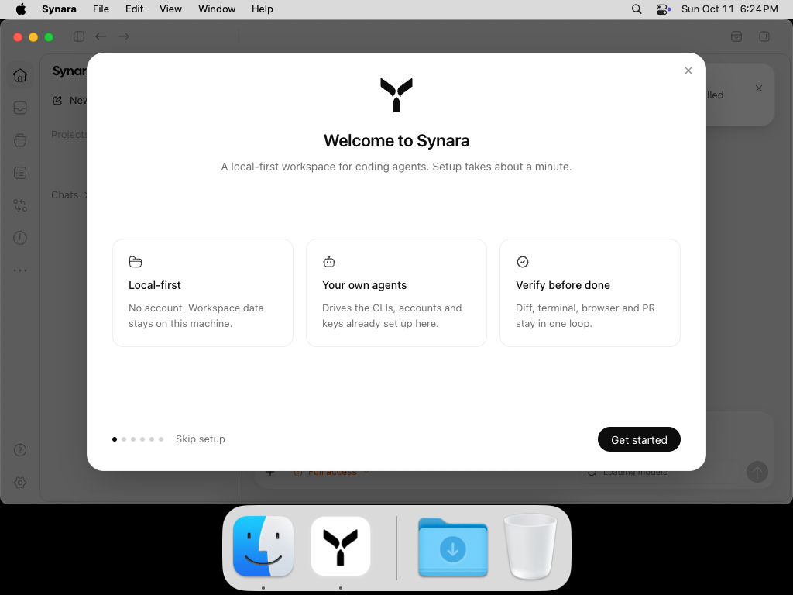
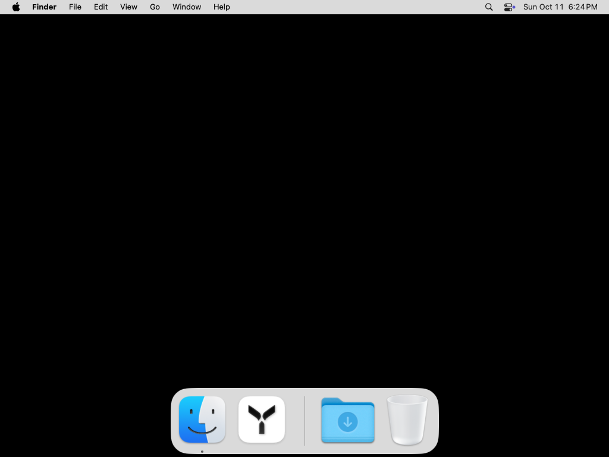
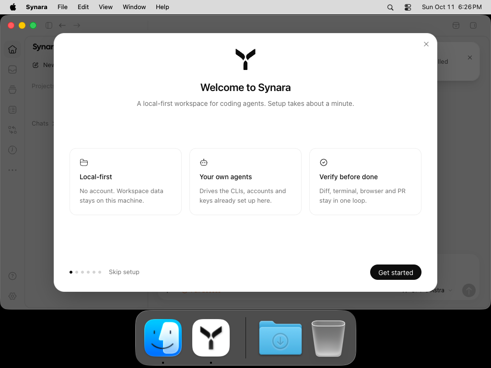
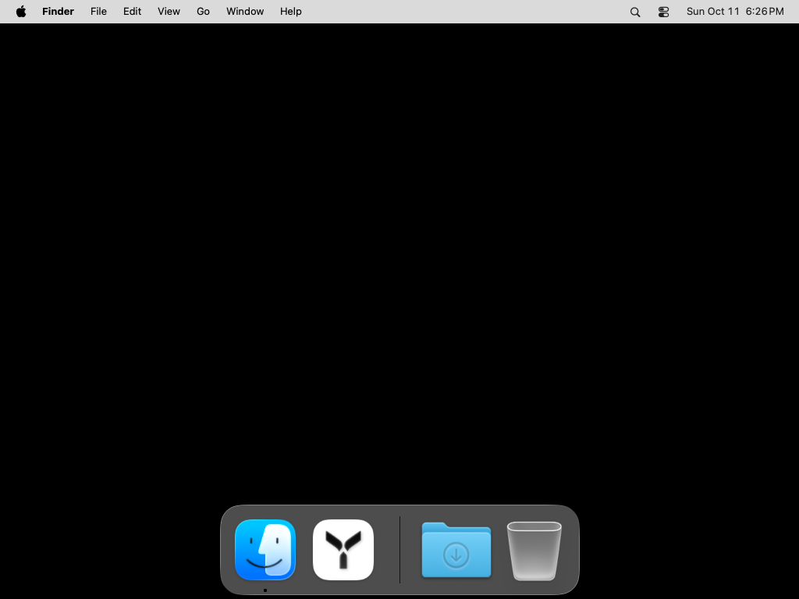

# PR #452 — actual Dock Before Vs After evidence

The original report concerned the closed Dock tile losing its rounded/shadowed appearance and changing the logo's proportions on macOS Sequoia. Actual macOS 15 and macOS 26 captures below retain the same white rounded tile and logo scale across closed, running, and normally quit states. **macOS 15 still shows visibly softer inner-mark shading when closed than when running. These images do not establish pixel-identical rendering.**

These lifecycle screenshots come from one exact later-main source, not from a rebuilt original PR application. The original author's bundle artwork is shown separately. The source/asset comparison and newer explicit Icon Composer policy support supersession of the old implementation; they do not claim every author diff was merged.

## Actual closed → running → normally quit

| Actual platform | Before launch: closed | Running | After confirmed normal Quit: closed |
| --- | --- | --- | --- |
| macOS 15 (Sequoia) |  |  |  |
| macOS 26 |  |  |  |

All screenshots are the original unedited 1024×768 native display PNGs. Open an image to inspect the Dock at its original size.

The application was launched through its actual owned bundle URL. Its visible window and canonical startup records were required. Native normal termination opened Synara's actual confirmation dialog; Playwright clicked the unchanged visible **Quit** button. Both native termination receipts report `normalRequest: true`, `terminated: true`, `forceUsed: false`.

| Actual confirmation | Screenshot and receipts |
| --- | --- |
| macOS 15 | [Visible Quit dialog](macos15/quit-confirmation.png), [renderer interaction](macos15/renderer-confirmation.json), [normal termination](macos15/normal-quit.json) |
| macOS 26 | [Visible Quit dialog](macos26/quit-confirmation.png), [renderer interaction](macos26/renderer-confirmation.json), [normal termination](macos26/normal-quit.json) |

The ephemeral loopback renderer connection was used only for this actual visible confirmation. No application source, IPC handler, provider reply, TCC setting, accessibility permission, or system screen-access policy was replaced.

## Original artwork versus current artwork

These are decoded bundle/runtime image exports, **not** an original-application launch comparison.

| Original PR bundle artwork at 01ca9a | Current legacy bundle artwork at ec8 | Current legacy runtime artwork at ec8 |
| --- | --- | --- |
|  |  |  |

The original author's ICNS was flattened through JPEG and has fully opaque pixels. Current legacy ICNS and runtime PNG decode to the same 1024×1024 RGBA bytes: SHA-256 `7449bcc6af214de3030abd572a293922da0359217b68750821619d5b021f9bb4`. Alpha is deliberately retained. [Full decoded-image/source receipts](review/icon-pixel-evidence.json).

## Original requirements and current disposition

| Original scope | Evidence and qualification |
| --- | --- |
| Preserve rounded corners, shadow, and logo proportions in the closed Dock tile on Sequoia; use the same scale when running. | Actual macOS15 closed/running/closed captures show the same rounded tile and proportions. The inner-mark shading difference is retained above. |
| Rebuild the app and manually inspect its closed and running icon. | A real unsigned production-flavor ec8 package was built, started, visually captured, normally quit through the renderer confirmation, and captured closed again on both native platforms. The original author application was not rebuilt. |
| Generate coordinated legacy bundle and runtime artwork. | Current `stageMacIcons` derives both legacy resources from the same flavor-specific source. The current source/runtime PNG blob is `598f4dafbb0245f59af844e4541bc640e1494670`; current ICNS blob is `b20868f8c778501d5c6df78ab85018a97d1ae625`. Their decoded pixel identity is verified. |
| Original follow-up: flatten bundle artwork through JPEG and avoid the modern glass treatment. | Superseded by the later explicit macOS26 layered Icon Composer design. This old policy was not reapplied or claimed to have merged. Current older-macOS fallback and newer platform/flavor behavior are retained. |
| Add coverage for icon selection and persistence. | Current desktop icon/config tests cover platform/flavor fallback; actual native AppKit persistence and reset tests passed 25/25 on each of macOS15 and26 in [run38156587374](https://github.com/Emanuele-web04/synara/actions/runs/38156587374). [Verified native receipts](review/native-persistence-receipts.json). |

Original author head: `01ca9a62f8bb222dda23d8c68181acdbf5ddd1fb`, preceded by `8f58d2ba91290d2d549c3168ef7c18e5525b7d95`. The original branch and both commits are preserved. Issue #156 was already closed externally; this investigation does not modify that issue.

## Exact source, native run, and current-main equivalence

- Captured source: `ec8c940e07582454a475250ade40147e3c89d59f`, tree `26c3b060469f224dce8135d8046697eb43fe0794`.
- Native driver: `b7cfab55d5896d57704cbf3fc4d1cf9c65a1929b`, tree `803e609fe2e44dd40e07d0c288b41bacf0025a05`.
- Actual successful [run38162333002](https://github.com/Emanuele-web04/synara/actions/runs/38162333002), macOS15 job114538551088 and macOS26 job114538551163.
- Current main comparison: `25b55b0bec0914d81e4db54b27f953721b067b29`, tree `00d8c27b49524a93e219c03c8639638e6415354c`. **All 22 listed icon, lifecycle, build, and test paths are byte-identical to ec8**, including `main.ts`, `desktopAppIcon.ts`, `macAppIcon.ts`, `stageMacIcons`' whole build file, production Icon Composer input files, ICNS/PNG resources, and canonical startup helper. [Every path's Git blob and SHA-256](review/main25b-icon-equivalence.json). This source equality does not claim a native rebuild of main25b or its changed dependencies/server.
- Exact ec8 Icon Composer source compiled on macOS26: actual packaged `Assets.car` SHA-256 `e66ffb6f405edd858cf95b64420954a87cbda0391d92b7844a8868b0a900802a`, 546,152 bytes. The same verified catalog was consumed by both native builds.
- Actual app executable, ASAR, ICNS, and Assets.car hashes were unchanged after each lifecycle observation. [Complete final receipts](review/dock-final-receipts.json), [macOS15 provenance](macos15/provenance.json), [macOS26 provenance](macos26/provenance.json).

| Original artifact ZIP | Verified SHA-256 |
| --- | --- |
| macOS15 artifact11711093054 | `61638d7b430e617fa40a90c5f1bdc1d16b0948103a578497257c11f0654cae65` |
| macOS26 artifact11711262004 | `ed564130b7f41d09ebec56df189ddb5ddb70fb1d52e5477cf9ad2221c557bd01` |

The experiment used a disposable runner's Dock layout. All six saved keys (`persistent-apps`, `show-recents`, `autohide`, `tilesize`, `magnification`, `orientation`) were restored and compared with their prior values. Actual app cleanup reported no failures. [macOS15 restore](macos15/dock-restore.json) / [cleanup](macos15/cleanup-result.json); [macOS26 restore](macos26/dock-restore.json) / [cleanup](macos26/cleanup-result.json).

## Earlier failures remain visible

| Attempt | Actual result and retained raw evidence |
| --- | --- |
| [38159736131](https://github.com/Emanuele-web04/synara/actions/runs/38159736131), macOS15 | Missing compiled Assets.car caused the first verifier failure. [Original failure](prior-failures/first-macos15/verify-failure.json), [provenance](prior-failures/first-macos15/provenance.json), [cleanup](prior-failures/first-macos15/cleanup-result.json). ZIP SHA-256 `4d26abf1779808620cf8be23ede92af42b1a3f465fe1751fff22d129ed3f3d1d`. |
| Same run, macOS26 | Actual startup passed, but the native Quit request opened the real confirmation which the first observer did not click; the job failed. [Original failure](prior-failures/first-macos26/original-capture-failure.json), [actual dialog](prior-failures/first-macos26/quit-did-not-complete.png), [termination receipt](prior-failures/first-macos26/normal-quit.json). ZIP SHA-256 `011c1e60a2b66f7308086ab6b87defc56b0f3636ea8bb65386516b740404489c`. |
| [38160728098](https://github.com/Emanuele-web04/synara/actions/runs/38160728098), icon prerequisite on macOS15 | Exact-source catalog compilation repaired preparation; startup then passed and the same unhandled confirmation still correctly failed. [Original failure](prior-failures/icon-prerequisite-macos15/original-capture-failure.json), [actual dialog](prior-failures/icon-prerequisite-macos15/quit-did-not-complete.png), [termination receipt](prior-failures/icon-prerequisite-macos15/normal-quit.json). ZIP SHA-256 `687de9b9bcc62f48777b9e5d9aae49b288460e22a8c561c5a1e551802f2bcb0a`. |

Raw `qualification.json` files retain their original `visualReviewPending` field. The subsequent independent image review is described here without editing those run receipts. [Copied-file origins and original SHA-256 values](review/copied-file-origins.json) and [complete publication manifest](manifest.json) make the durable files auditable.

This evidence does not establish signed release/install/upgrade behavior, every cached Dock state, every icon preference, authenticated provider sessions, or pixel-identical output across macOS versions.

